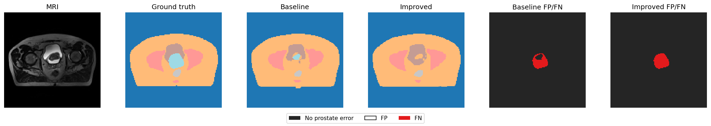
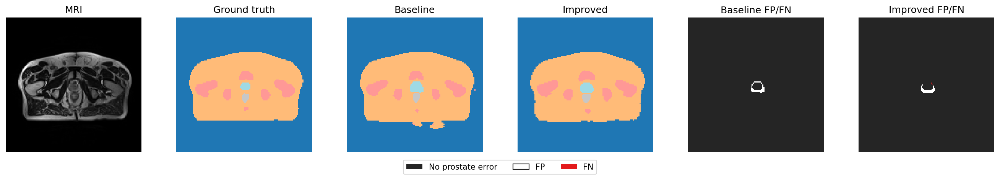
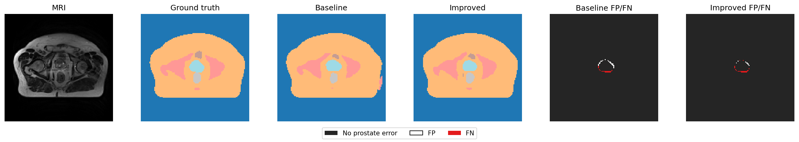
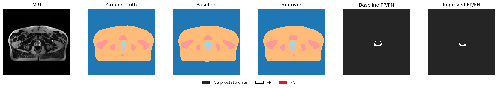
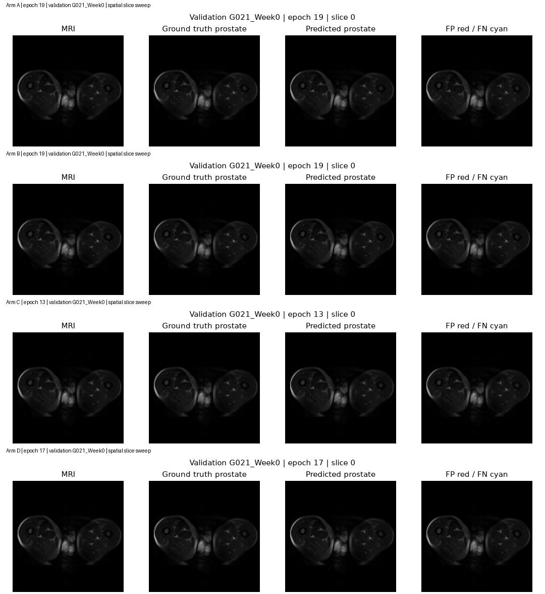

# 3D Improved U-Net for Pelvic MRI Segmentation

COMP3710 Pattern Recognition and Analysis · s4910970 · Hard difficulty

This project compares a Baseline 3D U-Net with a residual, deep-supervised Improved 3D U-Net for six-class pelvic MRI segmentation: Background, Body, Bones, Bladder, Rectum and Prostate. The dataset is CSIRO's [Labelled weekly MR images of the male pelvis](https://data.csiro.au/collection/csiro%3A51392), referred to as **HipMRI** in this project. The intended use is research on contour drafting with human review, not autonomous treatment planning.

**Main result.** Under the original matched held-out protocol, Baseline reached patient-mean prostate Dice **0.811548** and historical Improved reached **0.813587**, a difference of only **+0.002038**. Improved also reduced the worst patient's score by **0.062061**. The evidence therefore supports retaining Baseline as the conservative reference; it does not establish a reliable benefit from the added complexity.

## Repository Contents

```text
HipMRI_3D_UNet_s4910970/
├── README.md                   # report and instructions
├── requirements.txt            # pinned direct dependencies
├── src/                        # data, models, training, inference and plots
├── tests/                      # automated implementation checks
├── evidence/                   # frozen patient split and label sources
└── docs/
    ├── README.pdf              # static report export
    ├── feasibility_review.pdf  # one-page midpoint review extract
    ├── results_summary.json    # retained experiment results
    └── assets/                 # architecture, curves, failure panels and GIFs
```

All internal links are relative to this project directory. The directory can be placed under `recognition/` in the course fork without changing those links. Raw MRI volumes and trained weights are obtained or generated separately; neither is distributed here. The editable architecture source accompanies its rendered preview.


## Dataset

1. Open the official [CSIRO collection page](https://data.csiro.au/collection/csiro%3A51392) or its persistent DOI [10.25919/45T8-P065](https://doi.org/10.25919/45T8-P065).
2. Review the collection's licence and data-use conditions before downloading. The repository does not redistribute the MRI files.
3. Extract the download beneath `data/HipMRI_Study_open` so the two full-volume directories appear exactly as follows:

```text
HipMRI_3D_UNet_s4910970/
└── data/
    └── HipMRI_Study_open/
        ├── semantic_MRs/
        │   ├── B006_Week0_LFOV.nii.gz
        │   └── ...
        ├── semantic_labels_only/
        │   ├── B006_Week0_SEMANTIC.nii.gz
        │   └── ...
        └── data_use_agreement.txt
```

The code recursively discovers `.nii` and `.nii.gz` files in those two directories. An MRI ending in `_LFOV` is paired with the mask ending in `_SEMANTIC` through their shared case key. Do not rename medical files. The retained CSIRO [label description](evidence/sources/csiro-brief-data-description.txt) identifies label `5` as Prostate.

The fixed [dataset manifest](evidence/dataset_manifest.json) contains 211 scans from 38 patients. Seed 42 assigns 27/6/5 patients and 146/46/19 scans to train/validation/test, with every weekly scan from one patient kept in one partition. Its SHA-256 is:

```text
5457a611c5611f944a26d214a1f325b803dded66f70df5fda3fd009642751a07
```

### Dependencies and Environment

Run all commands from the directory containing this README, including after moving it into a course fork. Python 3.11 was used for implementation verification. A CUDA GPU is required for the declared full training configuration; CPU is suitable for tests and command inspection.

```powershell
python -m venv .venv
.\.venv\Scripts\Activate.ps1
python -m pip install --upgrade pip
python -m pip install -r requirements.txt
python -m pytest -q
```

The exact direct dependencies in `requirements.txt` match the import-verified local environment (rechecked on 26 October 2026). For the recorded CUDA build, first run `python -m pip install torch==2.11.0+cu128 --index-url https://download.pytorch.org/whl/cu128`. These pins do not freeze transitive packages, GPU drivers or operating-system libraries. [Locally verified versions](docs/requirements-verified-local.txt) are recorded separately. Historical formal jobs used PyTorch `2.13.0+cu130`, CUDA `13.0` and one A100-PCIE-40GB, but a complete historical `pip freeze` was not retained; the local record is not presented as that missing lockfile.

| Dependency | Verified version (26 October 2026)     | Purpose                            |
| ---------- | -------------------------------------- | ---------------------------------- |
| PyTorch    | `2.11.0+cu128`                       | Models, optimization and inference |
| NumPy      | `2.4.2`                              | NIfTI arrays and visualisation     |
| nibabel    | `5.4.2`                              | NIfTI loading and spatial metadata |
| matplotlib | `3.10.8`                             | Curves and failure panels          |
| pytest     | `9.1.1`                              | Automated checks                   |
| Pillow     | `12.1.1`, checked on 26 October 2026 | Optional validation GIFs           |

The Pillow check is current local evidence, not part of the older recorded environment. No W&B account is required.

### Data Audit and Patient Separation

Generate a fresh manifest outside the frozen evidence file:

```powershell
python src/audit.py data/HipMRI_Study_open --output artifacts/re_audited_manifest.json --seed 42
Get-FileHash artifacts/re_audited_manifest.json -Algorithm SHA256
Get-FileHash evidence/dataset_manifest.json -Algorithm SHA256
```

The hashes must match before claiming an exact split reproduction. A mismatch requires inspection of dataset version, paths, pairing and manifest contents; do not overwrite the frozen manifest merely to force agreement.

## 3D Improved U-Net

Both report models use channels 16/32/64/128, three downsampling stages and encoder skip connections. Baseline uses ordinary double-convolution blocks. The report's Improved model is `LegacyImprovedUNet3D` with architecture version `legacy_improved_v1`; it adds residual projections and two training-only auxiliary heads. Inference uses final logits only. The later `improved_context_v2` model is a separate validation experiment and its result is not substituted for the historical Improved test result.

MRI intensities are z-score normalized. Images are resized with trilinear interpolation and masks with nearest-neighbour interpolation. Training uses 96×96×96 crops with a 0.5 probability of choosing a prostate-containing crop. Validation and test use deterministic full resized volumes. Raw logits enter cross entropy; softmax is applied within soft Dice.

### Components and Comparison

The implementation is a compact residual, deep-supervised adaptation of 3D U-Net, rather than an exact reproduction of the complete Isensee training system. Input tensors have shape `[B,1,D,H,W]`, final logits `[B,6,D,H,W]`, and targets `[B,D,H,W]`. Integer targets enter cross entropy; soft Dice constructs one-hot targets inside the objective.

| Component            | Baseline                                               | Historical Improved                                        |
| -------------------- | ------------------------------------------------------ | ---------------------------------------------------------- |
| Feature block        | Two 3D convolutions, instance normalization, LeakyReLU | Same block with an identity or projected residual shortcut |
| Downsampling         | Max pooling                                            | Max pooling                                                |
| Decoder upsampling   | Transposed 3D convolution                              | Transposed 3D convolution                                  |
| Deep supervision     | None                                                   | Two decoder auxiliary heads during training                |
| Inference output     | Final head logits                                      | Final head logits                                          |
| Architecture version | `baseline_v1`                                        | `legacy_improved_v1`                                     |

`ConvBlock3D` extracts local volumetric features. `ResidualBlock3D` adds a shortcut so features can be refined through residual corrections. `_UNet3D` combines encoder and decoder features through skip concatenations. The two auxiliary heads in `LegacyImprovedUNet3D` provide segmentation gradients at intermediate resolutions. These model components depend on PyTorch and do not use NumPy.

The training objective is weighted cross entropy plus weighted soft Dice. In the main experiment, prostate has weight 4 in both terms and the remaining classes have weight 1. Each Improved auxiliary head adds 0.25 times the same objective, with nearest-neighbour downsampled labels. The later Context-v2 model introduces Dropout3D, interpolation-convolution upsampling and inference-time logit fusion; these features must not be attributed to the historical model's test results.

## Feasibility Review

The following review records the HipMRI proposal presented for the midpoint stage. It retains the original preliminary-evidence status; final experiments are reported separately below. The original consultation document also contains earlier OASIS 2D work, which is not evidence for this HipMRI comparison.

**Scope.** Hard difficulty: 3D Improved U-Net with residual units and deep supervision; HipMRI 3D NIfTI volumes; plain 3D U-Net baseline; patient-disjoint split with seed 42; prostate Dice target at least 0.70.

**User need and decision.** A radiotherapy contouring specialist needs a reviewable 3D draft of prostate and organ-at-risk boundaries. The engineering question is whether volumetric context, residual units and deep supervision reduce apex, base, cross-slice discontinuity and bladder or rectum boundary errors enough to justify higher GPU memory and runtime. The proposed scope and resource plan were to be confirmed before full training.

**Method and acceptance criteria.** Compare a plain 3D U-Net with a residual, deep-supervised 3D Improved U-Net using one saved patient-level train/validation/test manifest. Acceptance evidence comprises zero patient overlap; aligned NIfTI image-mask volumes; held-out prostate Dice at least 0.70; per-class Dice/IoU, peak VRAM and per-patient inference time; and 3-5 real failures with FP/FN overlays. Volumetric convolution, encoder-decoder skips, residual learning and auxiliary supervision motivate the model choice.

**Preliminary feasibility evidence.** At the midpoint, synthetic-NIfTI tests verified recursive pairing, missing-pair rejection, shape and affine validation, deterministic patient separation, finite 3D forward/backward passes, residual deep-supervision outputs, validation-only checkpoint selection and held-out metric fields. These checks established the software path. A real HipMRI audit, GPU smoke measurements and final Dice were not yet claimed at that stage.

**Risks, budget and fallback.** Risks included 3D memory demand, small foreground regions, orientation errors, slow I/O and failed cluster jobs. The next planned experiment was a short Rangpur GPU smoke run on audited volumes to set patch geometry, batch size and mixed-precision settings, followed by matched Slurm runs. The original review did not specify a numerical GPU-hour budget. Plain 3D U-Net was the fallback if the improved model did not reduce real held-out failures at acceptable cost.

**Questions for tutor confirmation.** Confirm the Hard HipMRI scope and patient-level protocol; whether prostate Dice at least 0.70 is assessed with background separate; and the expected GPU budget, patch strategy and evidence required before full training.

## Installation and Usage

### Train and Monitor

The command below reproduces the declared Baseline configuration through the maintained interface:

```powershell
python src/train.py `
  --manifest evidence/dataset_manifest.json `
  --data-root data/HipMRI_Study_open `
  --output-dir artifacts/reproduced_baseline `
  --model baseline `
  --epochs 20 `
  --batch-size 1 `
  --learning-rate 0.001 `
  --base-channels 16 `
  --target-shape 128 128 128 `
  --train-patch-shape 96 96 96 `
  --foreground-patch-probability 0.5 `
  --seed 42 `
  --device cuda `
  --prostate-label 5 `
  --prostate-label-source "CSIRO DOI 10.25919/45T8-P065, BriefDataDescription.txt: 5=Prostate" `
  --prostate-ce-weight 4 `
  --prostate-dice-weight 4 `
  --selection-metric mean_dice `
  --scheduler none
```

For the historical Improved arm, use a different output directory and replace the model arguments with:

```text
--model improved --architecture-version legacy_improved_v1
```

Every new Improved run must state either `legacy_improved_v1` or `improved_context_v2`; the training CLI rejects an omitted version. Historical checkpoints that predate this field remain loadable as `legacy_improved_v1` only for compatibility, not as a default for new training.

Do not enable augmentation for this historical comparison. Both arms must use the same manifest, geometry, optimizer settings, seed, number of epochs and selection rule. At every completed epoch, training refreshes the loss/validation-Dice curve and recorded-learning-rate plot from the available history. This is epoch-level monitoring. Training writes `experiment_config.json`, `history.json`, `training_summary.json`, validation-selected `best.pt` and `training_curves.png` beneath the chosen output directory.

These commands reproduce the stored configuration through the current code. They do not guarantee bitwise identity with the historical GPU runtime.

### Prediction and Held-out Evaluation

Evaluate a validation-selected checkpoint once with overlap-averaged full-volume inference:

```powershell
python src/predict.py `
  --checkpoint artifacts/reproduced_baseline/best.pt `
  --manifest evidence/dataset_manifest.json `
  --data-root data/HipMRI_Study_open `
  --output-dir artifacts/reproduced_baseline_test `
  --patch-size 128 128 128 `
  --stride 64 64 64 `
  --device cuda
```

Prediction verifies the manifest hash and architecture metadata stored in the checkpoint. It writes `test_metrics.json`, per-case prediction tensors and failure panels. Each panel selects the axial, coronal and sagittal slice with the largest prostate-specific FP+FN count; if a case has no prostate error, it selects the centre of the reference prostate extent. The JSON records the selected case, slice indices and rule. The test partition must not influence hyperparameters, checkpoint selection or acceptance thresholds. These five patients have been evaluated by historical models and are not an untouched external cohort.

The sliding-window implementation averages overlapping logits and verifies complete voxel coverage. With the main `128³` target and `128³` patch, only one window is used per volume; this experiment does not demonstrate multi-window seam behaviour. The current single-model panel selector and the historical paired-case selector described below use different documented rules.

## Results

### Training

Main training used Adam, batch size 1, a constant learning rate of 0.001, 20 epochs and seed 42. Checkpoints were selected by the highest validation mean Dice: epoch 20 for Baseline and epoch 18 for Improved. This historical selection metric includes background; the later prostate-specific selection option represents a different protocol.


Improved's objective includes auxiliary losses, so loss magnitudes are not directly equivalent between arms. Similar training and validation curves alone do not prove the absence of overfitting.

### Held-out Segmentation

Both formal jobs completed with exit status `0:0` at code revision `4232e0d`. The machine-readable retained summary is [docs/results_summary.json](docs/results_summary.json).

| Foreground class | Baseline Dice | Improved Dice | Baseline IoU | Improved IoU |
| ---------------- | ------------: | ------------: | -----------: | -----------: |
| Body             |      0.958148 |      0.977807 |     0.919909 |     0.956600 |
| Bones            |      0.859094 |      0.904555 |     0.753894 |     0.825973 |
| Bladder          |      0.957028 |      0.960610 |     0.917811 |     0.924386 |
| Rectum           |      0.852767 |      0.861629 |     0.747437 |     0.758714 |
| Prostate         |      0.822599 |      0.831385 |     0.702348 |     0.715546 |

The table above averages available scan-level class metrics and excludes background. Dice is `2TP/(2TP+FP+FN)` and IoU is `TP/(TP+FP+FN)`; mutually absent classes have no defined score. The headline below first averages prostate Dice within each patient, then gives all five patients equal weight.

| Test patient   |           Baseline |           Improved |          Difference |
| -------------- | -----------------: | -----------------: | ------------------: |
| B037           |           0.736256 |           0.674195 |           -0.062061 |
| H007           |           0.781378 |           0.839755 |           +0.058377 |
| K042           |           0.887015 |           0.878500 |           -0.008516 |
| L011           |           0.781136 |           0.795553 |           +0.014417 |
| M013           |           0.871957 |           0.879931 |           +0.007974 |
| **Mean** | **0.811548** | **0.813587** | **+0.002038** |

| Resource measure                           |    Baseline |    Improved |
| ------------------------------------------ | ----------: | ----------: |
| Trainable parameters                       |   1,400,646 |   1,423,106 |
| Peak training allocated memory             |   977.6 MiB | 1,193.4 MiB |
| Peak inference allocated memory            | 1,047.4 MiB | 1,047.5 MiB |
| Recorded forward time per volume           |  0.060885 s |  0.064924 s |
| Mean cumulative inference time per patient |  0.231362 s |  0.246713 s |

Patient time sums inference over that patient's weekly scans, whereas the forward-time row is per volume. These timings do not establish end-to-end clinical workflow latency. The maintained evaluator synchronizes the GPU around model/sliding-window inference on preprocessed tensors. The timed call includes host-to-device transfer of the input. This timing excludes NIfTI reading, normalization/resizing, checkpoint loading, panel rendering and prediction serialization. No separate warm-up or repeated-run timing distribution is retained for the historical table. Peak allocated memory is reset and recorded separately for training and validation/inference in the maintained code. The historical numbers cannot establish process-wide or device-wide peaks. Allocated VRAM is not total GPU reservation. Improved increases peak training allocation by approximately 22%.

The `+0.002038` mean difference is below the project's predeclared `+0.01` meaningful-upgrade target. Improved helped three patients and regressed on two; B037 deteriorated materially. Five repeatedly inspected patients and one seed do not support statistical-significance or clinical-generalization claims.

### Failure Case Autopsy

Five cases were selected by the mean whole-volume prostate FP+FN across both arms. Each panel compares the same MRI, GT and slice for Baseline and Improved; the selected slice maximizes error within the GT prostate extent. [Selection metadata](docs/assets/failure_selection.json) retains the cases, indices and counts. White indicates prostate FP, red indicates prostate FN. Three cases are repeated scans of L011 and are not independent patients.

| Case       | Baseline FP / FN | Improved FP / FN | Failure and review implication                                                                                                                                                  |
| ---------- | ---------------: | ---------------: | ------------------------------------------------------------------------------------------------------------------------------------------------------------------------------- |
| B037 Week0 |      393 / 2,495 |      166 / 3,123 | Improved suppresses excess but omits substantially more reference prostate. The displayed slice shows severe under-segmentation; inspect missing interior and boundary regions. |
| L011 Week2 |         894 / 68 |        738 / 159 | Reduced outward extension trades off against more omission. Check excluded tissue as well as external contour excess.                                                           |
| L011 Week7 |         868 / 81 |        661 / 147 | Peripheral excess remains and Improved increases FN. Review the weekly sequence for contour inconsistency.                                                                      |
| K042 Week0 |        432 / 439 |        208 / 673 | Contour contraction reduces FP but loses additional reference tissue. A cleaner-looking outline need not be more accurate.                                                      |
| L011 Week0 |        803 / 109 |        579 / 170 | Persistent outward extension and the same FP/FN trade-off recur. Inspect every weekly scan rather than assuming stable contour quality.                                         |










The counts are whole-volume measurements; each figure displays one selected slice. Low soft-tissue contrast, partial-volume effects and downsampling are plausible contributors, not experimentally isolated causes. Spatial checks on the source NIfTI affines confirm L/P/S axis codes for all five selected cases; tensor depth follows the superior direction after the loader transposes axes `(2,1,0)`. The table locates each displayed slice within the reference prostate extent in the resized tensor (zero-based indices). Position is `(slice - inferior)/(superior - inferior)`; it is a geometric fraction, not an anatomical landmark annotation.

| Case       | Inferior / superior GT slice | Displayed slice | Relative position |
| ---------- | ---------------------------: | --------------: | ----------------: |
| B037 Week0 |                      42 / 79 |              70 |             0.757 |
| L011 Week2 |                      62 / 88 |              70 |             0.308 |
| L011 Week7 |                      50 / 73 |              62 |             0.522 |
| K042 Week0 |                      51 / 82 |              72 |             0.677 |
| L011 Week0 |                      55 / 78 |              62 |             0.304 |

These checks establish that the selected panels mostly depict interior slices, so they cannot substantiate specific base/apex failure claims. At the inferior and superior ends, small reference cross-sections make one-slice omission disproportionately important; adjacent-slice area changes should therefore be reviewed separately from a worst-error interior panel. Clinical base/apex landmark verification and native-resolution boundary-distance measurements remain uncompleted. No base/apex label or millimetre accuracy is inferred from these fractions. The retained [spatial check record](docs/assets/failure_spatial_check.json) records the source directions and indices.

### Supplementary Experiments and Validation Animations

The retained Wide20 comparison used a different model width and prostate-specific validation selection. Baseline-new reached patient prostate Dice **0.818316**, while Wide20 reached **0.794166**, a difference of **-0.024150**. Wide20 used 2,222,878 parameters and 1,496.95 MiB peak training allocation. This negative finding is retained in the result summary; it does not replace the primary comparison.

Context-v2 candidate B reached mean patient prostate Dice `0.829472` on validation at epoch 19. Its peak training memory was `1455.8 MiB`, versus `979.6 MiB` for the declared control, a ratio of `1.486`; this exceeded the `1.35×` gate. It was therefore ineligible for automatic held-out testing. No new Context-v2 test metrics, test predictions or test failure panels are claimed here.

### Validation Learning Progress

The following animations belong to the separate Context-v2 validation experiment (job `692354`). They show **validation patient G021, scan Week0**, not the held-out test set. MRI, reference segmentation and predictions use identical slices within each comparison. Red marks prostate false positives and cyan marks false negatives.


Rows compare fixed checkpoints at epochs 1, 5 and 19. **Animation frames sweep spatial slices; they do not advance training epochs.** Candidate B has the highest validation mean patient prostate Dice, but fails the declared memory limit. A visually plausible contour does not qualify the candidate for testing.



The four rows compare each arm's validation-selected checkpoint. Their selected epochs differ and are labelled within the animation. The table links all twelve retained individual animations for closer inspection.

| Validation arm | Epoch 1                                                                    | Epoch 5                                                                    | Validation-selected checkpoint                                                |
| -------------- | -------------------------------------------------------------------------- | -------------------------------------------------------------------------- | ----------------------------------------------------------------------------- |
| A              | [View GIF](docs/assets/context_v2_ablation_692354/A_validation_epoch_1.gif) | [View GIF](docs/assets/context_v2_ablation_692354/A_validation_epoch_5.gif) | [View GIF](docs/assets/context_v2_ablation_692354/A_validation_best_epoch.gif) |
| B              | [View GIF](docs/assets/context_v2_ablation_692354/B_validation_epoch_1.gif) | [View GIF](docs/assets/context_v2_ablation_692354/B_validation_epoch_5.gif) | [View GIF](docs/assets/context_v2_ablation_692354/B_validation_best_epoch.gif) |
| C              | [View GIF](docs/assets/context_v2_ablation_692354/C_validation_epoch_1.gif) | [View GIF](docs/assets/context_v2_ablation_692354/C_validation_epoch_5.gif) | [View GIF](docs/assets/context_v2_ablation_692354/C_validation_best_epoch.gif) |
| D              | [View GIF](docs/assets/context_v2_ablation_692354/D_validation_epoch_1.gif) | [View GIF](docs/assets/context_v2_ablation_692354/D_validation_epoch_5.gif) | [View GIF](docs/assets/context_v2_ablation_692354/D_validation_best_epoch.gif) |

GIFs animate in the repository view. The PDF uses static previews; it cannot reproduce animation. These validation demonstrations supplement the historical paired test panels and do not replace their quantitative evaluation.

## Engineering Recommendation and Limitations

Retain Baseline as the conservative tested reference and require human correction of every proposed contour. The historical Improved package passed aggregate overlap targets, but its small mean change and severe B037 regression do not justify a stronger operational claim.

The evidence does not establish clinician time savings, treatment safety, external-cohort generalization, native-resolution boundary accuracy, HD95 performance or superiority of 3D over 2D. Future work should freeze a fresh protocol, use paired seeds, preserve validation and resource evidence, and evaluate the held-out set only after a candidate passes every declared gate.

## Course Fork and Report

Place this complete project directory under `recognition/HipMRI_3D_UNet_s4910970/` in the course fork. Preserve `src/`, `tests/`, `evidence/` and `docs/assets/` together with the README; copying the Markdown alone would omit figures and reproducibility evidence. Commands run from this project directory and do not depend on the original development drive, archived submissions or another student's project.

The feasibility review is included above as part of the report. The separate one-page PDF is a convenience copy. The original multi-page consultation DOCX is a personal record and is not required to render this report. The final course workflow requires the project contribution on `topic-recognition`, a pull request to the upstream branch, and a PDF export of the completed README submitted to Turnitin. Those submission actions and the tutor's consultation record are separate from the files provided here.

## References

1. Çiçek et al. [3D U-Net: Learning Dense Volumetric Segmentation from Sparse Annotation](https://arxiv.org/abs/1606.06650), 2016.
2. Isensee et al. [Brain Tumor Segmentation and Radiomics Survival Prediction: Contribution to the BRATS 2017 Challenge](https://arxiv.org/abs/1802.10508), 2018. This is architectural inspiration, not the source of HipMRI data.
3. CSIRO. [Labelled weekly MR images of the male pelvis](https://data.csiro.au/collection/csiro%3A51392), DOI [10.25919/45T8-P065](https://doi.org/10.25919/45T8-P065).

## Artificial Intelligence Usage Disclosure

### AI Tools Used

### Tasks Assisted by AI

### Author Audit and Verification
