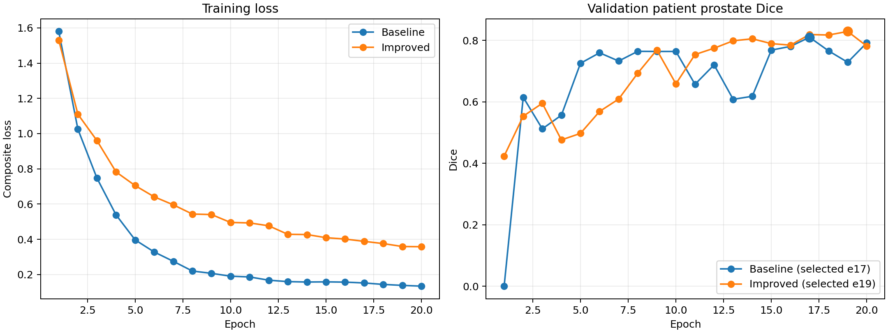
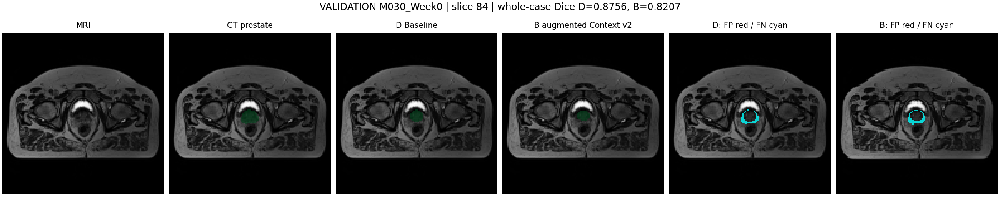

# Improved 3D U-Net for HipMRI Segmentation

This COMP3710 project implements a 3D U-Net to segment pelvic MRI into background, body, bones, bladder, rectum and prostate. It compares a standard **Baseline** with an **Improved** model using residual context blocks, dropout, interpolation-based upsampling and multi-scale predictions.

**Improved** throughout this README means the selected `improved_context_v2` configuration with training augmentation and a fixed learning rate: arm B of experiment `692354`. Its validation mean patient prostate Dice is **0.829472**, compared with **0.810463** for the matched Baseline (arm D). These are validation results; this Improved checkpoint has **not** been evaluated on the held-out test set.

## Dataset

The [CSIRO HipMRI dataset](https://doi.org/10.25919/45T8-P065) contains **211 MRI volumes from 38 patients**, including repeated weekly scans. MRI files are paired with manually labelled semantic masks.

| Partition | Patients | Volumes |
| --- | ---: | ---: |
| Training | 27 | 146 |
| Validation | 6 | 46 |
| Held-out test | 5 | 19 |

The seed-42 [manifest](evidence/dataset_manifest.json) splits **patients**, keeping every weekly scan from one patient in the same partition. Labels are `0=Background`, `1=Body`, `2=Bones`, `3=Bladder`, `4=Rectum`, `5=Prostate`, as documented in the [label-source record](evidence/SOURCES.md).

MRI intensities are standardized. Images are resized to `128³` with trilinear interpolation and masks with nearest-neighbour interpolation. Training uses `96³` crops, with prostate-guided sampling probability 0.5; validation uses the full resized volume.

## Improved 3D U-Net


The network has three encoder stages, a bottleneck and three decoder stages. Encoder features are concatenated with matching decoder features through skip connections.

| Component | Baseline | Improved |
| --- | --- | --- |
| Feature blocks | Two convolutions, InstanceNorm3d and LeakyReLU | Pre-activation residual context blocks with Dropout3d(0.3) |
| Decoder upsampling | ConvTranspose3d | Trilinear interpolation followed by convolution |
| Output heads | One final head | Final head and two auxiliary decoder heads |
| Prediction | Final logits | Sum of final and resized auxiliary logits |
| Training augmentation | Disabled | Paired flips and MRI-only intensity transforms |

**Context blocks** combine two `3×3×3` convolutions with instance normalization, LeakyReLU, dropout and a residual shortcut. **Decoder blocks** upsample features and combine them with encoder skips. **Segmentation heads** use `1×1×1` convolutions to predict six classes at three decoder resolutions.

The model returns **logits**, which are used directly by cross-entropy. Soft Dice applies softmax internally. The training objective is weighted cross-entropy plus soft Dice on the fused output, with additional auxiliary losses weighted by 0.25 each; prostate CE and Dice class weights are both 4. Dropout is disabled during evaluation, while logits fusion remains active.

This is an independent adaptation of residual context and deep-supervision ideas from Isensee et al., rather than a reproduction of their complete system. Implementations are in [modules.py](src/modules.py).

## Usage

Install the dependencies and place the course dataset in this structure:

```text
data/HipMRI_Study_open/
├── semantic_MRs/
└── semantic_labels_only/
```

```powershell
python -m pip install -r requirements.txt
python -m pytest -q
```

For a **new validation-only comparison** using the documented settings:

```powershell
python src/run_validation_ablation.py --arms B D --data-root data/HipMRI_Study_open --output-root artifacts/baseline_vs_improved_new --device cuda
```

Use a fresh output directory. The runner saves each model's `experiment_config.json`, `history.json`, `training_summary.json`, validation GIFs and validation-selected `best.pt`. It does not run held-out evaluation. MRI data and checkpoint files are not included in the repository.

| Module | Purpose |
| --- | --- |
| [dataset.py](src/dataset.py) | Paired MRI/mask loading, preprocessing and train-only augmentation |
| [modules.py](src/modules.py) | Baseline, Improved and version-aware model construction |
| [train.py](src/train.py) | Training, validation, checkpoint selection and visualizations |
| [predict.py](src/predict.py) | Separate checkpoint loading and held-out inference |
| [plot_training.py](src/plot_training.py) | Curves from recorded training histories |

## Results

### Training

Both models were trained on Rangpur with an NVIDIA A100 for **20 epochs**, batch size **1**, **16** base channels, **Adam** and a fixed learning rate of **0.001**. The Improved model applies LR/AP flips with probability 0.5 each, Gaussian noise with 0.5, Gaussian blur with 0.25 and gamma transformation with 0.25. Spatial transforms affect image and mask together; intensity transforms affect MRI only. Validation and test augmentation are disabled.



The curves read the actual Baseline D and Improved B histories. Checkpoints are selected by validation mean patient prostate Dice: **epoch 17** for Baseline and **epoch 19** for Improved. Lower training loss across these models does not establish higher accuracy because auxiliary supervision and augmentation change the training objective and difficulty.

### Baseline comparison

| Metric | Baseline | Improved |
| --- | ---: | ---: |
| Validation mean patient prostate Dice | 0.810463 | **0.829472** |
| Worst validation patient Dice | 0.722912 | **0.778456** |
| Prostate false-negative voxels | 13,804 | **13,159** |
| Prostate false-positive voxels | 19,624 | **17,733** |
| Parameters | **1,400,646** | 1,628,996 |
| Peak training VRAM (MiB) | **979.6** | 1,455.8 |
| Total training time (s) | **1,386.9** | 1,441.3 |
| Selected-epoch validation pass (s) | 21.46 | 21.19 |

The headline metric first averages scan-level prostate Dice within each patient, then averages the six patient values equally. FN/FP are full validation-cohort voxel totals; validation time covers the complete pass, not per-patient inference latency.

Improved gains **0.019009 Dice** over Baseline, improving four of six patients. However, it uses **48.6% more peak training memory**. Its 1.486× memory ratio exceeds the predeclared 1.35× screening limit, so it remains a validation candidate rather than an approved replacement. This comparison evaluates the architecture-plus-augmentation package, not the isolated effect of one module.

### Visualisation over training


The rows show epoch **1**, **5** and selected epoch **19** for the fixed validation scan **G021_Week0**. Frames sweep the same spatial slices; they are not consecutive training epochs. Columns show MRI, reference prostate, prediction and error overlay (**red: FP; cyan: FN**). The [full gallery](docs/assets/context_v2_ablation_692354/gallery.html) includes the original GIFs and model comparisons; open the HTML locally in a browser.

### Failure analysis

Five different-patient cases were selected using combined Baseline/Improved whole-volume FP+FN, followed by the highest-error slice within the reference prostate extent. Case Dice below describes a single scan, not a patient's multi-scan mean.

| Validation case | Baseline Dice | Improved Dice | Observed trade-off |
| --- | ---: | ---: | --- |
| N010_Week3 | 0.829248 | 0.805021 | Both FN and FP increase despite better coverage on the displayed slice |
| S022_Week2 | 0.761155 | 0.747247 | Fewer FN, but greater outward FP |
| W012_Week0 | 0.782081 | 0.813762 | FP decreases; a smaller FN increase remains |
| G021_Week6 | 0.741214 | 0.788690 | Both FN and FP decrease; boundary errors persist |
| M030_Week0 | 0.875641 | 0.820749 | FN increases substantially despite fewer FP |



In **M030_Week0**, Improved increases FN from 324 to 523 while reducing FP from 137 to 99. In **S022_Week2**, it reduces FN from 336 to 284 but increases FP from 483 to 634. **N010_Week3** demonstrates why a visually better slice cannot substitute for whole-volume scoring. These cases require inspection of omitted tissue and neighbouring slices, rather than acceptance based on a smoother contour. The [full validation analysis](docs/context_v2_ablation_results_20261025.md) retains all five paired panels and selection details.

## Engineering assessment

The intended use is specialist-reviewed prostate contour drafting. The recorded GPU memory and training time make this resized-volume workflow feasible on the retained A100 hardware, but resampling, six validation patients and one seed limit the evidence. Clinical contour-editing time and physical-distance accuracy were not measured. Keep Baseline as the lower-memory comparator and Improved as the accuracy-leading validation candidate; the failed memory gate and patient-specific regressions prevent an automatic replacement decision.

No held-out score is reported for this Improved checkpoint. Historical tested models have different checkpoint identities and remain in the [experiment evidence record](docs/EXPERIMENT_EVIDENCE.md); their test scores must not be assigned to this model. Other configurations are documented in the [ablation record](docs/context_v2_ablation_results_20261025.md). Job 692354 is confirmed `COMPLETED|0:0` (01:42:37); see the [final accounting](evidence/692354_sacct_final.txt). Historical environment-freeze limitations remain documented in the [environment record](docs/EXPERIMENT_ENVIRONMENT.md).

## References

- Çiçek et al. *3D U-Net: Learning Dense Volumetric Segmentation from Sparse Annotation* (MICCAI 2016), arXiv:1606.06650.
- Isensee et al. *Brain Tumor Segmentation and Radiomics Survival Prediction: Contribution to the BRATS 2017 Challenge* (2018), arXiv:1802.10508.
- Dataset label provenance and retained reference identities: [SOURCES.md](evidence/SOURCES.md).

## Artificial Intelligence Usage Disclosure


Validation continuation job **695600** was submitted on 25 October (initial status: `PENDING`, Priority). It reuses A/B/D, adds the missing Baseline + augmentation arm, profiles a fixed resource protocol and conditionally runs narrower Improved / paired seeds. [Registered protocol](configs/validation_completion_protocol.json) · [Submission record](evidence/validation_completion_695600_submission.json). This is a submission record, not completed experimental evidence; no held-out test was submitted.
