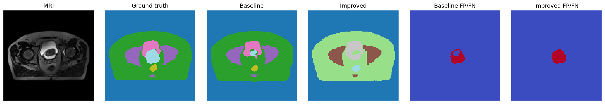
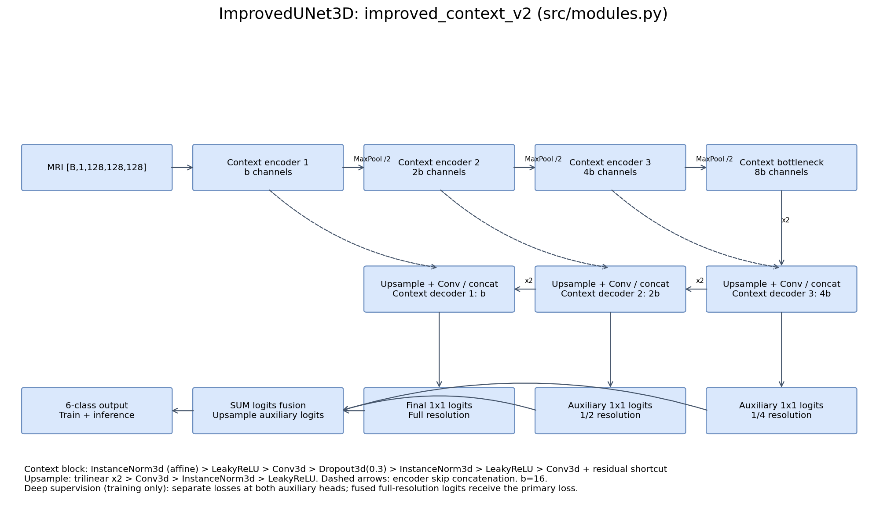
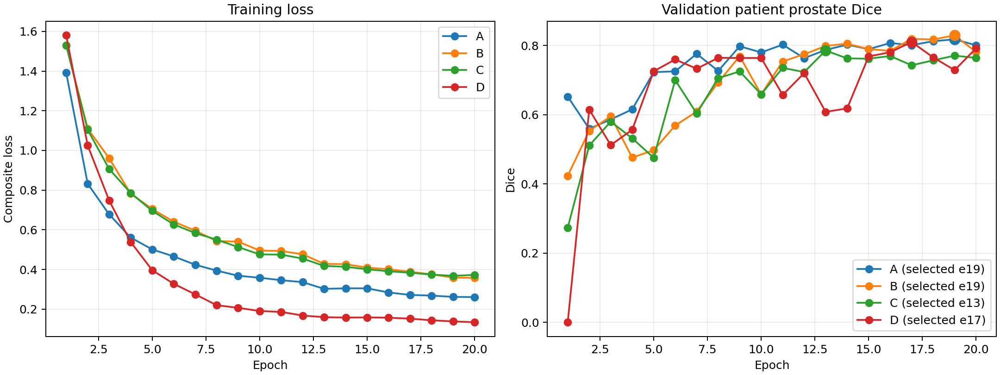
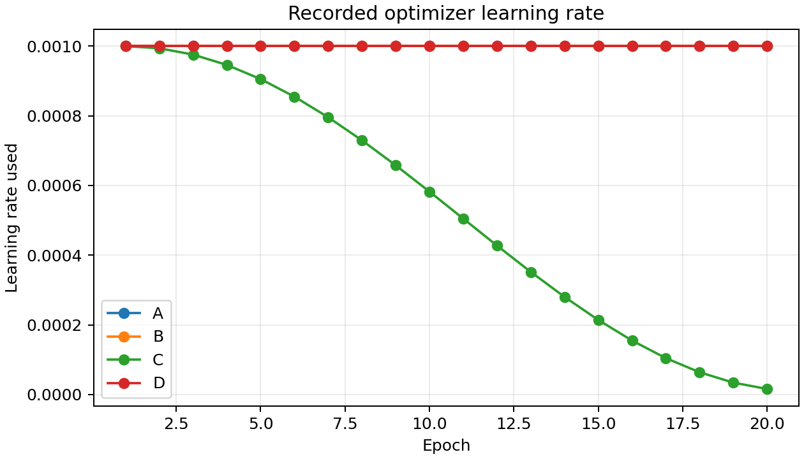

# HipMRI 3D U-Net: prostate contour drafting prototype

This COMP3710 Hard-difficulty project tests whether a residual, deep-supervised 3D U-Net improves prostate contour drafting over a plain 3D U-Net on downsampled HipMRI NIfTI volumes. The intended user is a radiotherapy contouring specialist who reviews and edits a proposed contour; this is a research prototype, not an autonomous clinical decision system. The primary matched formal experiment (`4232e0d`) reached held-out patient-level prostate Dice of 0.811548 for the baseline and 0.813587 for the Improved model. The difference is small (+0.002038), and paired failure analysis identifies cases where the improved model is worse. The evidence supports review-assist evaluation, not automated deployment.

## Main finding and evidence boundary

The headline is the arithmetic mean of one prostate Dice value per held-out patient after full-volume reconstruction. It is not pooled-voxel Dice, a patch metric, a validation score, or a mean across every class. The frozen mask meaning is `5=Prostate`, supported by the CSIRO v2 `Labels:` block in [evidence/SOURCES.md](evidence/SOURCES.md). Paths, hashes, job identities and archive status are indexed in [docs/EXPERIMENT_EVIDENCE.md](docs/EXPERIMENT_EVIDENCE.md).

| Result status                               | Code / jobs                                   | Selection rule                         |                                                             Held-out patient prostate Dice | Interpretation                                              |
| ------------------------------------------- | --------------------------------------------- | -------------------------------------- | -----------------------------------------------------------------------------------------: | ----------------------------------------------------------- |
| **Primary matched formal comparison** | `4232e0d`; baseline 683675, improved 683676 | Highest `validation_mean_dice`       |   Baseline **0.811548**; Improved **0.813587**; difference **+0.002038** | Small observed gain, not a clinical-use claim               |
| Validation scan                             | five Improved candidates, including Wide20    | validation patient prostate Dice       |                                                                      Not a held-out result | Used to choose a candidate only                             |
| **Supplementary matched comparison**  | Baseline-new 687753, recovered Wide20 687754  | `prostate_dice` validation selection | Baseline-new **0.818316**; Wide20 **0.794166**; difference **-0.024150** | Negative finding; Wide20 is not the recommended replacement |

The final Rangpur accounting query recorded `COMPLETED|0:0` for 683675, 683676, 687753 and 687754. Completion validates a clean job exit; it does not convert a supplementary result into independent confirmation or make a contour clinically acceptable.

## Model principles


Editable source: [model_architecture.drawio](docs/assets/model_architecture.drawio).

`src/modules.py` implements the same 3D U-Net skeleton for both models: three encoder reductions, a bottleneck, three decoder expansions, and skip concatenations. The baseline uses convolution blocks. The Improved U-Net replaces them with residual blocks and adds two decoder auxiliary heads for deep supervision during training. It has **no attention gate**. At inference, `predict.py` reads only final `1x1x1` logits.

For normalized MRI volumes, input is `[B, 1, D, H, W]`, final logits are `[B, 6, D, H, W]`, and target is `[B, D, H, W]`. `dataset.py` validates paired NIfTI geometry, preserves patient separation, standardizes each source volume, then resamples MRI intensity with trilinear interpolation and masks with nearest-neighbour interpolation. Training uses weighted cross-entropy plus soft Dice. The Improved model adds the same objective for two downsampled auxiliary decoder outputs, each weighted by 0.25. Foreground sampling chooses a prostate voxel as a crop anchor with probability 0.50 when that branch is taken; validation and test scoring use complete reconstructed volumes.

`InstanceNorm3d` and batch size 1 are implementation choices suited to the retained volumetric memory budget, while the `128^3` target and `96^3` training crop reduce training memory relative to full-target training. These are design considerations, not isolated performance evidence. Historical runs used resampling, standardization and random crop placement without synthetic intensity augmentation. The new opt-in training augmentation described below adds paired anatomical flips and MRI-only noise, blur and gamma; it remains disabled by default and is forbidden for validation/test. The local B006_Week0 sampling audit is retained at `artifacts/2026-10-21/local_patch_audit_B006_Week0_128_96.json`: on that one resized case, all 200 sampled `96^3` crops contained prostate because the large crop and anatomy made even the random branch positive. This does not prove that the 0.50 setting increases prostate exposure for every patient, nor does it measure generalization.

Checkpoint choice is validation-only. `predict.py` slides an inference patch over a volume, sums logits at each voxel, divides by overlap count, then takes `argmax`. Test scoring first averages any test volumes belonging to the same patient and then averages five patient Dice scores.

## Training objective and patient-level metric

For a final or auxiliary logit tensor, let `p_{ic}` be the softmax probability at voxel `i` for class `c`, `g_{ic}` its one-hot target, and `w_c` the class weight. `composite_3d_loss()` uses all six classes, including background, with `w_5 = 4` for prostate and `w_c = 1` otherwise. Its final-head loss is

$$
L_{final}=\frac{1}{N}\sum_i w_{y_i}[-\log p_{i,y_i}] + 1-\frac{\sum_c w_c\frac{2\sum_i p_{ic}g_{ic}+10^{-6}}{\sum_i p_{ic}+\sum_i g_{ic}+10^{-6}}}{\sum_c w_c}.
$$

The weighted cross-entropy is computed with PyTorch `reduction="none"` and then averaged over voxels; its weights are therefore not separately normalized. The soft-Dice term uses the displayed weighted mean across classes. This training soft Dice is not the headline test metric.

For Improved only, the same CE-plus-soft-Dice objective is added for each of two decoder auxiliary heads after nearest-neighbour downsampling of the target to that head's spatial shape:

$$
L_{improved}=L_{final}+0.25L_{aux3}+0.25L_{aux2}.
$$

The auxiliary heads exist only while `ImprovedUNet3D.training` is true. Evaluation and `predict.py` use final `1x1x1` logits only. The test prostate Dice for a reconstructed patient is hard-label Dice, $D_p=2|P_p\cap G_p|/(|P_p|+|G_p|)$. When a patient has multiple study volumes, `predict.py` first averages that patient's volume Dice values; the reported headline is the arithmetic mean of the five patient values, $\bar D=\frac{1}{5}\sum_p D_p$. The three L011 weekly scans are repeated volumes of one patient, not three independent patients.

## Data, preprocessing and split

The audited course data contain 211 volumes from 38 patients. The fixed seed-42 manifest has 27 train, 6 validation and 5 test patients; a patient never appears in more than one partition. `audit.py` validates image/mask shape, affine, orientation, finite MRI values and integral labels before the manifest is written. The LF-encoded manifest SHA-256 is `5457a611c5611f944a26d214a1f325b803dded66f70df5fda3fd009642751a07`, matching the formal checkpoints. Git enforces LF for this file. The earlier Windows CRLF copy had hash `188a42ad99e4a1a29ba6835828e3cc00a88edab9d691f7db753cfd0351e6b08a`; its parsed JSON was identical.

Raw data remain ignored. On Windows, use the actual local data root. Rangpur uses the course-provided HipMRI data root recorded in the retained command artifacts.

```powershell
$dataRoot = Resolve-Path '.\data\HipMRI_Study_open' # replace with the local course-data root
$device = 'cuda' # use 'cpu' only for a deliberately local, non-formal check
python src\audit.py $dataRoot --output evidence\dataset_manifest.json --seed 42
python -m pytest -q
```

`predict.py` refuses a checkpoint whose saved manifest hash differs from the supplied manifest and refuses prostate headline scoring when its cited mapping is missing.

## Feasibility review

| Requirement             | Evidence and decision                                                                                                                                                                                                   |
| ----------------------- | ----------------------------------------------------------------------------------------------------------------------------------------------------------------------------------------------------------------------- |
| User need and scope     | Draft a multi-class 3D pelvic segmentation for specialist inspection and editing; do not issue treatment decisions.                                                                                                     |
| Acceptance criteria     | Patient-disjoint split; cited `5=Prostate`; patient-level test prostate Dice at least 0.70; non-background Dice/IoU; peak VRAM and per-patient inference time; 3–5 held-out failure cases.                           |
| Model choice            | Plain 3D U-Net is the baseline. The Improved variant tests residual blocks and training-time deep supervision while retaining the same geometry and evaluation code.                                                    |
| Preliminary feasibility | Local synthetic tests and retained Rangpur smoke/preflight records validated loading, forward/backward, checkpoint restoration and whole-volume evaluation. These are engineering checks, not final performance claims. |
| Risks and fallback      | The small main gain and negative Wide20 result show configuration sensitivity. Retain the baseline comparator, use human review, and stop selection before test evaluation.                                             |

The written review is included as required documentation. A local file does not prove that a tutor feasibility consultation/check-off occurred.

## Reproducible commands and example I/O

Install dependencies from `requirements.txt`, then inspect exact local verification and separate Rangpur records in [docs/EXPERIMENT_ENVIRONMENT.md](docs/EXPERIMENT_ENVIRONMENT.md).

```powershell
python -m pip install -r requirements.txt
$dataRoot = Resolve-Path '.\data\HipMRI_Study_open' # replace with the local course-data root
$manifest = 'evidence\dataset_manifest.json'
$outputDir = 'artifacts\new_baseline_run'
$checkpoint = Join-Path $outputDir 'best.pt'
$device = 'cuda'
$prostateSource = 'CSIRO, Labelled weekly MR images of the male pelvis, v2, DOI: ' +
  '10.25919/45T8-P065, BriefDataDescription.txt, Labels block: 5=Prostate.'
$trainArgs = @(
  'src\train.py', '--manifest', $manifest, '--data-root', $dataRoot,
  '--output-dir', $outputDir, '--model', 'baseline', '--epochs', '20',
  '--batch-size', '1', '--learning-rate', '0.001', '--base-channels', '16',
  '--seed', '42', '--device', $device, '--target-shape', '128', '128', '128', '--train-patch-shape', '96', '96', '96',
  '--foreground-patch-probability', '0.50', '--prostate-label', '5',
  '--prostate-ce-weight', '4', '--prostate-dice-weight', '4',
  '--selection-metric', 'mean_dice',
  '--prostate-label-source', $prostateSource
)
python @trainArgs
# A new output directory and a new preregistered plan are required for an Improved arm.
$predictArgs = @(
  'src\predict.py', '--checkpoint', $checkpoint,
  '--manifest', $manifest, '--data-root', $dataRoot,
  '--output-dir', 'artifacts\new_baseline_test', '--patch-size', '128', '128', '128',
  '--stride', '64', '64', '64', '--device', $device
)
# Do not run $predictArgs for configuration selection after looking at the retained test results.
```

The formal checkpoints are Git-ignored and are not distributed by this repository. The three distinct uses are: train a new preregistered run; evaluate an already validation-selected checkpoint once; or plot an existing `training_summary.json` without training or inference. The commands above are documentation examples, not an instruction to submit a Rangpur job.

```bash
data_root=/path/to/HipMRI_Study_open
manifest=evidence/dataset_manifest.json
output_dir=artifacts/new_baseline_run
prostate_source='CSIRO, Labelled weekly MR images of the male pelvis, v2, DOI: 10.25919/45T8-P065, BriefDataDescription.txt, Labels block: 5=Prostate.'
python src/audit.py "$data_root" --output "$manifest" --seed 42
python src/train.py --manifest "$manifest" --data-root "$data_root" \
  --output-dir "$output_dir" --model baseline --epochs 20 --batch-size 1 \
  --learning-rate 0.001 --base-channels 16 --seed 42 --device cuda \
  --target-shape 128 128 128 --train-patch-shape 96 96 96 \
  --foreground-patch-probability 0.50 --prostate-label 5 \
  --prostate-label-source "$prostate_source" --prostate-ce-weight 4 \
  --prostate-dice-weight 4 --selection-metric mean_dice
```

Rangpur commands use the same declared arguments, but the retained remote environment has no complete package freeze. The local package record is not evidence of bit-for-bit remote reproduction.

Training writes `experiment_config.json`, `history.json`, `training_summary.json`, `best.pt`, and `training_curves.png`. Prediction writes `test_metrics.json`, ignored prediction tensors, and failure panels. The test JSON contains the headline patient mean, non-background class Dice/IoU, per-patient scores, patch/stride, overlap, logit merge method, GPU peak and inference timing.

Existing histories can be plotted without retraining:

```powershell
$baselineHistory = Join-Path 'artifacts\2026-10-22\683675_formal_baseline' 'training_summary.json'
$improvedHistory = Join-Path 'artifacts\2026-10-22\683676_formal_improved' 'training_summary.json'
$historyArgs = @(
  'src\plot_training.py', '--history',
  $baselineHistory, '--label', 'Baseline', '--history', $improvedHistory,
  '--label', 'Improved 3D U-Net', '--selection-metric', 'mean_dice',
  '--output', 'docs\assets\training_curves.png'
)
python @historyArgs
```

## Main matched experiment: curves, results and resources


The chart reads saved main-experiment histories. It labels the selected epoch directly: baseline epoch 20 and Improved epoch 18. The historical selection metric was `validation_mean_dice`, so the plot intentionally does not relabel it as prostate Dice. Training-loss magnitudes cannot establish model quality because the Improved model includes auxiliary supervision.

| Model                                | Selected epoch | Parameters | Peak training VRAM (MiB) | Peak inference VRAM (MiB) | Mean patient inference (s) | Patient prostate Dice |
| ------------------------------------ | -------------: | ---------: | -----------------------: | ------------------------: | -------------------------: | --------------------: |
| Plain 3D U-Net                       |             20 |  1,400,646 |                  977.641 |                 1,047.402 |                      0.231 |              0.811548 |
| Residual + deep-supervision 3D U-Net |             18 |  1,423,106 |                1,193.384 |                 1,047.492 |                      0.247 |              0.813587 |

| Non-background label | Baseline Dice / IoU | Improved Dice / IoU |
| -------------------- | ------------------: | ------------------: |
| 1 Body               | 0.958148 / 0.919909 | 0.977807 / 0.956600 |
| 2 Bones              | 0.859094 / 0.753894 | 0.904555 / 0.825972 |
| 3 Bladder            | 0.957028 / 0.917811 | 0.960610 / 0.924385 |
| 4 Rectum             | 0.852767 / 0.747437 | 0.861629 / 0.758713 |
| 5 Prostate           | 0.822599 / 0.702347 | 0.831385 / 0.715546 |

`docs/results_summary.json`, generated by `scripts/summarize_report_results.py`, records the raw JSON paths and SHA-256 values used for the tables. The five primary test patients change in different directions:

| Patient | Baseline prostate Dice | Improved prostate Dice | Improved − Baseline |
| ------- | ---------------------: | ---------------------: | -------------------: |
| B037    |               0.736256 |               0.674195 |            -0.062061 |
| H007    |               0.781378 |               0.839755 |            +0.058377 |
| K042    |               0.887015 |               0.878500 |            -0.008516 |
| L011    |               0.781136 |               0.795553 |            +0.014417 |
| M013    |               0.871957 |               0.879931 |            +0.007974 |

The small cohort mean increase therefore does not mean every patient improved. This table is patient-level; it does not reuse the class-wise pooled-style summary above as the headline.

## Failure analysis and engineering recommendation



These panels are regenerated from saved main-experiment predictions, with no new inference. The historical selection manifest in [failure_selection.json](docs/assets/failure_selection.json) retains source Git SHA `4232e0d91d8aa6cf8c1de38883b213c07cc62d10` and the five original case/slice selections. B037_Week0 uses axial index 70. The rule ranks common cases by mean baseline/improved prostate FP+FN voxels, breaks ties by patient ID and case ID, and chooses the largest-error slice within the reference prostate extent. These are **prostate-range high-error slices**, not anatomically verified base/apex slices. Segmentation panels share a fixed class-color mapping; white denotes prostate FP, red denotes FN, and dark grey denotes no prostate classification error. Counts below describe whole volumes, whereas each panel displays one selected slice.

| Rank | Case       | Shared FP+FN error score | Baseline FP / FN | Improved FP / FN | Diagnosis boundary |
| ---: | ---------- | -----------------------: | ---------------: | ---------------: | ------------------ |
|    1 | B037_Week0 |                   3088.5 |       393 / 2495 |       166 / 3123 | FN increase        |
|    2 | L011_Week2 |                    929.5 |         894 / 68 |        738 / 159 | FN increase        |
|    3 | L011_Week7 |                    878.5 |         868 / 81 |        661 / 147 | FP/FN trade-off    |
|    4 | K042_Week0 |                    876.0 |        432 / 439 |        208 / 673 | FN increase        |
|    5 | L011_Week0 |                    830.5 |        803 / 109 |        579 / 170 | FP/FN trade-off    |

**B037_Week0: severe omission.** The Improved prediction misses the complete prostate cross-section at the selected slice; Baseline retains only a small region. Whole-volume FN rises from 2,495 to 3,123 despite fewer FP. This is not a contour that can be accepted on the strength of its cohort-average Dice. A reviewer must inspect the complete gland extent. Ambiguous local appearance and downsampling are possible explanations, not experimentally isolated causes.


**L011_Week2: over-contouring with a sensitivity trade-off.** The selected Baseline slice has an outer ring of FP; Improved removes part of that ring but introduces a small FN region. Across the volume, FP drops from 894 to 738 while FN rises from 68 to 159. The image supports a change in contour extent, not proof of reduced injury to an adjacent organ. Inspect the MRI together with both masks before accepting the smaller draft.


**L011_Week7: residual boundary excess.** Both models retain visible peripheral FP at the selected slice, while Improved also has a small omitted region. Whole-volume FP/FN changes from 868/81 to 661/147. Additional context reduces some excess without resolving all boundary errors. This repeat scan belongs to L011 and is not an independent patient; weekly variation must be reviewed within the patient's sequence.


**K042_Week0: contraction loses reference boundary.** Baseline contains both outward FP and an omitted border; Improved reduces outward excess but leaves more FN on the selected slice. Whole-volume FP halves approximately (432 to 208), while FN rises from 439 to 673. Inspect apparent edge sharpness critically: a cleaner-looking outline can still exclude reference prostate voxels. Quantifying physical-distance error would require preserved spacing and a separate surface-distance analysis.


**L011_Week0: persistent outward extension.** Both models exceed the reference contour at the selected boundary. Improved reduces whole-volume FP from 803 to 579 but raises FN from 109 to 170; the selected slice alone cannot explain the complete volume-level change. Compare this scan with L011 Week2/Week7 to inspect temporal inconsistency. The three L011 examples show repeat-scan behavior, not three additional patients.

**Recommendation.** Neither model supports autonomous contour acceptance. The main Improved result adds only 0.002038 cohort Dice, while B037 deteriorates and several cases exchange FP for FN. Retain Baseline as the operational comparator; evaluate Improved only as a specialist-reviewed research draft, prioritizing omitted regions and inter-slice transitions. There is no demonstrated contour-editing time saving. Wide20 should not replace the main configuration. Anatomically verified base/apex analysis and clinical review remain outstanding; the images do not establish those outcomes. Reuse saved predictions for further analysis rather than selecting a new model on these test cases.

## Wide20 supplementary result and limitations

The five-candidate scan selected Wide20 on validation data. A validation-only control completed without test artifacts. The final one-time matched supplementary tests completed cleanly, yet Baseline-new outperformed recovered Wide20 by 0.024150 patient-level prostate Dice. The supplementary pair reused the already viewed five held-out patients, so it is a frozen, one-time post-selection comparison rather than a new independent blind test. It must not start another selection cycle.

| Arm                     | Patient prostate Dice | Parameters | Peak training VRAM (MiB) | Peak inference VRAM (MiB) | Mean patient inference (s) |
| ----------------------- | --------------------: | ---------: | -----------------------: | ------------------------: | -------------------------: |
| Baseline-new 687753     |              0.818316 |  1,400,646 |                  977.641 |                 1,047.402 |                      0.230 |
| Recovered Wide20 687754 |              0.794166 |  2,222,878 |                1,496.950 |                 1,295.299 |                      0.299 |

The negative result occurs alongside higher parameter count, memory use and mean inference time. Configuration sensitivity, capacity, and checkpoint lineage are possible explanations to test in a future preregistered experiment; the retained records do not isolate any one cause, and they do not establish that residual blocks or deep supervision alone caused the difference.

Limitations are the five-patient held-out cohort, downsampled geometry, one split/seed, uncalibrated contour confidence, and no clinical review. The project does not claim millimetre-level accuracy, anatomical-base correctness, prospective performance, or clinical safety.

## Literature and course concepts

Volumetric convolution and encoder-decoder skip connections follow the 3D U-Net concept of Çiçek et al., *3D U-Net: Learning Dense Volumetric Segmentation from Sparse Annotation* (MICCAI 2016, arXiv:1606.06650). Residual units and auxiliary supervision are motivated by Isensee et al., *Brain Tumor Segmentation and Radiomics Survival Prediction: Contribution to the BRATS 2017 Challenge* (arXiv:1802.10508), the brief's reference [2]. This implementation adapts those ideas and does not reproduce that paper's full system. Softmax, categorical cross-entropy, one-hot Dice targets, gradient optimization and held-out patient separation connect the implementation to course concepts. Bibliographic identities and retained paper hashes are indexed in [SOURCES.md](evidence/SOURCES.md). Literature motivates the design; only the retained HipMRI experiments support the reported results.

## Submission status

This is the independent development repository. The course contribution must reside under `recognition/HipMRI_3D_UNet_s4910970/` in the course fork, with a PR targeting upstream `topic-recognition`. A local export is not a PR and does not carry the development history by itself. Tutor check-off, the final README PDF submitted to Turnitin, and the later teaching-team review response require their own records. The feasibility section above is a retrospective summary; the actual midpoint consultation and its dated one-page review must be confirmed by the author. No tutor completion, numerical resource budget, or clinical approval is invented here.

## Environment and evidence index

`requirements.txt` provides development dependency ranges. [docs/requirements-verified-local.txt](docs/requirements-verified-local.txt) records exact locally import-verified versions used for current tests and tracked figures; it is not a portable lockfile. Formal artifacts were produced on Rangpur Linux with PyTorch `2.13.0+cu130`, CUDA `13.0`, and an NVIDIA A100-PCIE-40GB; see [docs/EXPERIMENT_ENVIRONMENT.md](docs/EXPERIMENT_ENVIRONMENT.md). Do not assign the local Windows package snapshot to formal runs.

- [Experiment evidence index](docs/EXPERIMENT_EVIDENCE.md)
- [Generated result summary and source hashes](docs/results_summary.json)
- [Environment distinction](docs/EXPERIMENT_ENVIRONMENT.md)
- [Execution and acceptance guide](docs/HIPMRI_3D_HARD_EXECUTION_FLOW.md)
- [Frozen label and source evidence](evidence/SOURCES.md)
- [Asset-generation command](scripts/generate_readme_assets.py)

### Context v2 validation candidate and new ablation workflow (24 October 2026)

Job `691652` completed with exit code `0:0` in `00:29:12`. Its only retained candidate is `candidate_00_control` (`improved_context_v2`, base channels 16). Validation patient prostate Dice selected epoch 15: **0.818697**, worst validation patient **0.783926**, validation FN **15,516**, FP **17,185**. This candidate has no held-out test metrics. These figures describe validation selection and do not establish superiority over Baseline. Historical Improved test results belong to their historical architecture and checkpoints.

The checkpoint identity is recorded by SHA-256 in `artifacts/2026-10-24/context_v2_followup/frozen_context_v2_checkpoint.json`; recording its hash does not make the file read-only. Its bytes are preserved. The historical validation-only comparison plot is regenerated from the saved histories, not from test metrics. Missing historical learning-rate fields are not invented.



The editable source is [Context v2 draw.io](docs/assets/model_architecture_context_v2.drawio). `scripts/generate_context_architecture.py` generates both files from the same graph specification. Context blocks use affine `InstanceNorm3d`, `LeakyReLU`, residual shortcuts and `Dropout3d(0.3)` throughout encoder, bottleneck and decoder. Each decoder uses trilinear upsampling followed by convolution, and concatenates its encoder skip. Two auxiliary heads contribute resized logits to the final sum during both training and inference; their additional supervision losses apply during training.

`--augmentation` enables training only: LR/AP flips (0.5 each, mapped through each NIfTI orientation), MRI Gaussian noise (0.5; normalized standard deviation uniform 0–0.1), separable Gaussian blur (0.25; sigma uniform 0.5–1.0 voxels), and range-preserving gamma (0.25; exponent uniform 0.7–1.5). Augmentation runs after resampling/cropping. Mask values remain integer classes. Dataset construction rejects augmentation for validation/test. These ranges are initial engineering choices, not a claim of clinical validity.

`--scheduler cosine --eta-min 0.00001` retains Adam and steps `CosineAnnealingLR(T_max=epochs)` after every epoch. Each history row records the learning rate actually used in that epoch. All enabled probabilities/ranges and scheduler settings are saved in `experiment_config.json`; checkpoints include scheduler state. `--validation-gifs` renders epoch 1, epoch 5 and the validation-selected best epoch for the lexicographically first validation patient/case. No missing historical epoch predictions are reconstructed.

The A/B/C/D runner preserves the audited manifest, seed 42, `128³` target, `96³` training crop, base channels 16, 20 epochs, batch size 1, LR 0.001, foreground sampling 0.5, loss weights 4/4 and patient-level prostate-Dice selection:

| Arm | Model | Augmentation | Scheduler |
| --- | --- | --- | --- |
| A | Context v2 | Off | Fixed LR |
| B | Context v2 | On | Fixed LR |
| C | Context v2 | On | Cosine |
| D | Baseline | Off | Fixed LR |

```bash
python src/run_validation_ablation.py --data-root data/HipMRI_Study_open --output-root artifacts/2026-10-24/context_v2_ablation_local --device cuda
# For Rangpur: sbatch scripts/run_hipmri_context_ablation.slurm
python src/validation_ablation_report.py --run-root artifacts/2026-10-24/context_v2_ablation_local
```

The earlier local run was launched on 24 October; its status must be read from its own `history.json` / `training_summary.json`. The completed Rangpur A/B/C/D results from job `692354` are recorded below and are a separate run. Never rerun into a non-empty arm directory. The report requires all four complete, matched runs and creates validation comparison/LR curves plus checkpoint hashes. Screening criteria are declared in `validation_ablation_report.py` before B/C results: mean gain at least 0.01, worst-patient drop at most 0.02, FN increase at most 10%, training VRAM at most 1.35× Baseline, and validation inference time at most 2× Baseline. They are operational criteria, not statistical significance or course thresholds. A single-seed result needs cautious interpretation.

`validation_diagnostics.py` generates five worst validation-patient panels using prostate-specific FP/FN and the highest-error slice inside the reference prostate extent. These support validation diagnosis; they do not replace the course-required independent-test failure analysis. No command in the ablation runner launches a test. Before any new held-out evaluation, review completed validation gates, the actual failure panels and resource costs, then freeze the chosen checkpoint. Do not choose a new epoch using test outcomes.

## Context v2 A/B/C/D validation results (25 October 2026)

**B (Context v2 + augmentation + fixed LR) has the highest validation mean patient prostate Dice, but fails the predeclared training-memory gate. No arm qualifies for test review under the current rules.** These are validation results from job `692354`, not new held-out test evidence. See the [full English ablation record](docs/context_v2_ablation_results_20261025.md) for matched settings, source artifacts, checkpoint identity, error counts, resource screening and limitations.

| Arm | Configuration | Selected epoch | Validation mean patient prostate Dice | Worst patient Dice | Peak training MiB |
| --- | --- | --- | --- | --- | --- |
| B | Context v2, augmentation, fixed LR | 19 | **0.829472** | **0.778456** | 1,455.8 |
| A | Context v2, no augmentation, fixed LR | 19 | 0.818156 | 0.772367 | 1,455.8 |
| D | Baseline, no augmentation, fixed LR | 17 | 0.810463 | 0.722912 | 979.6 |
| C | Context v2, augmentation, cosine | 13 | 0.785744 | 0.752366 | 1,455.8 |

All four arms use the same audited manifest, seed 42, 20-epoch budget and patient-level prostate-Dice selection protocol. B minus A is +0.011316 mean Dice; C minus B is -0.043727. This supports augmentation and disfavors the tested cosine schedule within this split, seed and budget. B minus D is +0.019009 mean Dice (+2.35%), with 645 fewer FN and 1,891 fewer FP. The higher cohort minimum does not mean every patient improves: B improves four of six patients versus D.

B requires **1.486 times** D's peak training memory (+48.6%), exceeding the **1.35** limit; `eligible_for_test_review` and `automatic_test_permitted` are both `false`. B remains the validation-first candidate requiring resource review, rather than a replacement for the formal tested model. A later budget change would be a documented post-result policy revision. No held-out evaluation was run for this update, and historical test conclusions remain unchanged. User-reported job completion is distinct from independently archived scheduler accounting; final `sacct -X` evidence remains to be retained with the package.

### Validation visual evidence and failure review

The retained job supplies 12 original GIFs (four arms, each at epoch 1, epoch 5 and its selected best epoch). The [local visual gallery](docs/assets/context_v2_ablation_692354/gallery.html) and [full ablation record](docs/context_v2_ablation_results_20261025.md#curves-patient-comparison-and-validation-animations) collect all animations, source hashes and five paired B/D failure diagnoses.






The GIF rows compare B's training checkpoints on the fixed validation scan `G021_Week0`. Frames sweep the same sampled spatial slices, not training epochs; red is prostate FP and cyan is FN. The [four-arm synchronized GIF](docs/assets/context_v2_ablation_692354/best_ABCD.gif) shows each arm's validation-selected checkpoint and labels the differing epochs. The source volumes are resampled validation volumes, and no test patients appear.

The additional local reconstruction covers all 46 validation scans for frozen B and D. Five distinct-patient cases were selected by combined B/D whole-volume FP+FN, followed by the highest-error slice inside GT prostate extent. The [full record](docs/context_v2_ablation_results_20261025.md#paired-validation-failure-analysis-d-versus-b) shows N010_Week3, S022_Week2, W012_Week0, G021_Week6 and M030_Week0, using identical MRI/GT/slices for both models. B improves two of these selected scans and declines on three; this count is selection-dependent and does not replace the cohort metric. In M030_Week0, FN rises from 324 to 523 despite reduced FP, lowering case Dice from 0.875641 to 0.820749. N010_Week3 looks better on the displayed slice but has worse full-volume Dice. These examples prevent a favorable single-image comparison from being mistaken for universal improvement.

The validation image review is complete for this selected five-case set, but the failed memory gate and missing archived final scheduler accounting remain unresolved. Keep B as a validation candidate; the new plots/GIFs do not authorize a new test or alter historical test conclusions. Regenerate with `python scripts/publish_context_validation_assets.py --device cuda`; source data and retained checkpoint files are required.

## Artificial Intelligence Usage Disclosure
