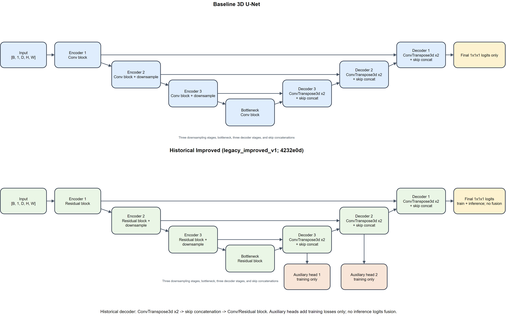

# HipMRI: Baseline and Improved 3D U-Net

COMP3710 · s4910970 · Reproducible course-submission candidate · 26 October 2026

This project compares a Baseline 3D U-Net with a residual, deep-supervised Improved 3D U-Net for six-class pelvic MRI segmentation: Background, Body, Bones, Bladder, Rectum and Prostate. The dataset is CSIRO's [Labelled weekly MR images of the male pelvis](https://data.csiro.au/collection/csiro%3A51392), referred to as **HipMRI** in this project. The intended use is research on contour drafting with human review, not autonomous treatment planning.

**Main result.** Under the original matched held-out protocol, Baseline reached patient-mean prostate Dice **0.811548** and historical Improved reached **0.813587**, a difference of only **+0.002038**. Improved also reduced the worst patient's score by **0.062061**. The evidence therefore supports retaining Baseline as the conservative reference; it does not establish a reliable benefit from the added complexity.

## 1. Repository contents

```text
COMP3710-A1/
├── README.md
├── requirements.txt
├── pyproject.toml
├── src/
│   ├── audit.py
│   ├── build_course_submission.py
│   ├── dataset.py
│   ├── modules.py
│   ├── plot_training.py
│   ├── predict.py
│   ├── train.py
│   └── validation_visuals.py
├── tests/                         # tests for maintained public code
├── evidence/
│   ├── dataset_manifest.json      # frozen patient-disjoint split
│   ├── SOURCES.md
│   └── sources/csiro-brief-data-description.txt
└── docs/
    ├── requirements-verified-local.txt
    ├── results_summary.json
    └── assets/model_architecture.drawio[.png]
```

Raw MRI volumes, trained weights and generated experiment directories are deliberately excluded. The editable architecture source is provided with its rendered preview.



## 2. Data download and placement

1. Open the official [CSIRO collection page](https://data.csiro.au/collection/csiro%3A51392) or its persistent DOI [10.25919/45T8-P065](https://doi.org/10.25919/45T8-P065).
2. Review the collection's licence and data-use conditions before downloading. The repository does not redistribute the MRI files.
3. Extract the download beneath `data/HipMRI_Study_open` so the two full-volume directories appear exactly as follows:

```text
COMP3710-A1/
└── data/
    └── HipMRI_Study_open/
        ├── semantic_MRs/
        │   ├── B006_Week0_LFOV.nii.gz
        │   └── ...
        ├── semantic_labels_only/
        │   ├── B006_Week0_SEMANTIC.nii.gz
        │   └── ...
        └── data_use_agreement.txt
```

The code recursively discovers `.nii` and `.nii.gz` files in those two directories. An MRI ending in `_LFOV` is paired with the mask ending in `_SEMANTIC` through their shared case key. Do not rename medical files. The retained CSIRO [label description](evidence/sources/csiro-brief-data-description.txt) identifies label `5` as Prostate.

The fixed [dataset manifest](evidence/dataset_manifest.json) contains 211 scans from 38 patients. Seed 42 assigns 27/6/5 patients and 146/46/19 scans to train/validation/test, with every weekly scan from one patient kept in one partition. Its SHA-256 is:

```text
5457a611c5611f944a26d214a1f325b803dded66f70df5fda3fd009642751a07
```

## 3. Environment and local verification

Python 3.11 was used for the local verification. A CUDA GPU is required for the declared full training configuration; CPU is suitable for tests and command inspection.

```powershell
cd E:\vscode\COMP3710-A1
python -m venv .venv
.\.venv\Scripts\Activate.ps1
python -m pip install --upgrade pip
python -m pip install -r requirements.txt
python -m pytest -q
```

The range-based dependencies in `requirements.txt` describe the supported environment. [Locally verified versions](docs/requirements-verified-local.txt) are recorded separately. Historical formal jobs used PyTorch `2.13.0+cu130`, CUDA `13.0` and one A100-PCIE-40GB, but a complete historical `pip freeze` was not retained; the local record is not presented as that missing lockfile.

## 4. Audit the downloaded data

Generate a fresh manifest outside the frozen evidence file:

```powershell
python src/audit.py data/HipMRI_Study_open --output local/re_audited_manifest.json --seed 42
Get-FileHash local/re_audited_manifest.json -Algorithm SHA256
Get-FileHash evidence/dataset_manifest.json -Algorithm SHA256
```

The hashes must match before claiming an exact split reproduction. A mismatch requires inspection of dataset version, paths, pairing and manifest contents; do not overwrite the frozen manifest merely to force agreement.

## 5. Models and preprocessing

Both report models use channels 16/32/64/128, three downsampling stages and encoder skip connections. Baseline uses ordinary double-convolution blocks. The report's Improved model is `LegacyImprovedUNet3D` with architecture version `legacy_improved_v1`; it adds residual projections and two training-only auxiliary heads. Inference uses final logits only. The later `improved_context_v2` model is a separate validation experiment and its result is not substituted for the historical Improved test result.

MRI intensities are z-score normalized. Images are resized with trilinear interpolation and masks with nearest-neighbour interpolation. Training uses 96×96×96 crops with a 0.5 probability of choosing a prostate-containing crop. Validation and test use deterministic full resized volumes. Raw logits enter cross entropy; softmax is applied within soft Dice.

## 6. Training reproduction

The command below reproduces the declared Baseline configuration through the maintained interface:

```powershell
python src/train.py `
  --manifest evidence/dataset_manifest.json `
  --data-root data/HipMRI_Study_open `
  --output-dir artifacts/reproduced_baseline `
  --model baseline `
  --epochs 20 `
  --batch-size 1 `
  --learning-rate 0.001 `
  --base-channels 16 `
  --target-shape 128 128 128 `
  --train-patch-shape 96 96 96 `
  --foreground-patch-probability 0.5 `
  --seed 42 `
  --device cuda `
  --prostate-label 5 `
  --prostate-label-source "CSIRO DOI 10.25919/45T8-P065, BriefDataDescription.txt: 5=Prostate" `
  --prostate-ce-weight 4 `
  --prostate-dice-weight 4 `
  --selection-metric mean_dice `
  --scheduler none
```

For the historical Improved arm, use a different output directory and replace the model arguments with:

```text
--model improved --architecture-version legacy_improved_v1
```

Do not enable augmentation for this historical comparison. Both arms must use the same manifest, geometry, optimizer settings, seed, number of epochs and selection rule. Training writes `experiment_config.json`, `history.json`, `training_summary.json`, validation-selected `best.pt` and `training_curves.png` beneath the chosen output directory.

These commands reproduce the stored configuration through the current code. They do not guarantee bitwise identity with the historical GPU runtime.

## 7. Held-out evaluation

Evaluate a validation-selected checkpoint once with overlap-averaged full-volume inference:

```powershell
python src/predict.py `
  --checkpoint artifacts/reproduced_baseline/best.pt `
  --manifest evidence/dataset_manifest.json `
  --data-root data/HipMRI_Study_open `
  --output-dir artifacts/reproduced_baseline_test `
  --patch-size 128 128 128 `
  --stride 64 64 64 `
  --device cuda
```

Prediction verifies the manifest hash and architecture metadata stored in the checkpoint. It writes `test_metrics.json`, per-case prediction tensors and failure panels. The test partition must not influence hyperparameters, checkpoint selection or acceptance thresholds. These five patients have been evaluated by historical models and are not an untouched external cohort.

## 8. Original matched held-out results

Both formal jobs completed with exit status `0:0` at code revision `4232e0d`. The machine-readable retained summary is [docs/results_summary.json](docs/results_summary.json).

| Foreground class | Baseline Dice | Improved Dice | Baseline IoU | Improved IoU |
|---|---:|---:|---:|---:|
| Body | 0.958148 | 0.977807 | 0.919909 | 0.956600 |
| Bones | 0.859094 | 0.904555 | 0.753894 | 0.825973 |
| Bladder | 0.957028 | 0.960610 | 0.917811 | 0.924386 |
| Rectum | 0.852767 | 0.861629 | 0.747437 | 0.758714 |
| Prostate | 0.822599 | 0.831385 | 0.702348 | 0.715546 |

The table above averages available scan-level class metrics. The headline below first averages prostate Dice within each patient, then gives all five patients equal weight.

| Test patient | Baseline | Improved | Difference |
|---|---:|---:|---:|
| B037 | 0.736256 | 0.674195 | -0.062061 |
| H007 | 0.781378 | 0.839755 | +0.058377 |
| K042 | 0.887015 | 0.878500 | -0.008516 |
| L011 | 0.781136 | 0.795553 | +0.014417 |
| M013 | 0.871957 | 0.879931 | +0.007974 |
| **Mean** | **0.811548** | **0.813587** | **+0.002038** |

| Resource measure | Baseline | Improved |
|---|---:|---:|
| Trainable parameters | 1,400,646 | 1,423,106 |
| Peak training allocated memory | 977.6 MiB | 1,193.4 MiB |
| Peak inference allocated memory | 1,047.4 MiB | 1,047.5 MiB |
| Recorded forward time per volume | 0.060885 s | 0.064924 s |

The `+0.002038` mean difference is below the project's predeclared `+0.01` meaningful-upgrade target. Improved helped three patients and regressed on two; B037 deteriorated materially. Five repeatedly inspected patients and one seed do not support statistical-significance or clinical-generalization claims.

## 9. Later validation-only work

Context-v2 candidate B reached mean patient prostate Dice `0.829472` on validation at epoch 19. Its peak training memory was `1455.8 MiB`, versus `979.6 MiB` for the declared control, a ratio of `1.486`; this exceeded the `1.35×` gate. It was therefore ineligible for automatic held-out testing. No new Context-v2 test metrics, test predictions or test failure panels are claimed here.

## 10. Engineering recommendation and limitations

Retain Baseline as the conservative tested reference and require human correction of every proposed contour. The historical Improved package passed aggregate overlap targets, but its small mean change and severe B037 regression do not justify a stronger operational claim.

The evidence does not establish clinician time savings, treatment safety, external-cohort generalization, native-resolution boundary accuracy, HD95 performance or superiority of 3D over 2D. Future work should freeze a fresh protocol, use paired seeds, preserve validation and resource evidence, and evaluate the held-out set only after a candidate passes every declared gate.

## 11. Build the local course-submission package

From the repository root:

```powershell
python src/build_course_submission.py --output local/course-submission-20261026
python src/build_course_submission.py --output local/course-submission-20261026 --validate-only
python -B -m pytest -q -p no:cacheprovider local/course-submission-20261026/tests
```

The builder refuses to overwrite a non-empty output directory. The generated package excludes raw data, checkpoints, local archives and internal experiment outputs.

## 12. References

1. Çiçek et al. [3D U-Net: Learning Dense Volumetric Segmentation from Sparse Annotation](https://arxiv.org/abs/1606.06650), 2016.
2. Isensee et al. [Brain Tumor Segmentation and Radiomics Survival Prediction: Contribution to the BRATS 2017 Challenge](https://arxiv.org/abs/1802.10508), 2018. This is architectural inspiration, not the source of HipMRI data.
3. CSIRO. [Labelled weekly MR images of the male pelvis](https://data.csiro.au/collection/csiro%3A51392), DOI [10.25919/45T8-P065](https://doi.org/10.25919/45T8-P065).

## AI disclosure
