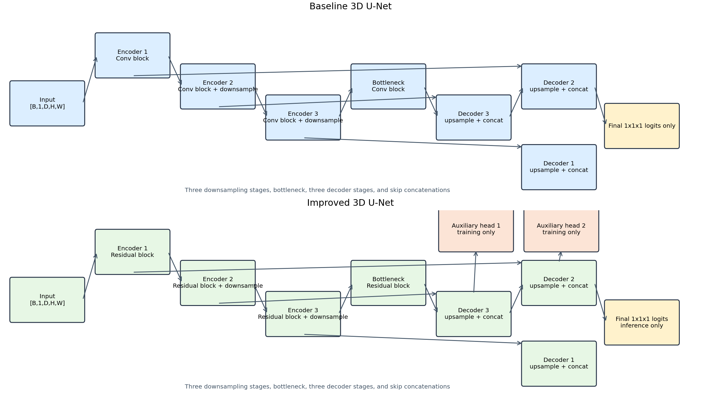

# HipMRI 3D U-Net: prostate contour drafting prototype

This COMP3710 Hard-difficulty project tests whether a residual, deep-supervised 3D U-Net improves prostate contour drafting over a plain 3D U-Net on downsampled HipMRI NIfTI volumes. The intended user is a radiotherapy contouring specialist who reviews and edits a proposed contour; this is a research prototype, not an autonomous clinical decision system. The primary matched formal experiment (`4232e0d`) reached held-out patient-level prostate Dice of 0.811548 for the baseline and 0.813587 for the Improved model. The difference is small (+0.002038), and paired failure analysis identifies cases where the improved model is worse. The evidence supports review-assist evaluation, not automated deployment.

## Main finding and evidence boundary

The headline is the arithmetic mean of one prostate Dice value per held-out patient after full-volume reconstruction. It is not pooled-voxel Dice, a patch metric, a validation score, or a mean across every class. The frozen mask meaning is `5=Prostate`, supported by the CSIRO v2 `Labels:` block in [evidence/SOURCES.md](evidence/SOURCES.md). Paths, hashes, job identities and archive status are indexed in [docs/EXPERIMENT_EVIDENCE.md](docs/EXPERIMENT_EVIDENCE.md).

| Result status | Code / jobs | Selection rule | Held-out patient prostate Dice | Interpretation |
| --- | --- | --- | ---: | --- |
| **Primary matched formal comparison** | `4232e0d`; baseline 683675, improved 683676 | Highest `validation_mean_dice` | Baseline **0.811548**; Improved **0.813587**; difference **+0.002038** | Small observed gain, not a clinical-use claim |
| Validation scan | five Improved candidates, including Wide20 | validation patient prostate Dice | Not a held-out result | Used to choose a candidate only |
| **Supplementary matched comparison** | Baseline-new 687753, recovered Wide20 687754 | `prostate_dice` validation selection | Baseline-new **0.818316**; Wide20 **0.794166**; difference **-0.024150** | Negative finding; Wide20 is not the recommended replacement |

The final Rangpur accounting query recorded `COMPLETED|0:0` for 683675, 683676, 687753 and 687754. Completion validates a clean job exit; it does not convert a supplementary result into independent confirmation or make a contour clinically acceptable.

## Model principles



`src/modules.py` implements the same 3D U-Net skeleton for both models: three encoder reductions, a bottleneck, three decoder expansions, and skip concatenations. The baseline uses convolution blocks. The Improved U-Net replaces them with residual blocks and adds two decoder auxiliary heads for deep supervision during training. It has **no attention gate**. At inference, `predict.py` reads only final `1x1x1` logits.

For normalized MRI volumes, input is `[B, 1, D, H, W]`, final logits are `[B, 6, D, H, W]`, and target is `[B, D, H, W]`. `dataset.py` validates paired NIfTI geometry, preserves patient separation, resamples MRI intensity with trilinear interpolation and masks with nearest-neighbour interpolation, then standardizes each volume. Training uses weighted cross-entropy plus soft Dice. The Improved model adds the same objective for two downsampled auxiliary decoder outputs, each weighted by 0.25. Foreground-aware patches raise the chance of prostate exposure, while validation and test scoring use complete reconstructed volumes.

Checkpoint choice is validation-only. `predict.py` slides an inference patch over a volume, sums logits at each voxel, divides by overlap count, then takes `argmax`. Test scoring first averages any test volumes belonging to the same patient and then averages five patient Dice scores.

## Data, preprocessing and split

The audited course data contain 211 volumes from 38 patients. The fixed seed-42 manifest has 27 train, 6 validation and 5 test patients; a patient never appears in more than one partition. `audit.py` validates image/mask shape, affine, orientation, finite MRI values and integral labels before the manifest is written. The manifest SHA-256 is `188a42ad99e4a1a29ba6835828e3cc00a88edab9d691f7db753cfd0351e6b08a`.

Raw data remain ignored. On Windows, use the actual local data root. Rangpur uses the course-provided HipMRI data root recorded in the retained command artifacts.

```powershell
$dataRoot = Resolve-Path '.\data\HipMRI_Study_open'
python src\audit.py $dataRoot --output evidence\dataset_manifest.json --seed 42
python -m pytest -q
```

`predict.py` refuses a checkpoint whose saved manifest hash differs from the supplied manifest and refuses prostate headline scoring when its cited mapping is missing.

## Feasibility review

| Requirement | Evidence and decision |
| --- | --- |
| User need and scope | Draft a multi-class 3D pelvic segmentation for specialist inspection and editing; do not issue treatment decisions. |
| Acceptance criteria | Patient-disjoint split; cited `5=Prostate`; patient-level test prostate Dice at least 0.70; non-background Dice/IoU; peak VRAM and per-patient inference time; 3–5 held-out failure cases. |
| Model choice | Plain 3D U-Net is the baseline. The Improved variant tests residual blocks and training-time deep supervision while retaining the same geometry and evaluation code. |
| Preliminary feasibility | Local synthetic tests and retained Rangpur smoke/preflight records validated loading, forward/backward, checkpoint restoration and whole-volume evaluation. These are engineering checks, not final performance claims. |
| Risks and fallback | The small main gain and negative Wide20 result show configuration sensitivity. Retain the baseline comparator, use human review, and stop selection before test evaluation. |

The written review is included as required documentation. A local file does not prove that a tutor feasibility consultation/check-off occurred.

## Reproducible commands and example I/O

Install dependencies from `requirements.txt`, then inspect exact local verification and separate Rangpur records in [docs/EXPERIMENT_ENVIRONMENT.md](docs/EXPERIMENT_ENVIRONMENT.md).

```powershell
python -m pip install -r requirements.txt
python -m pytest -q
$prostateSource = 'CSIRO, Labelled weekly MR images of the male pelvis, v2, DOI: ' +
  '10.25919/45T8-P065, BriefDataDescription.txt, Labels block: 5=Prostate.'
$trainArgs = @(
  'src\train.py', '--manifest', 'evidence\dataset_manifest.json', '--data-root', $dataRoot,
  '--output-dir', 'artifacts\training_baseline', '--model', 'baseline', '--epochs', '20',
  '--batch-size', '1', '--learning-rate', '0.001', '--base-channels', '16',
  '--target-shape', '128', '128', '128', '--train-patch-shape', '96', '96', '96',
  '--foreground-patch-probability', '0.50', '--prostate-label', '5',
  '--prostate-label-source', $prostateSource
)
python @trainArgs
$predictArgs = @(
  'src\predict.py', '--checkpoint', 'artifacts\training_baseline\best.pt',
  '--manifest', 'evidence\dataset_manifest.json', '--data-root', $dataRoot,
  '--output-dir', 'artifacts\test_baseline', '--patch-size', '128', '128', '128',
  '--stride', '64', '64', '64'
)
python @predictArgs
```

Training writes `experiment_config.json`, `history.json`, `training_summary.json`, `best.pt`, and `training_curves.png`. Prediction writes `test_metrics.json`, ignored prediction tensors, and failure panels. The test JSON contains the headline patient mean, non-background class Dice/IoU, per-patient scores, patch/stride, overlap, logit merge method, GPU peak and inference timing.

Existing histories can be plotted without retraining:

```powershell
$baselineHistory = Join-Path 'artifacts\2026-10-22\683675_formal_baseline' 'training_summary.json'
$improvedHistory = Join-Path 'artifacts\2026-10-22\683676_formal_improved' 'training_summary.json'
$historyArgs = @(
  'src\plot_training.py', '--history',
  $baselineHistory, '--label', 'Baseline', '--history', $improvedHistory,
  '--label', 'Improved 3D U-Net', '--selection-metric', 'mean_dice',
  '--output', 'docs\assets\training_curves.png'
)
python @historyArgs
```

## Main matched experiment: curves, results and resources


The chart reads saved main-experiment histories. It labels the selected epoch directly: baseline epoch 20 and Improved epoch 18. The historical selection metric was `validation_mean_dice`, so the plot intentionally does not relabel it as prostate Dice. Training-loss magnitudes cannot establish model quality because the Improved model includes auxiliary supervision.

| Model | Selected epoch | Parameters | Peak training VRAM (MiB) | Peak inference VRAM (MiB) | Mean patient inference (s) | Patient prostate Dice |
| --- | ---: | ---: | ---: | ---: | ---: | ---: |
| Plain 3D U-Net | 20 | 1,400,646 | 977.641 | 1,047.402 | 0.231 | 0.811548 |
| Residual + deep-supervision 3D U-Net | 18 | 1,423,106 | 1,193.384 | 1,047.492 | 0.247 | 0.813587 |

| Non-background label | Baseline Dice / IoU | Improved Dice / IoU |
| --- | ---: | ---: |
| 1 Body | 0.958148 / 0.919909 | 0.977807 / 0.956600 |
| 2 Bones | 0.859094 / 0.753894 | 0.904555 / 0.825972 |
| 3 Bladder | 0.957028 / 0.917811 | 0.960610 / 0.924385 |
| 4 Rectum | 0.852767 / 0.747437 | 0.861629 / 0.758713 |
| 5 Prostate | 0.822599 / 0.702347 | 0.831385 / 0.715546 |

## Failure analysis and engineering recommendation


This paired panel comes from the main formal archive, not a new run. The selected case is `B037_Week0`; source Git SHA is `4232e0d91d8aa6cf8c1de38883b213c07cc62d10`, and selected axial index is 70. The deterministic rule ranks common cases by mean baseline/improved prostate FP+FN voxels, breaks ties by patient ID and case ID, and chooses the largest-error slice inside the ground-truth prostate extent. It is therefore a **prostate-range high-error slice**, not an anatomical prostate base. Panels 5 and 6 show prostate-only error: pale/white is false positive and red is false negative.

| Rank | Case | Shared FP+FN error score | Baseline FP / FN | Improved FP / FN | Diagnosis boundary |
| ---: | --- | ---: | ---: | ---: | --- |
| 1 | B037_Week0 | 3088.5 | 393 / 2495 | 166 / 3123 | FN increase |
| 2 | L011_Week2 | 929.5 | 894 / 68 | 738 / 159 | FN increase |
| 3 | L011_Week7 | 878.5 | 868 / 81 | 661 / 147 | FP/FN trade-off |
| 4 | K042_Week0 | 876.0 | 432 / 439 | 208 / 673 | FN increase |
| 5 | L011_Week0 | 830.5 | 803 / 109 | 579 / 170 | FP/FN trade-off |

The first two rows reduce false-positive voxels but increase false-negative voxels; K042 has the same direction. B037 has the largest shared error and the Improved model raises FN from 2,495 to 3,123. Recommendation: use neither model for autonomous contour acceptance. The primary Improved model is a viable human-review drafting prototype because it preserves the matched protocol and gives a small aggregate gain, but B037 and the other paired failures require specialist review. Wide20 is worse than Baseline-new and should not replace the main configuration. Any new validation choice must be registered before another held-out evaluation.

## Wide20 supplementary result and limitations

The five-candidate scan selected Wide20 on validation data. A validation-only control completed without test artifacts. The final one-time matched supplementary tests completed cleanly, yet Baseline-new outperformed recovered Wide20 by 0.024150 patient-level prostate Dice. This can reflect configuration sensitivity, checkpoint lineage, or limited sample size; it does not prove the residual/deep-supervision architecture globally worse.

Limitations are the five-patient held-out cohort, downsampled geometry, one split/seed, uncalibrated contour confidence, and no clinical review. The project does not claim millimetre-level accuracy, anatomical-base correctness, prospective performance, or clinical safety.

## Environment and evidence index

`requirements.txt` provides development dependency ranges. [docs/requirements-verified-local.txt](docs/requirements-verified-local.txt) records exact locally import-verified versions used for current tests and tracked figures; it is not a portable lockfile. Formal artifacts were produced on Rangpur Linux with PyTorch `2.13.0+cu130`, CUDA `13.0`, and an NVIDIA A100-PCIE-40GB; see [docs/EXPERIMENT_ENVIRONMENT.md](docs/EXPERIMENT_ENVIRONMENT.md). Do not assign the local Windows package snapshot to formal runs.

- [Experiment evidence index](docs/EXPERIMENT_EVIDENCE.md)
- [Environment distinction](docs/EXPERIMENT_ENVIRONMENT.md)
- [Execution and acceptance guide](docs/HIPMRI_3D_HARD_EXECUTION_FLOW.md)
- [Frozen label and source evidence](evidence/SOURCES.md)
- [Asset-generation command](scripts/generate_readme_assets.py)

## Artificial Intelligence Usage Disclosure

OpenAI Codex and ChatGPT assisted code modification, debugging, experiment orchestration, test design, documentation drafting, figure-generation scripts, and review of result consistency. The user remains responsible for checking every code change, command, loss formula, metric definition, result table and written claim. Verification includes automated tests, saved-artifact inspection, checksum comparison, fresh scheduler accounting queries, and manual visual inspection of generated figures. Passing tests do not substitute for manual clinical validation or specialist contour review.
