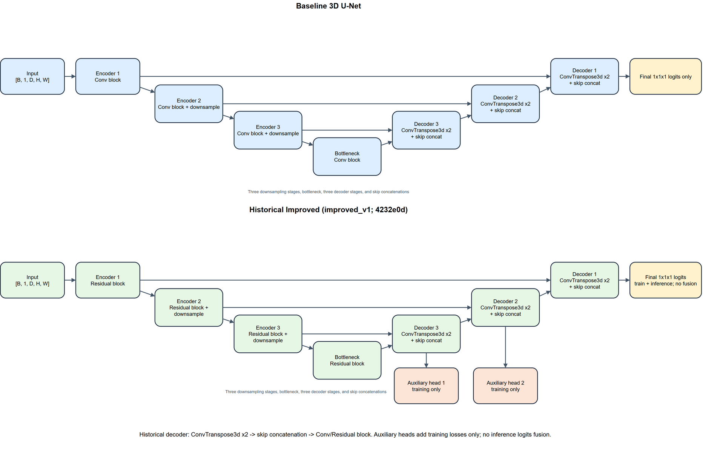
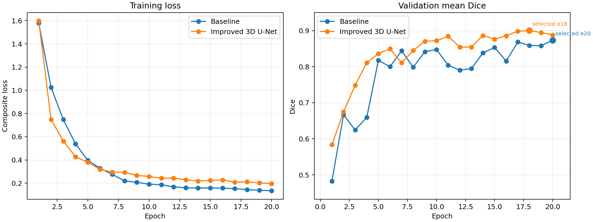
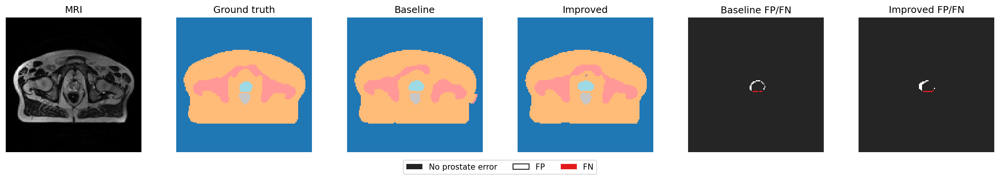
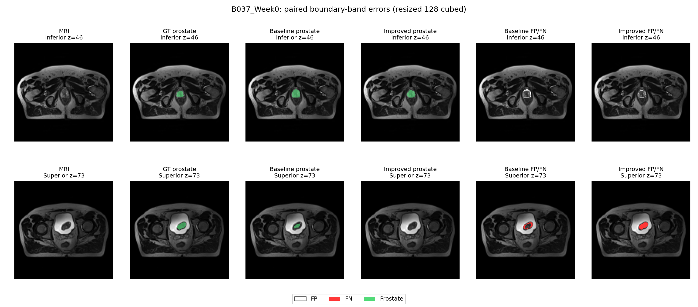

# HipMRI 3D U-Net for Human-Reviewed Prostate Contour Drafting

**COMP3710 Hard option | Student s4910970**

## 1. Project summary

This project investigates whether residual refinement and deep supervision improve six-class 3D pelvic MRI segmentation enough to justify their additional engineering cost. A plain 3D U-Net (**Baseline**) is compared with a residual, deep-supervised 3D U-Net (**Improved**) on the same patient-disjoint split of the CSIRO HipMRI dataset. The intended output is a draft for human review, not an autonomous treatment-planning decision.

On five held-out patients, Baseline achieved **0.811548** patient-mean prostate Dice and Improved achieved **0.813587**, a difference of **+0.002038**. Improved used about 22% more peak training memory and reduced the B037 patient score by **0.062061**. The evidence supports retaining Baseline as the conservative reference model.



## 2. Engineering question and feasibility review

### 2.1 User need and scope

A radiotherapy contouring specialist needs a reviewable draft of prostate and organ-at-risk boundaries. The prototype must preserve patient independence, report small-structure performance, expose boundary failures and remain practical on the available GPU. It is not designed or validated for autonomous clinical use.

The engineering question is:

> Do residual blocks and training-only deep supervision reduce clinically relevant segmentation errors enough to justify their additional memory use and complexity over a plain 3D U-Net?

### 2.2 Acceptance criteria

The feasibility review defined five testable criteria:

1. No patient overlap between training, validation and test partitions.
2. Every MRI-mask pair passes pairing, shape, affine, finite-value and integer-label checks.
3. Held-out patient-mean prostate Dice is at least `0.70`, with per-class Dice and IoU also reported.
4. Parameter count, peak GPU VRAM and inference time are recorded under a matched protocol.
5. Three to five held-out failures are reviewed using MRI, ground truth, prediction, false-positive and false-negative views.

### 2.3 Model rationale and course concepts

The project uses the Hard-option 3D Improved U-Net. Volumetric convolution and encoder-decoder skip connections preserve through-plane context. Residual blocks provide a shorter optimization route, while auxiliary heads supply training signals at intermediate decoder scales. Weighted cross entropy, soft Dice and prostate-containing crop sampling address the small prostate target relative to background and larger pelvic structures.

The implementation is deliberately compact. It is inspired by Çiçek et al. and Isensee et al.; it does not claim to reproduce either complete research system.

### 2.4 Midpoint evidence, risks and fallback

At midpoint, the data audit identified 211 paired scans from 38 patients and froze a patient-disjoint `27/6/5` split. Synthetic NIfTI tests covered recursive pairing, invalid-data rejection, patient separation, finite 3D forward/backward passes, auxiliary outputs, checkpoint reload and validation-only model selection. Earlier OASIS 2D work was retained only as workflow evidence and was not used as HipMRI performance evidence.

The main risks were GPU memory pressure, prostate under-sampling, orientation or affine errors, slow NIfTI input, overfitting and failed cluster jobs. The planned budget was a short GPU smoke test followed by one matched 20-epoch run for each model on an A100, with batch size 1 and checkpoint selection using validation data only. The fallback was to retain Baseline if Improved did not produce a reliable boundary benefit at acceptable cost.

The complete midpoint document and supporting appendices are available in the [HipMRI Feasibility Review v5](assets/HipMRI_Feasibility_Review_v5.pdf). Its midpoint statements remain historical evidence and do not imply that final test results were available at that time.

## 3. Dataset, split and preprocessing

The project uses the CSIRO collection [*Labelled weekly MR images of the male pelvis*](https://data.csiro.au/collection/csiro%3A51392), DOI [10.25919/45T8-P065](https://doi.org/10.25919/45T8-P065). The dataset documentation identifies label `5` as Prostate. Raw MRI data are not redistributed.

Place the separately obtained dataset under:

```text
data/HipMRI_Study_open/
|-- semantic_MRs/
`-- semantic_labels_only/
```

The loader pairs `_LFOV` MRI volumes with `_SEMANTIC` masks. Seed 42 assigns all weekly scans from each patient to one partition:

| Partition | Patients | Scans |
| --- | ---: | ---: |
| Training | 27 | 146 |
| Validation | 6 | 46 |
| Test | 5 | 19 |
| **Total** | **38** | **211** |

This approximately 70/15/15 allocation retains most patients for fitting while preserving separate model-selection and final-evaluation cohorts. Grouping by patient prevents repeated anatomy from appearing on both sides of an evaluation boundary.

Frozen manifest SHA-256:

```text
5457a611c5611f944a26d214a1f325b803dded66f70df5fda3fd009642751a07
```

MRI intensities are z-score normalized. Images use trilinear resizing and masks use nearest-neighbour resizing to `128 x 128 x 128`. Training uses `96 x 96 x 96` crops with a `0.5` probability of selecting a prostate-containing crop. Validation and test use deterministic resized volumes.

## 4. Model design

Both networks use channel widths `16/32/64/128`, three encoder stages, skip connections and six-class output logits.

| Component | Baseline | Improved |
| --- | --- | --- |
| Main blocks | Double convolution | Residual convolution |
| Decoder supervision | Final output | Final output plus two auxiliary heads |
| Auxiliary heads at inference | Not applicable | Disabled; final head only |
| Output classes | 6 | 6 |

The objective combines weighted cross entropy and soft Dice. Prostate has weight `4`; all other classes have weight `1`. Each Improved auxiliary loss has weight `0.25` during training.

## 5. Repository contents and environment

| File | Responsibility |
| --- | --- |
| `modules.py` | Baseline and Improved PyTorch model components |
| `dataset.py` | MRI-mask loading, preprocessing, crops and split access |
| `train.py` | Training, validation, checkpoint selection and summaries |
| `predict.py` | Checkpoint loading, full-volume inference, metrics and failure panels |
| `audit.py` | Deterministic data audit and patient-disjoint manifest generation |
| `plot_training.py` | Training-history visualisation |
| `requirements.txt` | Exact locally verified direct dependencies |

The locally verified environment uses Python 3.11 with:

| Dependency | Version |
| --- | ---: |
| PyTorch | 2.11.0 |
| NumPy | 2.4.2 |
| NiBabel | 5.4.2 |
| Matplotlib | 3.10.8 |
| pytest | 9.1.1 |

Formal jobs `701809` and `701810` used Python `3.11.15`, PyTorch `2.13.0+cu130`, CUDA `13.0` and an A100-PCIE-40GB GPU. Exact bitwise equivalence across different PyTorch, CUDA and driver versions is not claimed.

Create an environment:

```bash
python -m venv .venv
```

Activate it with `source .venv/bin/activate` on Linux or Rangpur, or `.venv\Scripts\Activate.ps1` on Windows PowerShell. Then install the declared dependencies:

```bash
python -m pip install --upgrade pip
python -m pip install -r requirements.txt
```

## 6. Reproduction workflow

Run all commands from the directory containing this README. Raw data, generated manifests and checkpoints must remain outside version control.

### 6.1 Audit the dataset

```bash
python audit.py data/HipMRI_Study_open \
  --output artifacts/dataset_manifest.json \
  --seed 42
```

The audit validates MRI-mask pairing and spatial metadata. Both model arms must use the same unchanged manifest.

### 6.2 Train Baseline

```bash
python train.py \
  --manifest artifacts/dataset_manifest.json \
  --data-root data/HipMRI_Study_open \
  --output-dir artifacts/reproduced_baseline \
  --model baseline \
  --epochs 20 \
  --batch-size 1 \
  --learning-rate 0.001 \
  --base-channels 16 \
  --target-shape 128 128 128 \
  --train-patch-shape 96 96 96 \
  --foreground-patch-probability 0.5 \
  --seed 42 \
  --device cuda \
  --prostate-label 5 \
  --prostate-label-source "CSIRO DOI 10.25919/45T8-P065, BriefDataDescription.txt: 5=Prostate" \
  --prostate-ce-weight 4 \
  --prostate-dice-weight 4 \
  --selection-metric mean_dice \
  --scheduler none
```

Train Improved with the same manifest and matched shared settings, a separate output directory, and:

```text
--model improved --architecture-version improved_v1
```

Held-out test results must not be used for checkpoint or hyperparameter selection.

### 6.3 Evaluate a validation-selected checkpoint

```bash
python predict.py \
  --checkpoint artifacts/reproduced_baseline/best.pt \
  --manifest artifacts/dataset_manifest.json \
  --data-root data/HipMRI_Study_open \
  --output-dir artifacts/reproduced_baseline_test \
  --patch-size 128 128 128 \
  --stride 64 64 64 \
  --device cuda
```

Use a new empty output directory for each run. Prediction checks checkpoint and manifest metadata, reconstructs full volumes, prints results and writes quantitative metrics and visual failure panels.

## 7. Matched experimental protocol

The final-code experiment used the exact Python sources in this submission. Their SHA-256 hashes match the source records stored with Rangpur jobs `701809` (Baseline) and `701810` (Improved). Both jobs used the frozen manifest above, the same preprocessing, optimizer settings, epoch budget and evaluation procedure. Both completed with Slurm state `COMPLETED` and exit code `0:0`.

Baseline epoch 20 and Improved epoch 18 were selected using validation mean Dice before the held-out test was evaluated. Improved has auxiliary losses, so raw total training loss is not directly comparable with Baseline loss.



## 8. Results

### 8.1 Primary patient-level result

The primary metric first averages prostate Dice across each patient's weekly scans and then weights the five held-out patients equally.

| Test patient | Baseline | Improved | Difference |
| --- | ---: | ---: | ---: |
| B037 | 0.736256 | 0.674195 | -0.062061 |
| H007 | 0.781378 | 0.839755 | +0.058377 |
| K042 | 0.887015 | 0.878500 | -0.008516 |
| L011 | 0.781136 | 0.795553 | +0.014417 |
| M013 | 0.871957 | 0.879931 | +0.007974 |
| **Mean** | **0.811548** | **0.813587** | **+0.002038** |

Both models exceed the pre-registered `0.70` prostate Dice threshold. Improved is higher on three patients and lower on two; its largest change is the B037 regression.

### 8.2 Per-class segmentation metrics

The following Dice and IoU values are averaged across the 19 held-out scans. Labels 1-5 reproduce `test_metrics.json`. Background was independently recomputed from saved prediction tensors using the same per-scan averaging rule; it is reported separately because a dominant background score can obscure anatomical errors.

| Class | Baseline Dice | Baseline IoU | Improved Dice | Improved IoU |
| --- | ---: | ---: | ---: | ---: |
| Background | 0.982804 | 0.966255 | 0.994107 | 0.988292 |
| Body | 0.958148 | 0.919909 | 0.977807 | 0.956600 |
| Bones | 0.859094 | 0.753894 | 0.904555 | 0.825973 |
| Bladder | 0.957028 | 0.917811 | 0.960610 | 0.924386 |
| Rectum | 0.852767 | 0.747437 | 0.861629 | 0.758714 |
| Prostate | 0.822599 | 0.702348 | 0.831385 | 0.715546 |

### 8.3 Computational cost

Training and inference memory are peak allocated GPU memory. Training time is the duration recorded by `training_summary.json`. Inference time is cumulative model-execution time per preprocessed held-out patient, not end-to-end clinical latency.

| Model | Parameters | Peak train VRAM | Peak inference VRAM | Training time | Mean inference time per patient |
| --- | ---: | ---: | ---: | ---: | ---: |
| Baseline | 1,400,646 | 977.6 MiB | 1,047.4 MiB | 1,369.1 s | 0.248920 s |
| Improved | 1,423,106 | 1,193.4 MiB | 1,047.5 MiB | 1,388.2 s | 0.249449 s |

Improved adds 22,460 parameters and uses approximately 22% more peak training memory. The recorded inference times are effectively equal, so the measured cost is concentrated in training memory and architectural complexity.

### 8.4 Supplementary Context-v2 B

Context-v2 B was a separately frozen follow-up candidate selected using validation evidence before one held-out evaluation. It achieved **0.795699 patient-mean prostate Dice**, which is `0.015849` below Baseline. It is supplementary experiment history, not the Improved arm of the matched Baseline-versus-Improved comparison reported above. Its scan-aggregated class-5 Dice of `0.814222` uses a different aggregation and must not be compared directly with the patient-mean result.

## 9. Failure-case autopsy

Five cases were selected, one per held-out patient, using whole-volume prostate false-positive plus false-negative error. Improved reduced false positives in all five cases but increased false negatives in all five, producing more compact yet less complete contours.

| Case | Baseline FP / FN | Improved FP / FN | Diagnosis |
| --- | ---: | ---: | --- |
| B037 Week0 | 393 / 2,495 | 166 / 3,123 | Fewer FP but 628 additional missed prostate voxels |
| L011 Week2 | 894 / 68 | 738 / 159 | Lower outward extension but greater omission |
| K042 Week0 | 432 / 439 | 208 / 673 | Compact prediction loses additional reference tissue |
| M013 Week0 | 581 / 85 | 407 / 171 | Total error falls while coverage becomes less complete |
| H007 Week0 | 432 / 155 | 121 / 245 | Large FP reduction accompanies lower recall |




The strongest boundary failure occurs in the geometric superior band of B037 Week0. Improved Dice is `0.000000`, with all `431/431` reference prostate voxels missed.



The boundary bands are defined from the ends of the reference-positive axial extent. They are not clinician-annotated apex/base landmarks. Across all 19 held-out scans, Baseline produced multiple prostate components in `6/19` scans, whereas Improved produced one component in every scan. Connectivity alone does not establish accuracy: the connected Improved prediction still omits the B037 superior region. No component filtering was used in the reported protocol.

## 10. Requirement outcome and recommendation

| Criterion | Final evidence | Outcome |
| --- | --- | --- |
| Patient independence | Frozen 27/6/5 patient split; regenerated manifest matched the recorded SHA-256 | Met |
| Valid paired data | 211 pairs passed pairing, shape, affine, finite-value and integer-label checks | Met |
| Prostate Dice at least 0.70 | Baseline 0.811548; Improved 0.813587 | Met |
| Resource measurement | Parameters, training/inference VRAM, training time and inference time recorded | Met |
| Review 3-5 held-out failures | Five paired cases with MRI, reference, predictions and FP/FN overlays | Met |

Retain **Baseline** as the reference model for human-reviewed contour drafting. Improved's `+0.002038` mean difference does not justify its additional complexity and memory use, particularly given its `-0.062061` B037 regression.

This recommendation does not establish clinical suitability. The evidence does not demonstrate clinician time savings, treatment safety, external-cohort generalisation, native-resolution boundary accuracy, HD95 performance or superiority of 3D over 2D. The held-out cohort contains only five patients and the matched comparison uses one seed. A future study should pre-register a new protocol, use paired seeds, select models using validation data only, evaluate once on a newly frozen held-out set and obtain clinician-reviewed anatomical boundary labels.

## 11. References

1. Çiçek et al., [3D U-Net: Learning Dense Volumetric Segmentation from Sparse Annotation](https://arxiv.org/abs/1606.06650), 2016.
2. Isensee et al., [Brain Tumor Segmentation and Radiomics Survival Prediction: Contribution to the BRATS 2017 Challenge](https://arxiv.org/abs/1802.10508), 2018. Architectural inspiration only.
3. CSIRO, [Labelled weekly MR images of the male pelvis](https://data.csiro.au/collection/csiro%3A51392), DOI [10.25919/45T8-P065](https://doi.org/10.25919/45T8-P065).

## 12. Artificial Intelligence Usage Disclosure

**AI tools used:** OpenAI ChatGPT and Codex.

Generative AI tools were used to provide general technical guidance and assist with selected software development and documentation tasks during this project.

The main areas of assistance included:

- **General guidance:** Clarifying project requirements, discussing preliminary implementation ideas and organising development tasks.
- **Project organisation:** Assisting with the initial file structure, code organisation and documentation layout.
- **Testing:** Assisting with drafting test files, preparing test cases and troubleshooting testing-related issues.
- **SLURM scripts:** Assisting with writing and adjusting SLURM job submission scripts for GPU experiments on the Rangpur cluster.
- **Documentation:** Assisting with organising and refining README content, Markdown formatting and technical descriptions.

AI-generated suggestions and code were reviewed and adjusted as needed. Relevant scripts and tests were checked through local execution or GPU job outputs.

The project implementation, experimental results and final submission remain the responsibility of the author.
