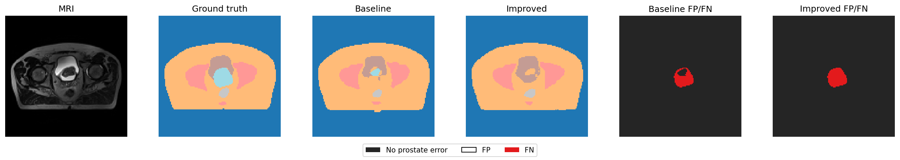
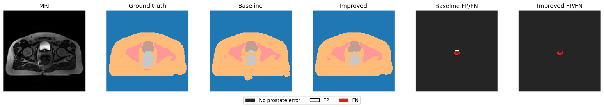
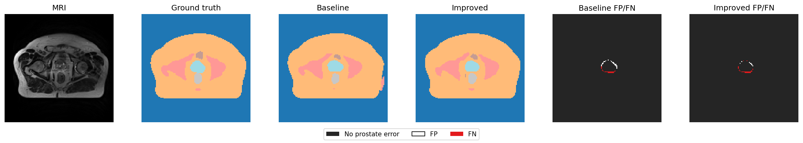
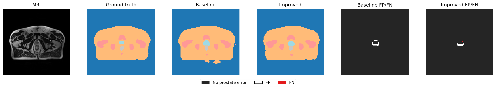
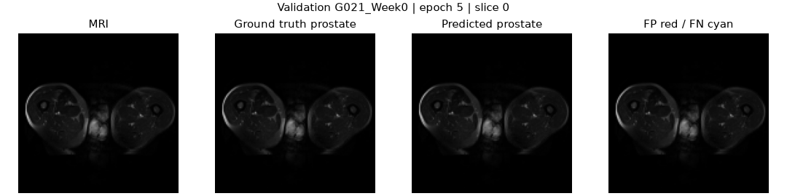

# COMP3710 Assignment 1 — 3D U-Net Segmentation

**Student:** s4910970
**Option:** Hard option — Baseline versus Improved 3D U-Net

## Overview

This submission implements and evaluates two six-class 3D segmentation networks on the HipMRI dataset:

- **Baseline:** a conventional 3D U-Net with double-convolution blocks.
- **Improved:** a residual 3D U-Net with two training-only deep-supervision heads.

The assignment tests whether residual blocks and deep supervision improve segmentation enough to justify their additional cost. Both models use the same patient-disjoint split, preprocessing, loss, training budget and full-volume evaluation, so architecture is the main experimental variable.


## Assignment objectives

1. Build a reproducible 3D workflow: audit, preprocessing, training, validation and full-volume inference.
2. Keep patients disjoint across training, validation and test data.
3. Compare standard and Improved 3D U-Net architectures under matched settings.
4. Report segmentation metrics, computational cost and representative prediction errors.
5. Meet the Hard-option patient-mean prostate Dice target of `0.70`.

This is a compact course implementation inspired by 3D U-Net literature, not a reproduction of a complete research system.

## Dataset and preprocessing

The project uses the CSIRO [*Labelled weekly MR images of the male pelvis*](https://data.csiro.au/collection/csiro%3A51392) dataset. Raw data are not redistributed. After obtaining the dataset, use this layout:

```text
data/
`-- HipMRI_Study_open/
    |-- semantic_MRs/
    `-- semantic_labels_only/
```

The audit pairs `_LFOV` images with `_SEMANTIC` masks. Seed `42` keeps every patient's scans in one partition:

| Split           |     Patients |         Scans |
| --------------- | -----------: | ------------: |
| Training        |           27 |           146 |
| Validation      |            6 |            46 |
| Test            |            5 |            19 |
| **Total** | **38** | **211** |

Frozen manifest SHA-256:

```text
5457a611c5611f944a26d214a1f325b803dded66f70df5fda3fd009642751a07
```

Images are z-score normalised and resized with trilinear interpolation to `128 x 128 x 128`; masks use nearest-neighbour resizing. Training uses `96 x 96 x 96` patches, with a `0.5` probability of sampling a prostate-containing patch. Validation and test use deterministic resized volumes.

## Model design

Both models use three encoder stages, skip connections, channel widths `16 / 32 / 64 / 128`, and six output logits.

| Component                    | Baseline 3D U-Net  | Improved 3D U-Net                  |
| ---------------------------- | ------------------ | ---------------------------------- |
| Main block                   | Double convolution | Residual convolution               |
| Decoder supervision          | Final output only  | Final output + two auxiliary heads |
| Auxiliary heads at inference | —                 | Disabled                           |
| Output                       | Six-class logits   | Six-class logits                   |

Training combines weighted cross-entropy and soft Dice loss. The prostate class weight is `4`, and all other classes use `1`. Each Improved auxiliary head contributes `0.25` times the same objective during training.

## Repository structure

| File                 | Purpose                                                  |
| -------------------- | -------------------------------------------------------- |
| `audit.py`         | Validates pairs and writes the patient-disjoint manifest |
| `dataset.py`       | Loading, preprocessing, crop sampling and split access   |
| `modules.py`       | Baseline and Improved model definitions                  |
| `train.py`         | Training, validation, checkpoint selection and summaries |
| `predict.py`       | Full-volume inference, metrics and visual panels         |
| `plot_training.py` | Training-history plotting                                |
| `requirements.txt` | Required Python packages                                 |
| `assets/`          | Assignment figures, GIFs and evidence                    |

Generated datasets, manifests, checkpoints and outputs are excluded from version control.

## Setup and reproduction

Run commands from this directory. The dependency list is already supplied; download/install it with:

```bash
python -m pip install -r requirements.txt
```

### 1. Audit the dataset

```bash
python audit.py data/HipMRI_Study_open --output artifacts/dataset_manifest.json --seed 42
```

The audit checks pairings, shape, affine consistency, finite values, integer labels and patient separation. Use the same unmodified manifest for both models.

### 2. Train Baseline

```bash
python train.py \
  --manifest artifacts/dataset_manifest.json \
  --data-root data/HipMRI_Study_open \
  --output-dir artifacts/baseline \
  --model baseline \
  --epochs 20 \
  --batch-size 1 \
  --learning-rate 0.001 \
  --base-channels 16 \
  --target-shape 128 128 128 \
  --train-patch-shape 96 96 96 \
  --foreground-patch-probability 0.5 \
  --seed 42 \
  --device cuda \
  --prostate-label 5 \
  --prostate-label-source "CSIRO DOI 10.25919/45T8-P065, BriefDataDescription.txt: 5=Prostate" \
  --prostate-ce-weight 4 \
  --prostate-dice-weight 4 \
  --selection-metric mean_dice \
  --scheduler none
```

### 3. Train Improved

Use the same command with a separate output directory and:

```text
--output-dir artifacts/improved --model improved --architecture-version improved_v1
```

The best checkpoint is selected using validation performance only; the held-out test split is not used for selection or tuning.

### 4. Evaluate a selected checkpoint

```bash
python predict.py \
  --checkpoint artifacts/baseline/best.pt \
  --manifest artifacts/dataset_manifest.json \
  --data-root data/HipMRI_Study_open \
  --output-dir artifacts/baseline_test \
  --patch-size 128 128 128 \
  --stride 64 64 64 \
  --device cuda
```

Use a new output directory for each evaluation. `predict.py` reconstructs complete volumes with overlap-averaged logits, reports metrics and writes visual panels.

## Experimental protocol

The formal runs used identical splits, preprocessing, seed, batch size, 20-epoch budget, optimiser, class-weighted loss and inference. Improved differs only through residual blocks and two auxiliary heads. Since auxiliary losses contribute to its training objective, raw total training losses are not directly comparable.

The final experiments ran on an NVIDIA A100-PCIE-40GB GPU. Baseline epoch 20 and Improved epoch 18 were selected by validation mean Dice before held-out evaluation.


## Results

### Patient-level prostate Dice

This primary metric averages prostate Dice across each patient's weekly scans, then weights the five held-out patients equally.

| Test patient   |           Baseline |           Improved |          Difference |
| -------------- | -----------------: | -----------------: | ------------------: |
| B037           |           0.736256 |           0.674195 |           -0.062061 |
| H007           |           0.781378 |           0.839755 |           +0.058377 |
| K042           |           0.887015 |           0.878500 |           -0.008516 |
| L011           |           0.781136 |           0.795553 |           +0.014417 |
| M013           |           0.871957 |           0.879931 |           +0.007974 |
| **Mean** | **0.811548** | **0.813587** | **+0.002038** |

Both models meet the `0.70` target. Improved is higher for three patients and lower for two; its mean advantage is small rather than consistent for every patient.

### Per-class metrics

The following values are scan means across the 19 held-out volumes.

| Class      | Baseline Dice | Baseline IoU | Improved Dice | Improved IoU |
| ---------- | ------------: | -----------: | ------------: | -----------: |
| Background |      0.982804 |     0.966255 |      0.994107 |     0.988292 |
| Body       |      0.958148 |     0.919909 |      0.977807 |     0.956600 |
| Bones      |      0.859094 |     0.753894 |      0.904555 |     0.825973 |
| Bladder    |      0.957028 |     0.917811 |      0.960610 |     0.924386 |
| Rectum     |      0.852767 |     0.747437 |      0.861629 |     0.758714 |
| Prostate   |      0.822599 |     0.702348 |      0.831385 |     0.715546 |

Improved is higher for every scan-mean class metric. This is compatible with the small patient-level difference because the two tables aggregate data differently.

### Computational cost

| Model    | Parameters | Peak train VRAM | Peak inference VRAM | Training time | Mean inference / patient |
| -------- | ---------: | --------------: | ------------------: | ------------: | -----------------------: |
| Baseline |  1,400,646 |       977.6 MiB |         1,047.4 MiB |     1,369.1 s |               0.248920 s |
| Improved |  1,423,106 |     1,193.4 MiB |         1,047.5 MiB |     1,388.2 s |               0.249449 s |

Improved adds 22,460 parameters and uses about 22% more peak training memory. Its inference memory and measured model-execution time are effectively unchanged.

## Prediction analysis

Five held-out cases were selected using prostate false-positive plus false-negative error. Improved reduces false positives in all five examples, but increases false negatives; it produces more compact predictions while Baseline preserves more foreground coverage.

| Case       | Baseline FP / FN | Improved FP / FN | Comparison                              |
| ---------- | ---------------: | ---------------: | --------------------------------------- |
| B037 Week0 |      393 / 2,495 |      166 / 3,123 | Fewer FP, 628 additional FN             |
| L011 Week2 |         894 / 68 |        738 / 159 | Less outward extension, lower coverage  |
| K042 Week0 |        432 / 439 |        208 / 673 | More compact, additional missed tissue  |
| M013 Week0 |         581 / 85 |        407 / 171 | Lower total error, moderate FN increase |
| H007 Week0 |        432 / 155 |        121 / 245 | Large FP reduction, lower recall        |










Baseline produced multiple prostate components in `6/19` held-out scans; Improved produced one component in every scan. Connectivity is an observation, not by itself proof of a better segmentation.

## Training progression GIFs

This is the most appropriate place for the GIFs: they illustrate learning progress without interrupting the quantitative tables. 

| Epoch | Validation animation                                                 |
| ----- | -------------------------------------------------------------------- |
| 1     |   |
| 5     |   |
| 19    |  |

## Conclusion

Both models were implemented, trained and evaluated successfully under the same patient-disjoint protocol, and both exceed the assignment target. Improved achieved the higher patient-mean prostate Dice (`0.813587` versus `0.811548`) and higher scan-mean class metrics, but the difference is small and varies by patient. Its main measured cost is approximately 22% greater peak training memory.

Baseline remains the more resource-efficient reference for this experiment; Improved demonstrates that residual blocks and deep supervision are competitive under matched conditions. With five test patients and one random seed, this conclusion is specific to the assignment experiment.

## References

1. Çiçek et al., [3D U-Net: Learning Dense Volumetric Segmentation from Sparse Annotation](https://arxiv.org/abs/1606.06650), 2016.
2. Isensee et al., [Brain Tumor Segmentation and Radiomics Survival Prediction: Contribution to the BRATS 2017 Challenge](https://arxiv.org/abs/1802.10508), 2018.
3. CSIRO, [Labelled weekly MR images of the male pelvis](https://data.csiro.au/collection/csiro%3A51392), DOI [10.25919/45T8-P065](https://doi.org/10.25919/45T8-P065).

## AI usage

**AI tools used:** OpenAI ChatGPT and Codex.

Generative AI tools were used to provide general technical guidance and assist with selected software development and documentation tasks during this project.

The main areas of assistance included:

- **General guidance:** Clarifying project requirements, discussing preliminary implementation ideas and organising development tasks.
- **Project organisation:** Assisting with the initial file structure, code organisation and documentation layout.
- **Testing:** Assisting with drafting test files, preparing test cases and troubleshooting testing-related issues.
- **SLURM scripts:** Assisting with writing and adjusting SLURM job submission scripts for GPU experiments on the Rangpur cluster.
- **Documentation:** Assisting with organising and refining README content, Markdown formatting and technical descriptions.

AI-generated suggestions and code were reviewed and adjusted as needed. Relevant scripts and tests were checked through local execution or GPU job outputs.

The project implementation, experimental results and final submission remain the responsibility of the author.
