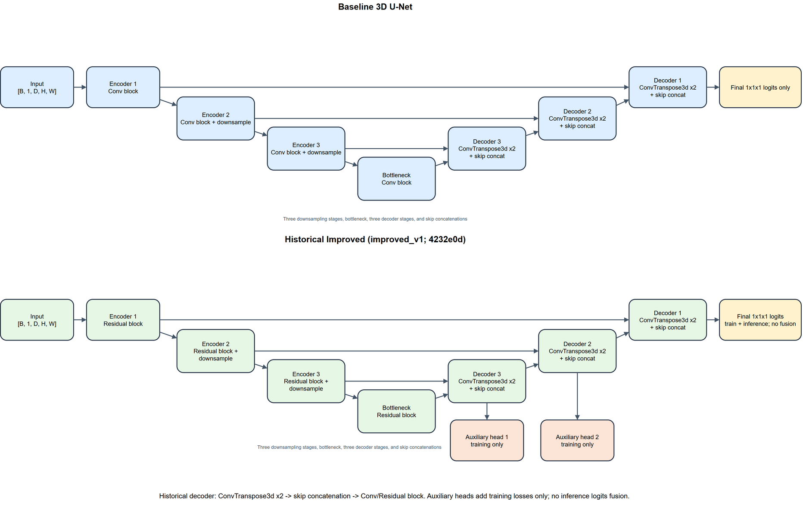
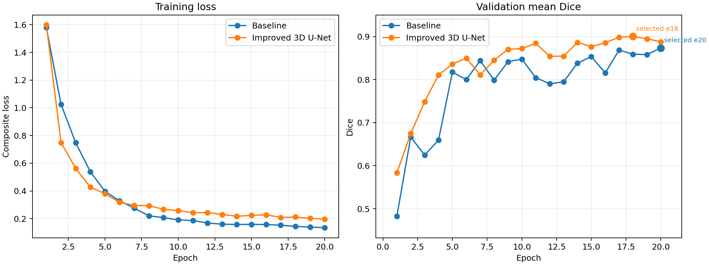
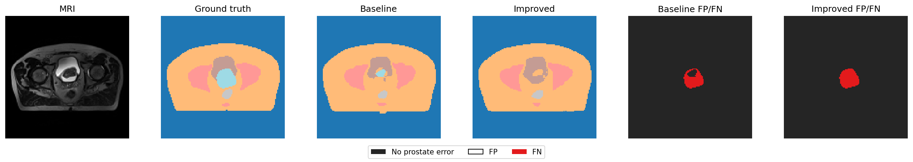
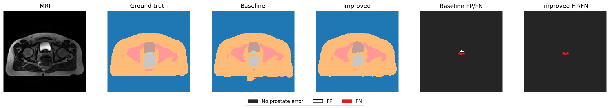
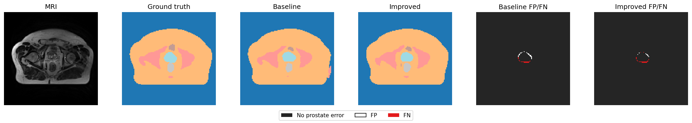
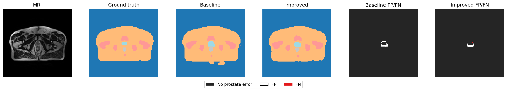
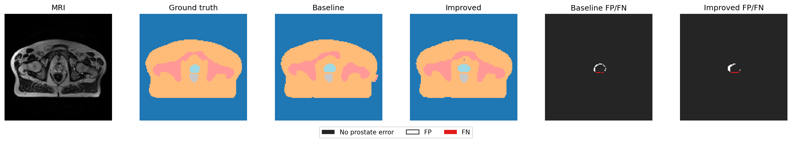
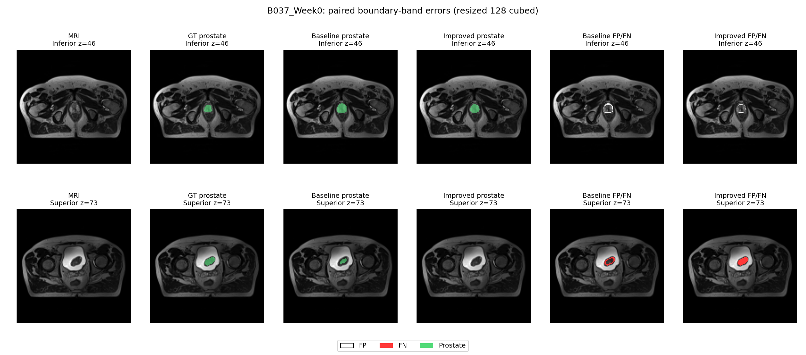

# HipMRI 3D U-Net Segmentation

**COMP3710 Hard Option | Student s4910970**

## 1. Project Overview

This project implements and evaluates two three-dimensional U-Net architectures for six-class pelvic MRI segmentation using the CSIRO HipMRI dataset. The **Baseline** model uses standard double-convolution blocks, while the **Improved** model introduces residual convolution blocks and training-only deep supervision.

Both models were trained and evaluated under a matched experimental protocol using a patient-disjoint dataset split. On five held-out patients, Baseline achieved a patient-mean prostate Dice of **0.811548**, while Improved achieved **0.813587**. Both models exceeded the Hard-option target of `0.70`.

The project includes dataset auditing, full-volume 3D training and inference, validation-based checkpoint selection, quantitative evaluation, computational resource measurement, paired visual comparisons and error analysis. These components establish that both architectures were successfully implemented and tested. The small difference between their final scores is treated as an experimental result rather than evidence that Improved is consistently superior.



## 2. Objectives and Feasibility Review

### 2.1 Project objective and scope

The objective is to implement, train and evaluate an Improved 3D U-Net for multi-class pelvic MRI segmentation. The project focuses on dataset preprocessing, patient-independent evaluation, three-dimensional network design, training optimisation, segmentation accuracy and computational efficiency.

A standard 3D U-Net provides the reference model for measuring the effect of residual blocks and auxiliary supervision. The central engineering question is:

> How do residual blocks and deep supervision affect segmentation accuracy, boundary errors and computational efficiency compared with a standard 3D U-Net under matched training and evaluation conditions?

The HipMRI data provide a practical volumetric segmentation task. The implementation is a course research prototype and its outputs are evaluated as model predictions rather than as autonomous clinical decisions.

### 2.2 Acceptance criteria

The project uses five testable criteria:

1. Training, validation and test partitions contain no shared patients.
2. Every MRI-mask pair passes pairing, shape, affine, finite-value and integer-label checks.
3. Held-out patient-mean prostate Dice reaches at least `0.70`, with per-class Dice and IoU also reported.
4. Parameter count, peak GPU memory, training time and inference time are recorded under a matched protocol.
5. Three to five held-out cases are reviewed using MRI, ground truth, prediction, false-positive and false-negative views.

### 2.3 Feasibility evidence

The midpoint feasibility review documented dataset integrity checks, preliminary 3D implementation tests, computational planning and the proposed evaluation protocol. It identified GPU memory usage, data integrity, training stability and reproducibility as the main engineering risks. These risks were addressed through dataset auditing, preliminary tests, controlled training configurations and final experiments on the Rangpur A100 GPU cluster.

The complete midpoint document and its supporting appendices are provided in the [HipMRI Feasibility Review v5](assets/HipMRI_Feasibility_Review_v5.pdf). The review records the project plan at midpoint; the final results reported below were produced later by the matched formal experiments.

## 3. Dataset and Preprocessing

The project uses the CSIRO collection [*Labelled weekly MR images of the male pelvis*](https://data.csiro.au/collection/csiro%3A51392), DOI [10.25919/45T8-P065](https://doi.org/10.25919/45T8-P065). The accompanying dataset documentation identifies label `5` as **Prostate**. Raw MRI data are not redistributed with this repository.

Place the separately obtained dataset under:

```text
data/HipMRI_Study_open/
|-- semantic_MRs/
`-- semantic_labels_only/
```

The loader pairs `_LFOV` MRI volumes with their `_SEMANTIC` masks. A deterministic seed of `42` assigns every weekly scan from the same patient to one partition:

| Partition | Patients | Scans |
| --- | ---: | ---: |
| Training | 27 | 146 |
| Validation | 6 | 46 |
| Test | 5 | 19 |
| **Total** | **38** | **211** |

This patient-disjoint `27/6/5` split prevents repeated anatomy from the same patient appearing in both model development and held-out evaluation. The frozen manifest has SHA-256:

```text
5457a611c5611f944a26d214a1f325b803dded66f70df5fda3fd009642751a07
```

MRI intensities are z-score normalised. Images use trilinear resizing and masks use nearest-neighbour resizing to `128 x 128 x 128`. Training uses `96 x 96 x 96` crops with a `0.5` probability of selecting a prostate-containing crop. Validation and test use deterministic resized volumes so that both model arms are evaluated on identical inputs.

## 4. Model Architecture

Both networks use three encoder stages, skip connections, channel widths `16/32/64/128` and six-class output logits. Their principal architectural differences are shown below.

| Component | Baseline 3D U-Net | Improved 3D U-Net |
| --- | --- | --- |
| Main feature block | Double convolution | Residual convolution |
| Skip connections | Encoder-to-decoder | Encoder-to-decoder |
| Decoder supervision | Final output | Final output plus two auxiliary heads |
| Auxiliary heads during inference | Not applicable | Disabled; final head only |
| Output classes | 6 | 6 |

### 4.1 Baseline

Baseline uses a conventional 3D encoder-decoder structure. Each level applies double-convolution blocks, the encoder reduces spatial resolution while increasing channel capacity, and the decoder combines upsampled features with matching encoder features through skip connections.

### 4.2 Improved

Improved replaces the main double-convolution blocks with residual blocks. The residual connection supplies a direct feature route through each block and is intended to support optimisation in the deeper three-dimensional network. Two auxiliary prediction heads are attached to intermediate decoder levels during training. Their losses encourage useful segmentation features at multiple resolutions, but the auxiliary heads are not used during inference.

### 4.3 Training objective

Both models use the same combination of weighted cross entropy and soft Dice loss. The prostate class has weight `4`, while each other class has weight `1`. Each Improved auxiliary head contributes `0.25` times the same objective during training. Prostate-containing crop sampling helps expose the network to the comparatively small prostate target.

The design is inspired by Çiçek et al. and Isensee et al. It is a compact course implementation and does not claim to reproduce either complete research system.

## 5. Environment and Repository Structure

### 5.1 Repository contents

| File | Responsibility |
| --- | --- |
| `modules.py` | Baseline and Improved PyTorch model components |
| `dataset.py` | MRI-mask loading, preprocessing, crop sampling and split access |
| `train.py` | Training, validation, checkpoint selection and experiment summaries |
| `predict.py` | Checkpoint loading, full-volume inference, metrics and visual comparison panels |
| `audit.py` | Deterministic data audit and patient-disjoint manifest generation |
| `plot_training.py` | Training-history visualisation |
| `requirements.txt` | Exact locally verified direct dependencies |

Generated manifests, checkpoints, raw data and prediction outputs are excluded from version control.

### 5.2 Software and hardware

The locally verified Python 3.11 environment uses:

| Dependency | Version |
| --- | ---: |
| PyTorch | 2.11.0 |
| NumPy | 2.4.2 |
| NiBabel | 5.4.2 |
| Matplotlib | 3.10.8 |
| pytest | 9.1.1 |

Formal jobs `701809` and `701810` used Python `3.11.15`, PyTorch `2.13.0+cu130`, CUDA `13.0` and an NVIDIA A100-PCIE-40GB GPU. Exact bitwise equivalence across different PyTorch, CUDA and driver versions is not claimed.

Create and activate a virtual environment:

```bash
python -m venv .venv
```

Use `source .venv/bin/activate` on Linux or Rangpur, or `.venv\Scripts\Activate.ps1` in Windows PowerShell. Install the declared dependencies with:

```bash
python -m pip install --upgrade pip
python -m pip install -r requirements.txt
```

## 6. Training and Reproduction

Run the following commands from the directory containing this README. Each model must use the same audited manifest, and held-out test scores must not be used for checkpoint or hyperparameter selection.

### 6.1 Audit the dataset

```bash
python audit.py data/HipMRI_Study_open \
  --output artifacts/dataset_manifest.json \
  --seed 42
```

The audit verifies MRI-mask pairing, shapes, affine consistency, finite values, integer labels and patient separation. Both model arms must use the same unchanged output manifest.

### 6.2 Train Baseline

```bash
python train.py \
  --manifest artifacts/dataset_manifest.json \
  --data-root data/HipMRI_Study_open \
  --output-dir artifacts/reproduced_baseline \
  --model baseline \
  --epochs 20 \
  --batch-size 1 \
  --learning-rate 0.001 \
  --base-channels 16 \
  --target-shape 128 128 128 \
  --train-patch-shape 96 96 96 \
  --foreground-patch-probability 0.5 \
  --seed 42 \
  --device cuda \
  --prostate-label 5 \
  --prostate-label-source "CSIRO DOI 10.25919/45T8-P065, BriefDataDescription.txt: 5=Prostate" \
  --prostate-ce-weight 4 \
  --prostate-dice-weight 4 \
  --selection-metric mean_dice \
  --scheduler none
```

### 6.3 Train Improved

Train Improved with the same manifest and shared settings, a separate output directory, and the following model selection:

```text
--model improved --architecture-version improved_v1
```

The best checkpoint for each arm is selected from validation performance. The held-out test set is reserved for final evaluation.

### 6.4 Evaluate a validation-selected checkpoint

```bash
python predict.py \
  --checkpoint artifacts/reproduced_baseline/best.pt \
  --manifest artifacts/dataset_manifest.json \
  --data-root data/HipMRI_Study_open \
  --output-dir artifacts/reproduced_baseline_test \
  --patch-size 128 128 128 \
  --stride 64 64 64 \
  --device cuda
```

Use a new empty output directory for every evaluation. `predict.py` checks checkpoint and manifest metadata, reconstructs complete volumes using overlap-averaged logits, reports quantitative metrics and writes visual comparison panels.

## 7. Experimental Setup and Results

### 7.1 Matched experimental protocol

The formal comparison was designed to isolate the network architecture as the principal experimental variable. Baseline and Improved used:

- the same patient-disjoint `27/6/5` manifest;
- the same preprocessing and target geometry;
- the same random seed, batch size and 20-epoch budget;
- the same optimiser configuration and class-weighted objective;
- validation-only checkpoint selection; and
- the same full-volume inference procedure and evaluation metrics.

Improved differs through its residual blocks and two auxiliary training heads. Since auxiliary losses contribute to its recorded training objective, raw total loss values are not directly comparable between the two architectures.

The final-code experiment used the exact Python sources included in this submission. Their SHA-256 hashes match the source records retained with Rangpur jobs `701809` (Baseline) and `701810` (Improved). Both jobs completed with Slurm state `COMPLETED` and exit code `0:0`. Baseline epoch 20 and Improved epoch 18 were selected using validation mean Dice before held-out evaluation.



### 7.2 Primary patient-level result

The primary metric calculates prostate Dice for each weekly scan, averages the scans belonging to each patient, and then gives the five held-out patients equal weight.

| Test patient | Baseline | Improved | Difference |
| --- | ---: | ---: | ---: |
| B037 | 0.736256 | 0.674195 | -0.062061 |
| H007 | 0.781378 | 0.839755 | +0.058377 |
| K042 | 0.887015 | 0.878500 | -0.008516 |
| L011 | 0.781136 | 0.795553 | +0.014417 |
| M013 | 0.871957 | 0.879931 | +0.007974 |
| **Mean** | **0.811548** | **0.813587** | **+0.002038** |

Both models exceed the target patient-mean prostate Dice of `0.70`. Improved is higher for three patients and lower for two. Its mean advantage is `0.002038`, showing comparable aggregate performance rather than a consistent patient-level improvement.

### 7.3 Per-class segmentation metrics

The following Dice and IoU values are averaged across the 19 held-out scans. Labels 1-5 reproduce `test_metrics.json`. Background was independently recomputed from the saved prediction tensors using the same per-scan averaging rule and is listed separately because its much larger volume can obscure errors in anatomical classes.

| Class | Baseline Dice | Baseline IoU | Improved Dice | Improved IoU |
| --- | ---: | ---: | ---: | ---: |
| Background | 0.982804 | 0.966255 | 0.994107 | 0.988292 |
| Body | 0.958148 | 0.919909 | 0.977807 | 0.956600 |
| Bones | 0.859094 | 0.753894 | 0.904555 | 0.825973 |
| Bladder | 0.957028 | 0.917811 | 0.960610 | 0.924386 |
| Rectum | 0.852767 | 0.747437 | 0.861629 | 0.758714 |
| Prostate | 0.822599 | 0.702348 | 0.831385 | 0.715546 |

Improved records higher scan-mean Dice and IoU for every reported class in this table. This class-level result is compatible with the small patient-mean improvement, but it does not remove the patient-specific variation shown above because the two tables use different aggregation units.

### 7.4 Computational cost

Training and inference memory are peak allocated GPU memory. Training time comes from `training_summary.json`. Inference time is cumulative model-execution time per preprocessed held-out patient rather than end-to-end data-loading or workflow time.

| Model | Parameters | Peak train VRAM | Peak inference VRAM | Training time | Mean inference time per patient |
| --- | ---: | ---: | ---: | ---: | ---: |
| Baseline | 1,400,646 | 977.6 MiB | 1,047.4 MiB | 1,369.1 s | 0.248920 s |
| Improved | 1,423,106 | 1,193.4 MiB | 1,047.5 MiB | 1,388.2 s | 0.249449 s |

Improved adds 22,460 parameters and uses approximately 22% more peak training memory. The observed training duration differs by 19.1 seconds, and the recorded inference times are nearly equal. The principal measured resource trade-off is therefore the additional training memory rather than inference latency.

## 8. Error Analysis and Visual Comparison

Five paired cases were selected, one per held-out patient, using whole-volume prostate false-positive plus false-negative error. These cases illustrate a consistent precision-recall trade-off: Improved reduces false-positive voxels in all five examples but increases false-negative voxels in all five. Its predictions are generally more compact, while Baseline preserves more foreground coverage in these examples.

| Case | Baseline FP / FN | Improved FP / FN | Observed comparison |
| --- | ---: | ---: | --- |
| B037 Week0 | 393 / 2,495 | 166 / 3,123 | Lower FP count with 628 additional missed prostate voxels |
| L011 Week2 | 894 / 68 | 738 / 159 | Reduced outward extension with lower foreground coverage |
| K042 Week0 | 432 / 439 | 208 / 673 | More compact prediction with additional reference tissue omitted |
| M013 Week0 | 581 / 85 | 407 / 171 | Lower total FP+FN error with a moderate FN increase |
| H007 Week0 | 432 / 155 | 121 / 245 | Large FP reduction accompanied by lower recall |











The geometric boundary analysis provides a closer view of B037 Week0. Within the superior band defined from the end of the reference-positive axial extent, Improved records Dice `0.000000` and misses all `431/431` reference prostate voxels.



These bands are reproducible geometric regions, not clinician-annotated anatomical apex or base landmarks. Across the 19 held-out scans, Baseline produces multiple prostate components in `6/19` scans, while Improved produces one component in every scan. This shows that Improved generates more connected outputs in this experiment, although connectivity alone does not guarantee complete anatomical coverage. No component filtering was applied to either model.

The paired cases complement the aggregate metrics by showing how the architectural change alters segmentation behaviour. Improved suppresses more isolated or outward predictions, but in these selected cases that reduction is accompanied by additional missed prostate tissue.

## 9. Conclusion and Future Work

### 9.1 Requirement outcome

| Criterion | Final evidence | Outcome |
| --- | --- | --- |
| Patient independence | Frozen `27/6/5` patient split; regenerated manifest matched the recorded SHA-256 | Met |
| Valid paired data | 211 pairs passed pairing, shape, affine, finite-value and integer-label checks | Met |
| Prostate Dice at least 0.70 | Baseline `0.811548`; Improved `0.813587` | Met |
| Resource measurement | Parameters, training/inference VRAM, training time and inference time recorded | Met |
| Review 3-5 held-out cases | Five paired MRI, reference, prediction and FP/FN comparisons | Met |

Both Baseline and Improved were successfully implemented, trained and evaluated, and both exceeded the target prostate Dice of `0.70`. Improved achieved a slightly higher patient-mean Dice (`0.813587` versus `0.811548`), demonstrating that the residual and deep-supervised architecture is competitive under the matched protocol.

The mean improvement is small and varies across patients, while peak training memory increases by approximately 22%. Baseline is therefore retained as the preferred reference model for this experiment because it has lower training resource requirements and avoids the largest observed patient regression. This engineering recommendation does not change the implementation outcome: Improved met the quantitative target and produced higher mean results at both the patient and per-class scan aggregation levels.

The evaluation contains five held-out patients and uses one random seed. The measured difference should therefore be interpreted as specific to this experimental setting rather than evidence of consistent superiority across training runs or datasets. Future work could evaluate additional predeclared seeds, alternative loss functions, higher-resolution inputs and boundary-focused metrics such as HD95. Model selection should continue to use validation data only, followed by one uniform evaluation on a frozen held-out cohort.

## 10. References and AI Disclosure

### 10.1 References

1. Çiçek et al., [3D U-Net: Learning Dense Volumetric Segmentation from Sparse Annotation](https://arxiv.org/abs/1606.06650), 2016.
2. Isensee et al., [Brain Tumor Segmentation and Radiomics Survival Prediction: Contribution to the BRATS 2017 Challenge](https://arxiv.org/abs/1802.10508), 2018. Architectural inspiration only.
3. CSIRO, [Labelled weekly MR images of the male pelvis](https://data.csiro.au/collection/csiro%3A51392), DOI [10.25919/45T8-P065](https://doi.org/10.25919/45T8-P065).

### 10.2 Artificial Intelligence Usage Disclosure

OpenAI ChatGPT and Codex were used for general technical guidance, project and file organisation, drafting and debugging selected test files, preparing SLURM job scripts, and refining README documentation. AI-assisted code and suggestions were reviewed and adjusted, with relevant functionality checked through local tests or GPU job outputs. Responsibility for the final implementation, experimental results and submitted work remains with the author.
