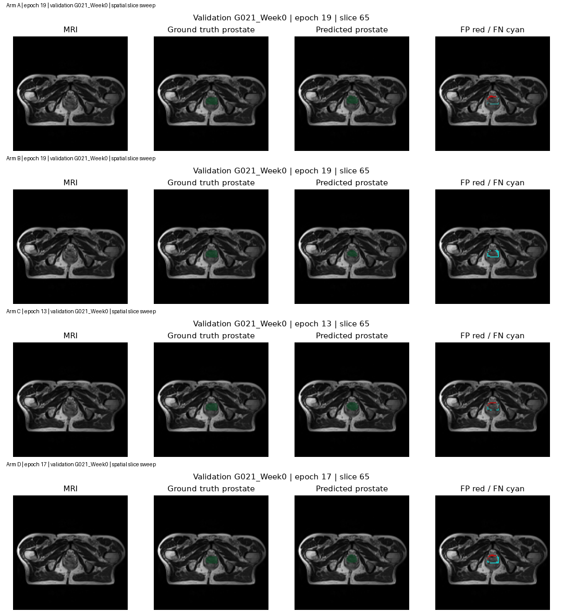
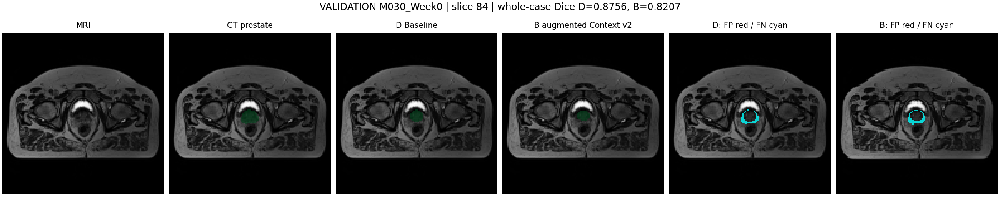
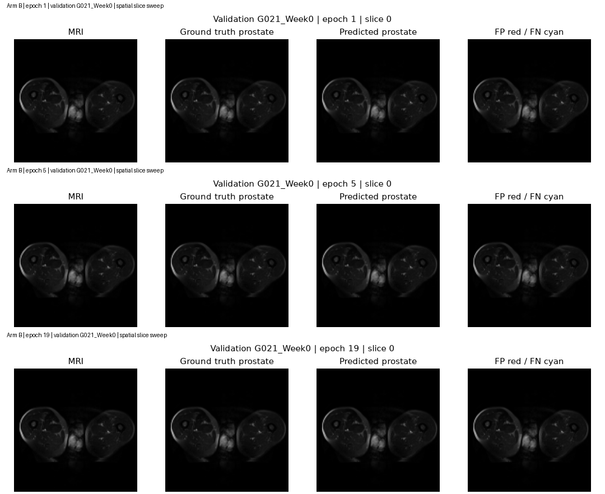
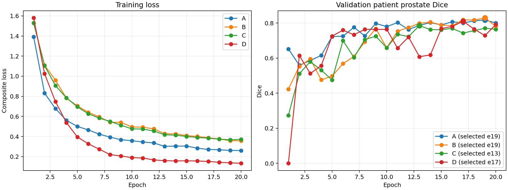
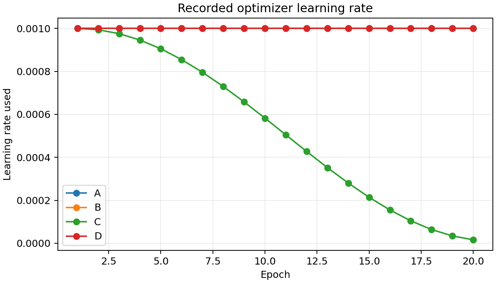
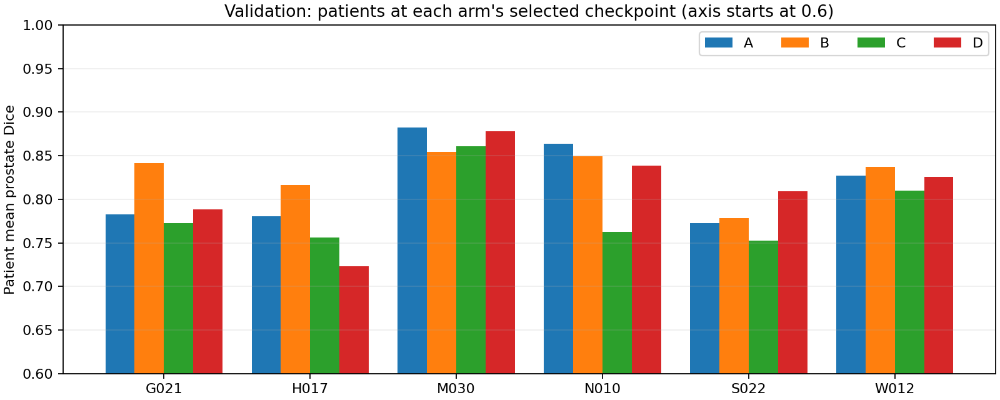

# Context v2 A/B/C/D validation ablation — 25 October 2026

**B (Improved Context v2 with training augmentation and fixed learning rate) ranks first on validation mean patient prostate Dice, but fails the predeclared training-memory gate. No arm is eligible for test review under the current rules, and this experiment supplies no new held-out test conclusion.**

## Evidence and matched protocol

This record describes Rangpur job `692354`. The retained `runs/validation_report.md` and `runs/validation_comparison.json` are the numerical sources. Raw artifacts remain in the local, Git-ignored artifact tree; these are local source paths within `artifacts/2026-10-25/692354_context_v2_ablation/context_v2_ablation_692354/`, not clone-accessible links.

| Arm | Model | Training augmentation | Learning-rate schedule | Controlled contrast |
| --- | --- | --- | --- | --- |
| A | Improved Context v2 | Off | Fixed 0.001 | Architecture versus D |
| B | Improved Context v2 | On | Fixed 0.001 | Augmentation versus A |
| C | Improved Context v2 | On | Cosine, minimum 0.00001 | Scheduler versus B |
| D | Baseline | Off | Fixed 0.001 | Matched baseline |

All arms share manifest SHA-256 `5457a611c5611f944a26d214a1f325b803dded66f70df5fda3fd009642751a07`, seed 42, 20 epochs, 16 base channels, batch size 1, `128 x 128 x 128` target, `96 x 96 x 96` training crop, foreground sampling probability 0.5, prostate label 5, prostate CE/Dice weights 4/4, and validation mean patient prostate Dice checkpoint selection. Validation covers six patients. Augmentation is disabled for validation/test. The contrasts isolate the declared configuration changes within this split and seed; A versus D compares an architecture package, not individual architectural components.

## Validation results and resources

The metric below is the arithmetic mean of patient prostate Dice, not the all-class `validation_mean_dice` field. FN and FP are aggregate validation prostate voxel counts. Validation seconds refer to the selected epoch's full validation pass, not per-patient test inference latency.

| Arm | Selected epoch | Mean patient prostate Dice | Worst patient Dice | FN | FP | Parameters | Peak training MiB | Total training seconds | Validation seconds |
| --- | --- | --- | --- | --- | --- | --- | --- | --- | --- |
| B | 19 | 0.829472 | 0.778456 | 13,159 | 17,733 | 1,628,996 | 1,455.8 | 1,441.3 | 21.19 |
| A | 19 | 0.818156 | 0.772367 | 11,227 | 21,313 | 1,628,996 | 1,455.8 | 1,442.8 | 21.26 |
| D | 17 | 0.810463 | 0.722912 | 13,804 | 19,624 | 1,400,646 | 979.6 | 1,386.9 | 21.46 |
| C | 13 | 0.785744 | 0.752366 | 16,720 | 25,065 | 1,628,996 | 1,455.8 | 1,442.6 | 21.16 |

| Contrast | Mean Dice difference | Worst-patient Dice difference | Interpretation within this experiment |
| --- | --- | --- | --- |
| A minus D | +0.007693 | +0.049456 | Architecture package improves observed validation scores, but misses the +0.01 mean-gain gate |
| B minus A | +0.011316 | +0.006088 | Augmentation is associated with the main additional mean-Dice gain |
| C minus B | -0.043727 | -0.026090 | This cosine configuration underperforms fixed LR within the 20-epoch budget |
| B minus D | +0.019009 | +0.055544 | Highest observed mean and cohort minimum, subject to the failed memory gate |

B improves mean Dice by approximately 2.35% relative to D and the cohort minimum by 7.68%. Aggregate FN falls by 645 (4.67%) and FP by 1,891 (9.64%). Against A, B increases FN by 1,932 but reduces FP by 3,580: total FN plus FP falls by 1,648. These voxel totals help explain the error trade-off; they are not interchangeable with the patient-averaged Dice metric.

The cohort minimum is not a matched-patient improvement: D's worst patient is H017, whereas B's is S022. B improves four of six patient Dice scores versus D; M030 and S022 decline. Therefore, neither universal patient benefit nor reduced variance is established. One seed and one small validation split do not establish statistical significance or generalization.

C has higher FN and FP than B and lower mean and minimum Dice. Retain it as a negative ablation result and do not promote this configuration. The result does not establish that cosine schedules generally fail; alternative schedules or longer budgets require a separately specified experiment.

## Resource screening and decision

The predeclared engineering rules require mean Dice gain at least 0.01, worst-patient drop no greater than 0.02, FN ratio no greater than 1.10, peak training-memory ratio no greater than 1.35, and validation-time ratio no greater than 2.0, all against D. These are project screening criteria, not course requirements, statistical tests or clinical assurance.

| Arm | Mean gain | Worst patient | FN ratio | Training memory | Validation time | Eligible for test review |
| --- | --- | --- | --- | --- | --- | --- |
| A | Fail | Pass | Pass | Fail | Pass | False |
| B | Pass | Pass | Pass | Fail | Pass | False |
| C | Fail | Pass | Fail | Fail | Pass | False |

B uses 1,455.8 MiB versus D's 979.6 MiB: **1.486 times baseline (+48.6%)**, exceeding the 1.35 limit. Its parameter count is 16.3% higher and total training duration approximately 3.9% longer; selected-epoch validation time is similar (21.19 versus 21.46 seconds). Accuracy and memory must both pass; higher validation Dice does not override the failed resource criterion. The JSON records `eligible_for_test_review=false` and `automatic_test_permitted=false` for A, B and C.

Record B as the validation-first candidate requiring explicit resource review, retain A as the architecture control, retain C as a negative scheduler result, and retain D as the lower-memory comparator. Any later revision of the memory budget must be documented as a post-result policy change, with its rationale; it cannot be represented as passing the original gate. No new held-out evaluation is authorized by this documentation update.

Before any separately authorized test, review validation failure panels, freeze the checkpoint and complete configuration, and preserve the evaluation protocol. B's selected checkpoint is epoch 19 with SHA-256 `477244b5009d1b941af9f2e94ed8dbc67ac369771227faafd780eeb7fceb46fc`. Do not switch arms or epochs after inspecting test scores. The existing held-out cohort has already been viewed in historical experiments; a later reuse would not be an independent blind test.

## Compact validation visual evidence

This record retains static comparisons, 12 original validation GIFs, two synchronized composites, curves and a local HTML gallery from this project's own outputs. No reference-project GIF, plot or result is copied. Raw training histories/checkpoints remain local evidence; distributed animation frames sweep spatial slices rather than training epochs.



The four arms show the same sampled slice of `G021_Week0`, chosen by the manifest's lexicographic patient/case rule. Selected epochs differ (A/B 19, C 13, D 17). Red denotes prostate FP and cyan FN. A single selected image cannot establish overall superiority, and the resampled geometry does not establish anatomical base/apex or physical-distance accuracy. The complete archived curves record coincident LR 0.001 for A/B/D and C's cosine schedule; its scheduler steps after the epoch, so the final trained epoch uses LR above `eta_min`. Cross-architecture composite training losses include different supervision/augmentation and cannot rank model quality.

## Paired validation failure analysis: D versus B

The numerical diagnoses below preserve the full five-case review; only the representative M030 static panel is distributed. References to the other selected slices describe panels in the local pre-convergence archive.

Both frozen checkpoints were rerun on the same 46 validation scans only, without augmentation or test-image access. Local inference is diagnostic and does not replace the original A100 selection metrics or resource measurements. A/B/C/D histories and original checkpoints remain unchanged. Full voxel counts and the selection rule are retained in `docs/assets/context_v2_ablation_692354/paired_validation_diagnostics.json` in the local pre-convergence archive.

Case selection is deterministic: rank all cases by the mean of B and D's full-volume FP+FN counts, break ties by patient ID/case ID, and retain at most one case from each of five distinct patients. For each case, show the depth slice with the largest combined B/D prostate error inside the reference prostate extent. This count-based rule emphasizes larger-volume errors; it is not a ranking by worst normalized Dice and does not represent the distribution of all cases. It can select a scan that declines even when its patient's average improves. Each figure uses the same MRI, reference, slice and color convention for both models.

| Validation scan | D case Dice | B case Dice | D FN / FP | B FN / FP |
| --- | --- | --- | --- | --- |
| N010_Week3 | 0.829248 | 0.805021 | 1076 / 589 | 1143 / 783 |
| S022_Week2 | 0.761155 | 0.747247 | 336 / 483 | 284 / 634 |
| W012_Week0 | 0.782081 | 0.813762 | 6 / 928 | 50 / 697 |
| G021_Week6 | 0.741214 | 0.788690 | 139 / 590 | 123 / 445 |
| M030_Week0 | 0.875641 | 0.820749 | 324 / 137 | 523 / 99 |

**N010_Week3 — local coverage does not guarantee whole-volume improvement.** B covers more of the reference on the displayed slice than D, yet its complete-volume FN increases from 1,076 to 1,143 and FP from 589 to 783, lowering case Dice from 0.829248 to 0.805021. This directly shows why one visually improved slice cannot establish whole-volume benefit. Review neighboring slices before interpreting the shape change; no specific anatomical or pathological cause is established.

**S022_Week2 — reduced omission with increased outward extension.** The displayed contour has adjacent FP and FN regions in both predictions. Across the volume, B reduces FN from 336 to 284 but increases FP from 483 to 634; Dice declines from 0.761155 to 0.747247. Investigate sensitivity to boundary placement and consistency across repeat scans. The observed trade-off does not prove a label error or a particular augmentation is responsible.

**W012_Week0 — outward error decreases but persists.** Both models extend beyond the reference on the selected slice. B reduces full-volume FP from 928 to 697, while FN rises from 6 to 50; case Dice improves from 0.782081 to 0.813762. Retain the gain while documenting the remaining outward contour discrepancy; a higher Dice does not establish accurate physical surface distances.

**G021_Week6 — partial improvement with residual boundary error.** B reduces both full-volume FN (139 to 123) and FP (590 to 445), raising case Dice from 0.741214 to 0.788690. The panel still contains an outward error region. This supports a narrower statement of reduced error on this scan, not complete correction or uniform benefit over the patient's other weeks.

**M030_Week0 — fewer outward voxels at the cost of substantially more omission.** B reduces FP from 137 to 99 but increases FN from 324 to 523; Dice falls from 0.875641 to 0.820749. The displayed cyan region is consistent with omitted reference contour. Prioritize this type of under-segmentation during any future review; a smaller or smoother prediction cannot be accepted solely for appearance.



Across all 46 locally reconstructed validation cases, the minimum case prostate Dice is 0.638079 for D and 0.698553 for B; none has an entirely absent predicted prostate. This excludes total volume-level omission in these validation predictions, but does not exclude missed individual slices or anatomical subregions and supplies no test-cohort assurance.

**Engineering recommendation after image review.** Retain B as the accuracy-leading validation candidate and D as the lower-memory comparator. The paired panels expose both gains and regressions, particularly omission in M030_Week0 and mixed boundary errors in S022_Week2; they do not justify autonomous contour acceptance. Do not promote C, revise epochs using test cases, or silently relax the memory gate. A follow-up experiment would need a separately documented resource budget and evaluation plan. These are five validation diagnoses, not a replacement for the historical held-out failure analysis required by the report.

## Retained animation gallery

The [local gallery](assets/context_v2_ablation_692354/gallery.html) contains all original validation animations and paired panels. All animations use fixed validation `G021_Week0`; each frame sweeps depth slices rather than advancing the training epoch. The GIFs show 26 sampled slices from the resampled volume. Raw training checkpoints and MRI are not redistributed.



[Compare the four selected checkpoints at synchronized slices](assets/context_v2_ablation_692354/best_ABCD.gif): A/B select epoch 19, C epoch 13 and D epoch 17. This compares validation-selected checkpoints, not equal training epochs.

| Arm | Epoch 1 | Epoch 5 | Selected checkpoint |
| --- | --- | --- | --- |
| A | [GIF](assets/context_v2_ablation_692354/A_validation_epoch_1.gif) | [GIF](assets/context_v2_ablation_692354/A_validation_epoch_5.gif) | [GIF](assets/context_v2_ablation_692354/A_validation_best_epoch.gif) |
| B | [GIF](assets/context_v2_ablation_692354/B_validation_epoch_1.gif) | [GIF](assets/context_v2_ablation_692354/B_validation_epoch_5.gif) | [GIF](assets/context_v2_ablation_692354/B_validation_best_epoch.gif) |
| C | [GIF](assets/context_v2_ablation_692354/C_validation_epoch_1.gif) | [GIF](assets/context_v2_ablation_692354/C_validation_epoch_5.gif) | [GIF](assets/context_v2_ablation_692354/C_validation_best_epoch.gif) |
| D | [GIF](assets/context_v2_ablation_692354/D_validation_epoch_1.gif) | [GIF](assets/context_v2_ablation_692354/D_validation_epoch_5.gif) | [GIF](assets/context_v2_ablation_692354/D_validation_best_epoch.gif) |







The [asset provenance](assets/context_v2_ablation_692354/asset_provenance.json) records original file hashes and frame counts. [Paired diagnostics](assets/context_v2_ablation_692354/paired_validation_diagnostics.json) retain the case-selection rule and voxel counts for the five-case analysis above. These are validation-only artifacts; no new held-out conclusion follows from their appearance.

## Reproduction and provenance

Publish the two retained static panels from an existing local presentation archive with:

```bash
python scripts/publish_context_validation_assets.py --publish-compact --output local/context_v2_ablation_692354
```

Compact mode copies only the two PNG files and does not load MRI data or checkpoints. Full regeneration is a separate explicit command (`python scripts/publish_context_validation_assets.py --output local/context_v2_ablation_692354` without `--publish-compact`), which requires the ignored raw histories, frozen checkpoints and source MRI and may reconstruct validation predictions. Its default full-output directory is ignored `local/`; neither mode trains or launches held-out evaluation. A fresh clone supplies the reviewed images, GIFs and gallery, but not the local raw checkpoints or MRI package. The original publication verified epoch/configuration identity, manifest hashes and validation access.

The complete pre-convergence presentation set is preserved in local `local/project-convergence-20261025/before_convergence.zip`, verified during the convergence backup step. Original numerical sources remain in local `artifacts/2026-10-25/692354_context_v2_ablation/context_v2_ablation_692354/runs/`. The archive's `docs/assets/context_v2_ablation_692354/asset_provenance.json` records source SHA-256 values, checkpoint identities, GIF frame counts and diagnostic device; `paired_validation_diagnostics.json` records all 46 validation reconstructions and five-case selection. The reviewed GIFs, HTML gallery, curves, provenance and paired panels are retained in the repository and the course export under an exact asset whitelist, following the author's request to preserve animation display. These local paths describe provenance and do not imply that a submission package contains raw artifacts.

## Artifact and accounting limits

The original local synchronized run package contained 54 files, including four checkpoints, complete histories, configuration and learning-rate records, curves, epoch-1/epoch-5/best-epoch validation GIFs, manifest and environment records. No new `test_metrics.json`, test predictions or test failure panels were found in this package. A separate local validation-only B/D reconstruction and five-case paired image review have now been completed as documented above. They do not supply new held-out failure evidence.

The user reports final Rangpur `COMPLETED` status. The synchronized package does not contain an independently retained `sacct_final.txt`; archive the final `sacct -X` job-state and exit-code output for accounting evidence. Local histories and summaries support the numerical record but do not independently verify scheduler accounting. Historical formal and supplementary test conclusions remain unchanged.
