# 3D Improved U-Net for Pelvic MRI Segmentation

COMP3710 Pattern Recognition and Analysis · s4910970 · Hard difficulty

This project compares a Baseline 3D U-Net with a residual, deep-supervised Improved 3D U-Net for six-class pelvic MRI segmentation: Background, Body, Bones, Bladder, Rectum and Prostate. The dataset is CSIRO's [Labelled weekly MR images of the male pelvis](https://data.csiro.au/collection/csiro%3A51392), referred to as **HipMRI** in this project. The intended use is research on contour drafting with human review, not autonomous treatment planning.

**Main result.** Under the original matched held-out protocol, Baseline reached patient-mean prostate Dice **0.811548** and historical Improved reached **0.813587**, a difference of only **+0.002038**. Improved also reduced the worst patient's score by **0.062061**. The evidence therefore supports retaining Baseline as the conservative reference; it does not establish a reliable benefit from the added complexity.

## Dataset

1. Open the official [CSIRO collection page](https://data.csiro.au/collection/csiro%3A51392) or its persistent DOI [10.25919/45T8-P065](https://doi.org/10.25919/45T8-P065).
2. Review the collection's licence and data-use conditions before downloading. The repository does not redistribute the MRI files.
3. Extract the download beneath `data/HipMRI_Study_open` so the two full-volume directories appear exactly as follows:

```text
HipMRI_3D_UNet_s4910970/
└── data/
    └── HipMRI_Study_open/
        ├── semantic_MRs/
        │   ├── B006_Week0_LFOV.nii.gz
        │   └── ...
        ├── semantic_labels_only/
        │   ├── B006_Week0_SEMANTIC.nii.gz
        │   └── ...
        └── data_use_agreement.txt
```

The code recursively discovers `.nii` and `.nii.gz` files in those two directories. An MRI ending in `_LFOV` is paired with the mask ending in `_SEMANTIC` through their shared case key. Do not rename medical files. The CSIRO collection's `BriefDataDescription.txt` identifies label `5` as Prostate.

The frozen manifest used in the reported experiment contains 211 scans from 38 patients. Weekly scans are correlated, so splitting individual scans would allow patient-specific anatomy to appear in both training and evaluation. Patient separation reduces that leakage risk, although five test patients still provide limited coverage. Seed 42 assigns 27/6/5 patients and 146/46/19 scans to train/validation/test, with every weekly scan from one patient kept in one partition. Its SHA-256 is:

```text
5457a611c5611f944a26d214a1f325b803dded66f70df5fda3fd009642751a07
```

## 3D Improved U-Net

Both report models use channels 16/32/64/128, three downsampling stages and encoder skip connections. Baseline uses ordinary double-convolution blocks. The report's Improved model is `LegacyImprovedUNet3D` with architecture version `legacy_improved_v1`; it adds residual projections and two training-only auxiliary heads. Inference uses final logits only. The later `improved_context_v2` model is a separate validation experiment and its result is not substituted for the historical Improved test result.

MRI intensities are z-score normalized. Images are resized with trilinear interpolation and masks with nearest-neighbour interpolation. Training uses 96×96×96 crops with a 0.5 probability of choosing a prostate-containing crop. Validation and test use deterministic full resized volumes. Raw logits enter cross entropy; softmax is applied within soft Dice.

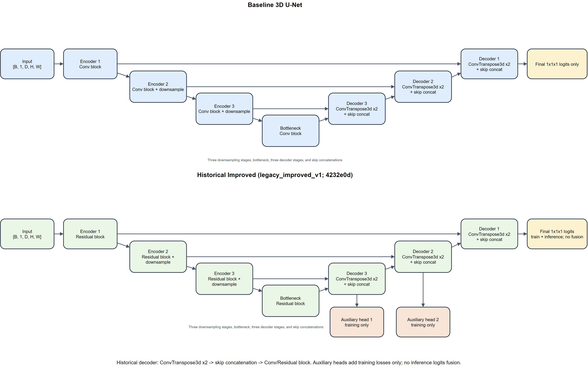

### Components and Comparison

The implementation is a compact residual, deep-supervised adaptation of 3D U-Net, rather than an exact reproduction of the complete Isensee training system. Input tensors have shape `[B,1,D,H,W]`, final logits `[B,6,D,H,W]`, and targets `[B,D,H,W]`. Integer targets enter cross entropy; soft Dice constructs one-hot targets inside the objective.

| Component            | Baseline                                               | Historical Improved                                        |
| -------------------- | ------------------------------------------------------ | ---------------------------------------------------------- |
| Feature block        | Two 3D convolutions, instance normalization, LeakyReLU | Same block with an identity or projected residual shortcut |
| Downsampling         | Max pooling                                            | Max pooling                                                |
| Decoder upsampling   | Transposed 3D convolution                              | Transposed 3D convolution                                  |
| Deep supervision     | None                                                   | Two decoder auxiliary heads during training                |
| Inference output     | Final head logits                                      | Final head logits                                          |
| Internal architecture identifier | `baseline_v1` | `legacy_improved_v1` |

### Modules and Forward Pass

The implementation in [modules.py](modules.py) separates feature extraction, reconstruction and supervision:

- **Convolution block (`ConvBlock3D`).** Two padded 3×3×3 convolutions each use instance normalization and LeakyReLU. This block is shared by the plain model and the residual block's main branch.
- **Residual block (`ResidualBlock3D`).** The main branch is added to an identity shortcut, or a 1×1×1 projection when channel counts differ, followed by LeakyReLU.
- **Encoder and bottleneck (`_UNet3D`).** Three encoder stages retain skip features at 16, 32 and 64 channels. Max pooling halves each spatial dimension before the next stage; the bottleneck uses 128 channels.
- **Decoder and final head (`_UNet3D`).** Transposed convolutions double spatial dimensions. Each result is concatenated with the corresponding encoder feature and refined by a decoder block. A 1×1×1 head produces six-class logits at input resolution.
- **Auxiliary heads (`LegacyImprovedUNet3D`).** Two 1×1×1 heads supervise intermediate decoder features during training. They are omitted from the evaluation output; historical Improved does not sum their logits into the final prediction.

These model components depend on PyTorch and do not use NumPy. For a 96³ training crop, encoder resolutions are 96³, 48³ and 24³, the bottleneck is 12³, and the decoder reconstructs 24³, 48³ and 96³. Argmax over the six final logits gives the predicted integer class at each voxel.

### Architecture Identifiers and Historical Evidence

`baseline_v1` and `legacy_improved_v1` are **project-defined compatibility identifiers**, not names assigned by the course specification, CSIRO or either paper. They distinguish which implementation must be constructed when a saved experiment is reproduced.

| Identifier | Definition in this submission | Evidence and loading behaviour |
| ---------- | ----------------------------- | ------------------------------ |
| `baseline_v1` | Plain `BaselineUNet3D`, without residual blocks or auxiliary heads | [train.py](train.py), `model_configuration()`, writes this identifier for new Baseline runs; [modules.py](modules.py), `build_model()`, accepts it or an absent historical field. The Baseline class itself does not declare an `architecture_version` attribute. |
| `legacy_improved_v1` | `LegacyImprovedUNet3D`, with residual blocks and training-only deep supervision | Declared on the class in [modules.py](modules.py). `build_model()` routes this identifier, or an absent version on a historical Improved config, to that class. |
| `improved_context_v2` | Current `ImprovedUNet3D`, with dropout, interpolation-convolution upsampling and fused decoder logits | Declared separately in [modules.py](modules.py); it is a different architecture and cannot inherit the historical held-out scores. |

The primary experiment used code revision `4232e0d91d8aa6cf8c1de38883b213c07cc62d10` (Baseline job `683675`, Improved job `683676`). At that revision the residual model was named `ImprovedUNet3D` and had no version identifier. The maintained `LegacyImprovedUNet3D` preserves its parameterized layers and forward computation; current input-size validation additionally rejects dimensions below 16. Thus `legacy_improved_v1` is a retrospective compatibility label, not a claim that the original run stored that string.

In the original project checkout, the historical definition can be inspected with:

```bash
git show 4232e0d91d8aa6cf8c1de38883b213c07cc62d10:src/modules.py
```

That command needs the original Git history and is not a prerequisite for running an exported course folder. The local evidence index is `docs/results_summary.json` in the original project root; it records the two jobs, source artifact paths, hashes, selected epochs and patient scores. Prediction uses `build_model()` and `load_state_dict(..., strict=True)` in [predict.py](predict.py). Version routing and strict loading guard architecture compatibility; the identifier alone does not establish a result's provenance.

The training objective is weighted cross entropy plus weighted soft Dice. In the main experiment, prostate has weight 4 in both terms and the remaining classes have weight 1. Each Improved auxiliary head adds 0.25 times the same objective, with nearest-neighbour downsampled labels. The later Context-v2 model introduces Dropout3D, interpolation-convolution upsampling and inference-time logit fusion; these features must not be attributed to the historical model's test results.

## Usage

### Dependencies and Environment

Run all commands from the directory containing this README, including after moving it into a course fork. Python 3.11 was used for implementation verification. A CUDA GPU is required for the declared full training configuration; CPU is suitable for tests and command inspection.

```bash
python -m venv .venv
source .venv/bin/activate  # Linux/macOS; Windows PowerShell: .venv\Scripts\Activate.ps1
python -m pip install --upgrade pip
python -m pip install torch==2.11.0 numpy==2.4.2 nibabel==5.4.2 matplotlib==3.10.8 Pillow==12.1.1
```

The dependency versions below were import-verified on 26 October 2026 in the local verification record; this README edit did not repeat that environment audit. For the verified CUDA build, install PyTorch using `python -m pip install torch==2.11.0+cu128 --index-url https://download.pytorch.org/whl/cu128`. Historical formal runs used PyTorch `2.13.0+cu130`, CUDA `13.0` and an A100-PCIE-40GB. The verification environment is not a complete reconstruction of that historical runtime; bitwise reproduction is not claimed.

| Dependency | Verified version (26 October 2026)     | Purpose                            |
| ---------- | -------------------------------------- | ---------------------------------- |
| PyTorch    | `2.11.0+cu128`                       | Models, optimization and inference |
| NumPy      | `2.4.2`                              | NIfTI arrays and visualisation     |
| nibabel    | `5.4.2`                              | NIfTI loading and spatial metadata |
| matplotlib | `3.10.8`                             | Curves and failure panels          |
| Pillow     | `12.1.1`, checked on 26 October 2026 | Optional validation GIFs           |

Pillow supports optional animation generation. No W&B account is required.

### Data Audit and Patient Separation

Generate the manifest from the downloaded data:

```bash
python audit.py data/HipMRI_Study_open --output artifacts/dataset_manifest.json --seed 42
```

The audit checks image-mask pairing and spatial metadata before recording patients and cases. For the same dataset release and directory contents, compare the generated manifest's SHA-256 with the reported value above. A mismatch requires inspection before claiming exact reproduction of the historical split. Use the same generated manifest for both model arms.

### Train and Monitor

The command below reproduces the declared Baseline configuration through the maintained interface:

```bash
python train.py \
  --manifest artifacts/dataset_manifest.json \
  --data-root data/HipMRI_Study_open \
  --output-dir artifacts/reproduced_baseline \
  --model baseline \
  --epochs 20 \
  --batch-size 1 \
  --learning-rate 0.001 \
  --base-channels 16 \
  --target-shape 128 128 128 \
  --train-patch-shape 96 96 96 \
  --foreground-patch-probability 0.5 \
  --seed 42 \
  --device cuda \
  --prostate-label 5 \
  --prostate-label-source "CSIRO DOI 10.25919/45T8-P065, BriefDataDescription.txt: 5=Prostate" \
  --prostate-ce-weight 4 \
  --prostate-dice-weight 4 \
  --selection-metric mean_dice \
  --scheduler none
```

For the historical Improved arm, use a different output directory and replace the model arguments with:

```text
--model improved --architecture-version legacy_improved_v1
```

Every new Improved run must state either `legacy_improved_v1` or `improved_context_v2`; the training CLI rejects an omitted version. Historical checkpoints that predate this field remain loadable as `legacy_improved_v1` only for compatibility, not as a default for new training.

Do not enable augmentation for this historical comparison. Both arms must use the same manifest, geometry, optimizer settings, seed, number of epochs and selection rule. At every completed epoch, training refreshes the loss/validation-Dice curve and recorded-learning-rate plot from the available history. This is epoch-level monitoring. Training writes `experiment_config.json`, `history.json`, `training_summary.json`, validation-selected `best.pt` and `training_curves.png` beneath the chosen output directory.

These commands reproduce the stored configuration through the current code. They do not guarantee bitwise identity with the historical GPU runtime.

### Prediction and Held-out Evaluation

Evaluate a validation-selected checkpoint once with overlap-averaged full-volume inference:

```bash
python predict.py \
  --checkpoint artifacts/reproduced_baseline/best.pt \
  --manifest artifacts/dataset_manifest.json \
  --data-root data/HipMRI_Study_open \
  --output-dir artifacts/reproduced_baseline_test \
  --patch-size 128 128 128 \
  --stride 64 64 64 \
  --device cuda
```

Prediction verifies the manifest hash and architecture metadata stored in the checkpoint. It writes `test_metrics.json`, per-case prediction tensors and failure panels. Each panel selects the axial, coronal and sagittal slice with the largest prostate-specific FP+FN count; if a case has no prostate error, it selects the centre of the reference prostate extent. The JSON records the selected case, slice indices and rule. The test partition must not influence hyperparameters, checkpoint selection or acceptance thresholds. These five patients have been evaluated by historical models and are not an untouched external cohort.

The sliding-window implementation averages overlapping logits and verifies complete voxel coverage. With the main `128³` target and `128³` patch, only one window is used per volume; this experiment does not demonstrate multi-window seam behaviour. The current single-model panel selector and the historical paired-case selector described below use different documented rules.

## Results

### Training

Main training used Adam, batch size 1, a constant learning rate of 0.001, 20 epochs and seed 42. Checkpoints were selected by the highest validation mean Dice: epoch 20 for Baseline and epoch 18 for Improved. This historical selection metric includes background; the later prostate-specific selection option represents a different protocol.

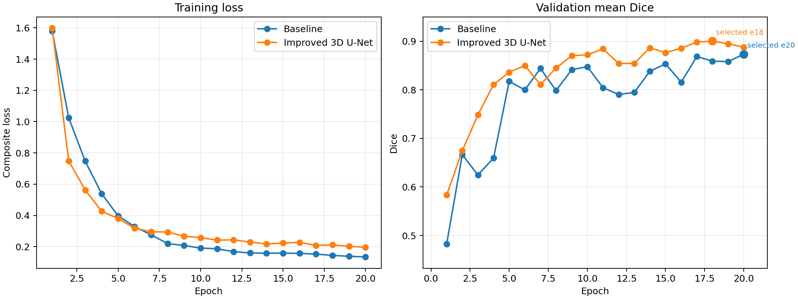

Improved's objective includes auxiliary losses, so loss magnitudes are not directly equivalent between arms. Similar training and validation curves alone do not prove the absence of overfitting.

### Held-out Segmentation

Both formal jobs completed with exit status `0:0` at code revision `4232e0d`. The following tables report the retained matched comparison.

| Foreground class | Baseline Dice | Improved Dice | Baseline IoU | Improved IoU |
| ---------------- | ------------: | ------------: | -----------: | -----------: |
| Body             |      0.958148 |      0.977807 |     0.919909 |     0.956600 |
| Bones            |      0.859094 |      0.904555 |     0.753894 |     0.825973 |
| Bladder          |      0.957028 |      0.960610 |     0.917811 |     0.924386 |
| Rectum           |      0.852767 |      0.861629 |     0.747437 |     0.758714 |
| Prostate         |      0.822599 |      0.831385 |     0.702348 |     0.715546 |

The table above averages available scan-level class metrics and excludes background. Dice is `2TP/(2TP+FP+FN)` and IoU is `TP/(TP+FP+FN)`; mutually absent classes have no defined score. The headline below first averages prostate Dice within each patient, then gives all five patients equal weight.

| Test patient   |           Baseline |           Improved |          Difference |
| -------------- | -----------------: | -----------------: | ------------------: |
| B037           |           0.736256 |           0.674195 |           -0.062061 |
| H007           |           0.781378 |           0.839755 |           +0.058377 |
| K042           |           0.887015 |           0.878500 |           -0.008516 |
| L011           |           0.781136 |           0.795553 |           +0.014417 |
| M013           |           0.871957 |           0.879931 |           +0.007974 |
| **Mean** | **0.811548** | **0.813587** | **+0.002038** |

| Resource measure                           |    Baseline |    Improved |
| ------------------------------------------ | ----------: | ----------: |
| Trainable parameters                       |   1,400,646 |   1,423,106 |
| Peak training allocated memory             |   977.6 MiB | 1,193.4 MiB |
| Peak inference allocated memory            | 1,047.4 MiB | 1,047.5 MiB |
| Recorded forward time per volume           |  0.060885 s |  0.064924 s |
| Mean cumulative inference time per patient |  0.231362 s |  0.246713 s |

Patient time sums inference over that patient's weekly scans, whereas the forward-time row is per volume. These timings do not establish end-to-end clinical workflow latency. The maintained evaluator synchronizes the GPU around model/sliding-window inference on preprocessed tensors. The timed call includes host-to-device transfer of the input. This timing excludes NIfTI reading, normalization/resizing, checkpoint loading, panel rendering and prediction serialization. No separate warm-up or repeated-run timing distribution is retained for the historical table. Peak allocated memory is reset and recorded separately for training and validation/inference in the maintained code. The historical numbers cannot establish process-wide or device-wide peaks. Allocated VRAM is not total GPU reservation. Improved increases peak training allocation by approximately 22%.

The `+0.002038` mean difference is below the project's predeclared `+0.01` meaningful-upgrade target. Improved helped three patients and regressed on two; B037 deteriorated materially. Five repeatedly inspected patients and one seed do not support statistical-significance or clinical-generalization claims.

### Failure Case Autopsy

Five cases were selected by the mean whole-volume prostate FP+FN across both arms. Each panel compares the same MRI, GT and slice for Baseline and Improved; the selected slice maximizes error within the GT prostate extent. Selection was deterministic, with patient ID and case ID resolving ties; the cases, indices and counts are reported below. White indicates prostate FP, red indicates prostate FN. Three cases are repeated scans of L011 and are not independent patients.

| Case       | Baseline FP / FN | Improved FP / FN | Failure and review implication                                                                                                                                                  |
| ---------- | ---------------: | ---------------: | ------------------------------------------------------------------------------------------------------------------------------------------------------------------------------- |
| B037 Week0 |      393 / 2,495 |      166 / 3,123 | Improved suppresses excess but omits substantially more reference prostate. The displayed slice shows severe under-segmentation; inspect missing interior and boundary regions. |
| L011 Week2 |         894 / 68 |        738 / 159 | Reduced outward extension trades off against more omission. Check excluded tissue as well as external contour excess.                                                           |
| L011 Week7 |         868 / 81 |        661 / 147 | Peripheral excess remains and Improved increases FN. Review the weekly sequence for contour inconsistency.                                                                      |
| K042 Week0 |        432 / 439 |        208 / 673 | Contour contraction reduces FP but loses additional reference tissue. A cleaner-looking outline need not be more accurate.                                                      |
| L011 Week0 |        803 / 109 |        579 / 170 | Persistent outward extension and the same FP/FN trade-off recur. Inspect every weekly scan rather than assuming stable contour quality.                                         |

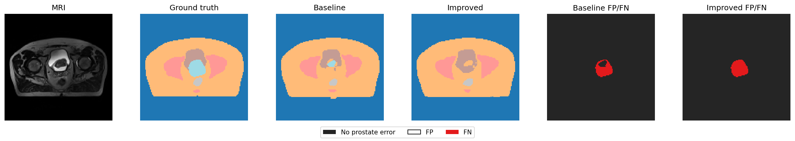

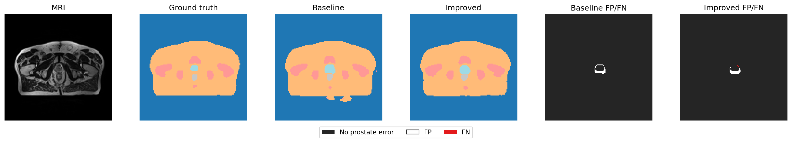

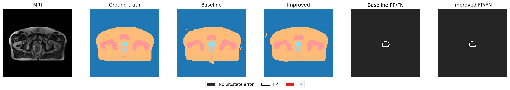

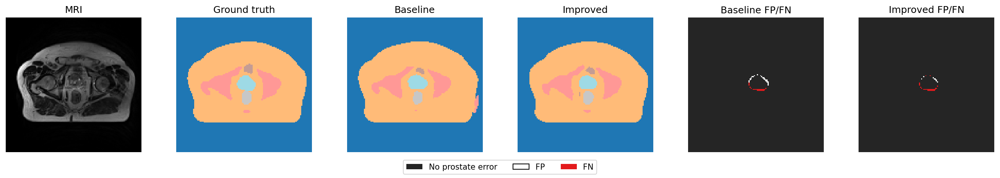

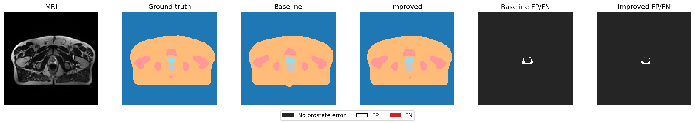

The counts are whole-volume measurements; each figure displays one selected slice. Low soft-tissue contrast, partial-volume effects and downsampling are plausible contributors, not experimentally isolated causes. Spatial checks on the source NIfTI affines confirm L/P/S axis codes for all five selected cases; tensor depth follows the superior direction after the loader transposes axes `(2,1,0)`. The table locates each displayed slice within the reference prostate extent in the resized tensor (zero-based indices). Position is `(slice - inferior)/(superior - inferior)`; it is a geometric fraction, not an anatomical landmark annotation.

| Case       | Inferior / superior GT slice | Displayed slice | Relative position |
| ---------- | ---------------------------: | --------------: | ----------------: |
| B037 Week0 |                      42 / 79 |              70 |             0.757 |
| L011 Week2 |                      62 / 88 |              70 |             0.308 |
| L011 Week7 |                      50 / 73 |              62 |             0.522 |
| K042 Week0 |                      51 / 82 |              72 |             0.677 |
| L011 Week0 |                      55 / 78 |              62 |             0.304 |

These checks establish that the selected panels mostly depict interior slices, so they cannot substantiate specific base/apex failure claims. At the inferior and superior ends, small reference cross-sections make one-slice omission disproportionately important; adjacent-slice area changes should therefore be reviewed separately from a worst-error interior panel. Clinical base/apex landmark verification and native-resolution boundary-distance measurements remain uncompleted. No base/apex label or millimetre accuracy is inferred from these fractions.

### Boundary Bands, Organ Leakage and Disconnected Predictions

A post-hoc audit on 26 October 2026 inspected all **19 retained paired test predictions** from the primary experiment, without rerunning either network or selecting a new model. [The analysis record](assets/boundary_analysis.json) contains source prediction SHA-256 hashes, per-case counts and the selection method. Source NIfTI affines identify increasing tensor depth as superior for all 19 cases.

For each reference prostate extent of `N` axial slices, the inferior and superior bands contain the first and last `ceil(0.20*N)` slices respectively. These are geometric end regions relevant to apex/base review, not clinician-annotated apex/base landmarks. Dice and FP/FN below are pooled **within each scan's specified band**, across the complete in-plane image; they are neither patient means nor native-resolution surface distances. The 20% definition was chosen for this retrospective diagnostic analysis and was not a predeclared model-selection rule.

| Case and region | Axial range | Baseline Dice | Improved Dice | Baseline FP / FN | Improved FP / FN | Observed failure and action |
| --------------- | ----------- | ------------: | ------------: | ---------------: | ---------------: | --------------------------- |
| B037 Week0 inferior | 42–49 | 0.828909 | 0.914716 | 222 / 10 | 77 / 25 | Improved reduces excess contour while slightly increasing omissions. Review both ends rather than inferring uniform benefit. |
| B037 Week0 superior | 72–79 | 0.541455 | 0.000000 | 0 / 271 | 0 / 431 | Improved misses the complete reference in this band: 431/431 prostate voxels. Reject this draft without correction of the superior extent. |
| L011 Week2 inferior | 62–67 | 0.567219 | 0.583012 | 235 / 0 | 213 / 3 | Excess contour remains larger than the 154-voxel reference. Inspect adjacent soft tissue and trim false-positive extent. |
| L011 Week2 superior | 83–88 | 0.723247 | 0.446429 | 18 / 57 | 19 / 105 | Improved recall falls from 0.632258 to 0.322581. Review superior termination slice by slice. |
| K042 Week0 inferior | 51–57 | 0.788462 | 0.689507 | 20 / 90 | 11 / 134 | Reduced excess accompanies more missing prostate; a visually cleaner draft is insufficient evidence of better coverage. |
| K042 Week0 superior | 76–82 | 0.845683 | 0.876404 | 171 / 56 | 122 / 54 | This region improves, while the inferior band regresses. Approval must consider both spatial ends. |

Each paired panel displays one inferior and one superior slice, chosen by the highest summed Baseline-plus-Improved FP+FN within that band; the larger slice index resolves ties. Green shows prostate, white FP and red FN. The tables aggregate entire bands, whereas images display selected slices.

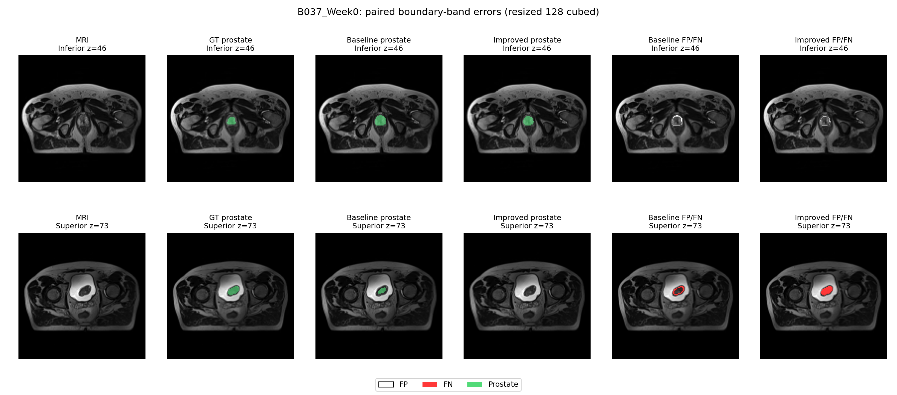

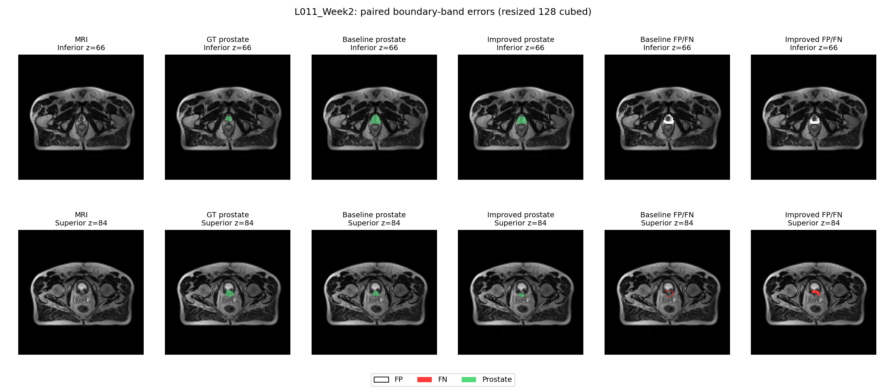

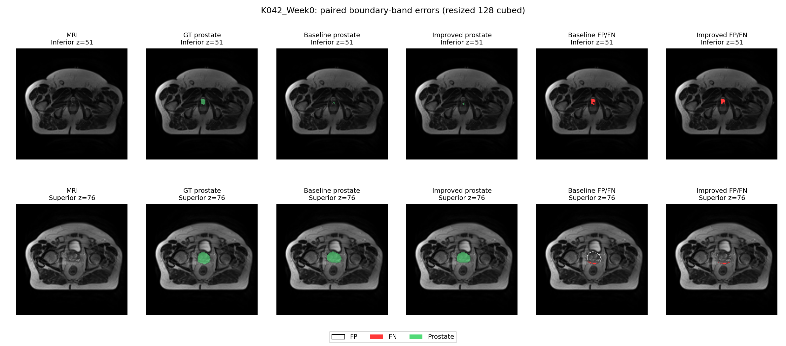

**Adjacent-organ confusion.** Across the 19 scans, Baseline assigns prostate to 272 reference-bladder voxels and 9 reference-rectum voxels; Improved assigns prostate to 13 and 9 respectively. These are counts on the resized annotation grid, not penetration distances or clinical injury estimates. The reduction in bladder-label confusion coexists with the B037 superior omission, so aggregate false-positive improvement does not resolve the coverage problem.

**Disconnected artifacts.** With 26-neighbour three-dimensional connectivity and no component filtering, Baseline has multiple prostate components in 6/19 scans; Improved has one component in every scan. Baseline's voxels outside its largest component total 136, and all 136 are false positives: L011 Weeks 1/4/6/7 contribute 4/14/11/21 voxels and M013 Weeks 2/5 contribute 1/85. These small islands are distinct from the large false-negative problem. Connectivity alone cannot establish correctness: the fully connected Improved B037 prediction still loses its superior band. Largest-component cleanup could remove these particular islands retrospectively, but its safety on other cases is untested and it is not part of the reported inference protocol.

**Interpretation.** The matched 3D experiment supports a specific trade-off: residual/deep-supervised training reduces some excess contours and disconnected artifacts, but may terminate the prostate too early. The existing five case autopsies and these three paired end-region panels identify drafts requiring slice-by-slice correction. Low contrast and resizing remain plausible contributors; neither was isolated experimentally. No new 2D comparison, clinical landmark annotation or millimetre boundary claim is introduced.

### Supplementary Experiments and Validation Animations

The retained Wide20 comparison used a different model width and prostate-specific validation selection. Baseline-new reached patient prostate Dice **0.818316**, while Wide20 reached **0.794166**, a difference of **-0.024150**. Wide20 used 2,222,878 parameters and 1,496.95 MiB peak training allocation. This supplementary negative finding does not replace the primary comparison.

Context-v2 candidate B reached mean patient prostate Dice `0.829472` on validation at epoch 19. Its peak training memory was `1455.8 MiB`, versus `979.6 MiB` for the declared control, a ratio of `1.486`; this exceeded the `1.35×` gate. It was therefore ineligible for automatic held-out testing. No new Context-v2 test metrics, test predictions or test failure panels are claimed here.

### Validation Visualisation over Epochs

The following sequence shows Context-v2 candidate B on the same validation scan, **G021 Week0**, at epochs **1, 5 and 19**, in chronological order. Epoch 19 is the validation-selected checkpoint. These images are separate from the historical Baseline/Improved test comparison.

Each animation has four columns: MRI, ground-truth prostate, predicted prostate, and prostate errors. Green overlays indicate prostate; red indicates false positives and cyan false negatives. Within each GIF, frames sweep depth slices 0, 5, 10, ..., 125. Frames are spatial positions, not successive epochs. The beginning and end of the sequence may show no prostate because the sweep covers the complete resized volume.

#### Epoch 1


#### Epoch 5

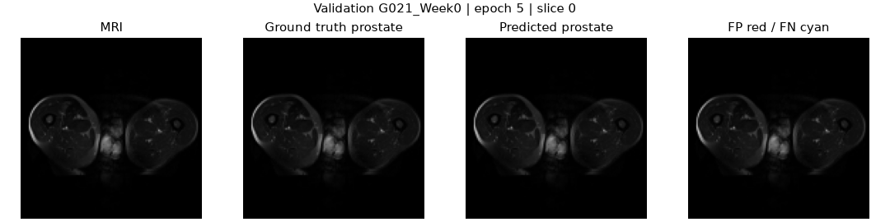

#### Epoch 19 Selected Checkpoint


This presentation uses one animation per checkpoint. A separate A/B/C/D montage is omitted because it reuses the selected B checkpoint and mixes model comparison with training progress. The animations do not establish monotonic improvement on every slice or every patient. Candidate B's validation Dice of 0.829472 does not override its failed memory gate; no Context-v2 held-out test result is claimed.

## Feasibility Review

[One-page review](assets/feasibility_review.pdf). This section preserves the midpoint proposal's preliminary status and adds a dated resource plan; the update is not evidence that these numerical limits existed at the original consultation. Tutor check-off remains an external record.

**User need and scope.** A radiotherapy contouring specialist needs reviewable prostate and organ-at-risk drafts. Compare a plain 3D U-Net against a residual, deep-supervised 3D Improved U-Net on downsampled HipMRI volumes (Hard option). Investigate whether added complexity improves boundary coverage enough to justify its memory and runtime cost. This comparison does not isolate 3D versus 2D.

**Method and course concepts.** Use one seed-42 patient-disjoint manifest, MRI/mask spatial checks, z-score normalization, 128³ full volumes and 96³ training crops. Volumetric convolution supplies local spatial context; skip connections recover resolution, residual shortcuts refine features and intermediate segmentation heads add training supervision. Weighted cross entropy plus soft Dice addresses six-class segmentation and small foreground regions. Select checkpoints on validation only.

**Five acceptance criteria.** (1) Zero patient overlap and valid image-mask alignment. (2) Held-out patient-mean prostate Dice at least 0.70, with per-class Dice/IoU and patient scores. (3) Inspect 3–5 real failures with paired FP/FN panels, including geometric end regions and disconnected components. (4) For a future controlled repeat, peak training allocated VRAM must be at most 1.35× the matched Baseline, with identical geometry and runtime measurement scope. (5) Retain Baseline unless the candidate improves patient-mean prostate Dice by at least 0.01 and does not worsen any patient's Dice by more than 0.02. Criteria 4–5 are the explicit **26 October follow-up plan**, not retroactive historical pass conditions.

**Preliminary evidence.** At the midpoint, synthetic-NIfTI checks covered pairing, missing-pair rejection, shape/affine validation, deterministic patient separation, finite forward/backward computation and auxiliary outputs. They established software feasibility, not real-data accuracy. Completed formal results and the present boundary audit are reported separately in Results.

**Risks, budget and next experiment.** Memory demand, small end slices, downsampling, orientation mistakes, I/O and interrupted jobs require checks. The retained 20-epoch histories sum training plus validation to 1,427.77 s for Baseline and 1,408.68 s for Improved: **0.788 GPU-hours combined**, excluding queueing, startup, test inference and other unrecorded work. The 26 October planning allowance is **2 GPU-hours for one matched two-arm repeat**, plus **0.25 GPU-hours for a validation-only smoke check**; this is a proposed allowance, not a measured job total or an approved allocation. No job is launched by this review. Run the short smoke check first, fix geometry and the protocol before a repeat, and stop candidates that breach the matched memory limit. Historical peak training allocation was 977.6/1,193.4 MiB; memory reservation and device-wide peaks were not measured.

**Fallback and decision.** Keep the plain 3D U-Net when the candidate misses acceptance criteria. Require human review of all drafts, particularly superior/inferior coverage and adjacent-organ boundaries. The historical mean gain of 0.002038 and B037 regression of 0.062061 support retaining Baseline. Clinical time savings and safety require separate evidence. Tutor confirmation is still required for consultation completion and the proposed resource allowance.

## Engineering Recommendation and Limitations

Retain Baseline as the conservative tested reference and require human correction of every proposed contour. The historical Improved package passed aggregate overlap targets, but its small mean change and severe B037 regression do not justify a stronger operational claim.

The evidence does not establish clinician time savings, treatment safety, external-cohort generalization, native-resolution boundary accuracy, HD95 performance or superiority of 3D over 2D. Future work should freeze a fresh protocol, use paired seeds, preserve validation and resource evidence, and evaluate the held-out set only after a candidate passes every declared gate.

## Assessment Coverage and Outstanding Evidence

This review uses the supplied **COMP3710 Report 2026 v2.5**, Sections 2.2, 3, 4, 5.3 and 6.1. The Hard option explicitly requires volumetric residual units and deep supervision, which the historical Improved implementation contains. The guideline permits a basic 2D **or 3D** U-Net baseline; this matched 3D comparison measures the added residual/deep-supervision package, rather than isolating the value of 3D over 2D.

| Requirement | Evidence in this report | Remaining qualification or action |
| ----------- | ----------------------- | --------------------------------- |
| Problem, working principles and figure | Introduction; architecture comparison, modules and diagram | This is a compact adaptation, not a complete reproduction of Isensee et al. |
| Reproducible usage and exact dependencies | Usage; audit, training and prediction commands; version table | The historical GPU runtime is not fully reconstructed; checkpoints and data are intentionally excluded from Git. |
| Preprocessing and justified split | Dataset; patient separation; normalization, interpolation and patch sampling | Resized-volume metrics do not establish native-resolution boundary accuracy. |
| Matched baseline and held-out Dice/IoU | Results; class-wise and patient-wise tables | One seed and five test patients do not establish a reliable gain. |
| Parameters, peak VRAM and per-case runtime | Resource table and timing-scope explanation | No retained timing distribution or end-to-end workflow latency; per-volume time and cumulative per-patient time are distinct. |
| 3–5 actual failure comparisons | Five paired panels, FP/FN counts and spatial checks | Five primary cases cover three patients; supplementary end-region panels and a 19-scan connectivity/organ-confusion audit now address the specific boundary questions. Clinical apex/base landmarks remain unannotated. |
| One-page feasibility review | Clearly identified Feasibility Review section | Linked one-page PDF; historical timing evidence and a dated follow-up GPU-hour allowance, memory limit and fallback are included. These additions do not reconstruct the original consultation; tutor check-off remains external. |
| Engineering recommendation | Retain Baseline; human review; limitations | No measured contour-editing benefit or clinical deployment evidence. |
| Mandatory AI usage disclosure | Dedicated section and three headings below | Deferred at the author's request for this editing task; headings are preserved. Section 6.1 still requires completion before final submission. |
| Course delivery and originality hurdles | Separate submission workflow | Deferred at the author's request: progressive commits, the final course folder, upstream PR, Turnitin export and later review responses are outside this editing task. |

The in-scope technical documentation has been supplemented with retained-prediction boundary analysis and a one-page resource review. AI disclosure and course delivery checks are deferred as requested. This review did not train a model or run new held-out inference; the supplementary diagnostic counts were computed from previously saved test predictions.

## References

1. Çiçek et al. [3D U-Net: Learning Dense Volumetric Segmentation from Sparse Annotation](https://arxiv.org/abs/1606.06650), 2016.
2. Isensee et al. [Brain Tumor Segmentation and Radiomics Survival Prediction: Contribution to the BRATS 2017 Challenge](https://arxiv.org/abs/1802.10508), 2018. This is architectural inspiration, not the source of HipMRI data.
3. CSIRO. [Labelled weekly MR images of the male pelvis](https://data.csiro.au/collection/csiro%3A51392), DOI [10.25919/45T8-P065](https://doi.org/10.25919/45T8-P065).

## Artificial Intelligence Usage Disclosure

### AI Tools Used

### Tasks Assisted by AI

### Author Audit and Verification
